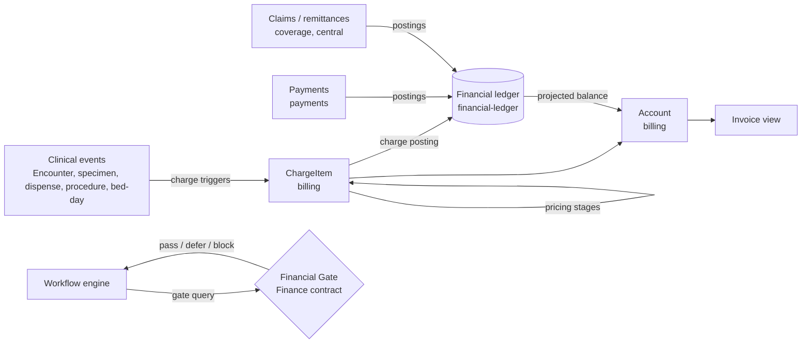
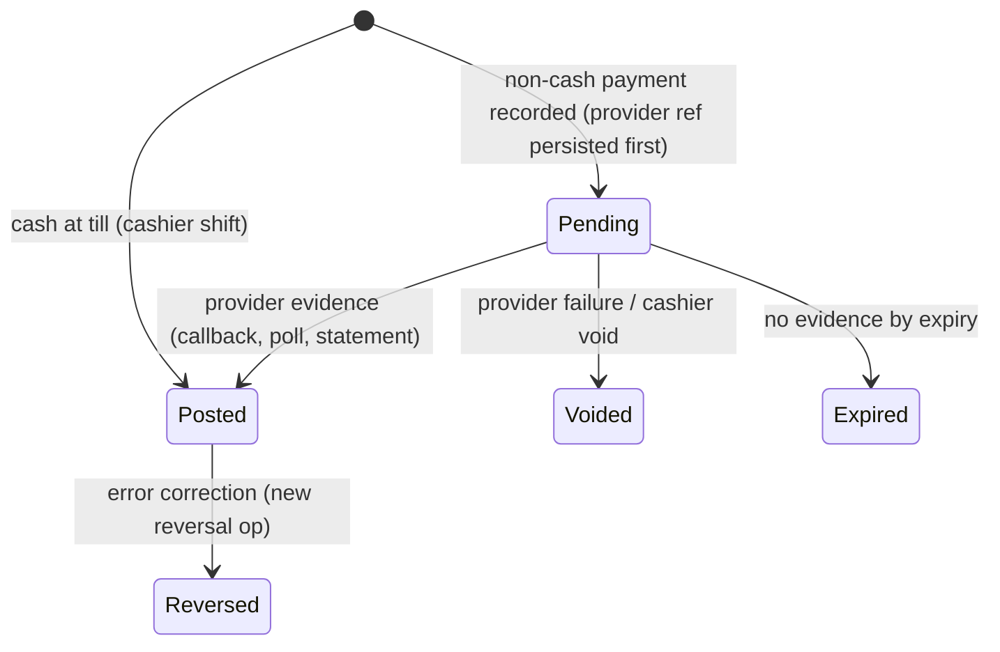

# Billing, payments and the financial ledger

Status: **accepted** (ADRs 0030, 0032, 0033). Produced while resolving the Wayfinder ticket [How do pricing, coverage, billing, payments and the ledger fit together?](https://github.com/carapai/people-centered-healthcare/issues/27). Background: [docs/research/health-financing.md](../research/health-financing.md). Spec: MASTER_PROMPT §63, §68–70. Pricing and payers are in [pricing-and-insurance.md](pricing-and-insurance.md). Ledger operations sync as `kind: op` items ([synchronization.md](synchronization.md)).

## Overview

## The ledger (ADR 0030)

- **One ledger per facility.** It is written only by the facility's Authority Node, or by a lease holder for a leased sub-scope such as an outreach till.
- **Double-entry and append-only.** Every posting balances, and errors are corrected by reversal. Balances are always derived from postings.
- **Chart of accounts.** The templates come from country configuration:
  - receivables per funding source;
  - patient deposits (a liability);
  - payments in transit (clearing);
  - cash per till;
  - revenue per service class;
  - waivers and subsidies (contra-revenue);
  - rounding;
  - till variance.
- **Dimensions on every posting:** facility, department, service, program, **funding source**, `fund` (restricted grant), encounter or episode, and the price version references.
- **Money.** `rust_decimal`, with the ISO 4217 scale per currency (UGX: 0) and round-half-even. Largest-remainder allocation is used for splits, with residue posted to the rounding account. There is one functional currency per ledger; foreign amounts keep their original value and rate.
- **Implementation** (#119): `health-financial-ledger` holds the exact money, the chart template, balanced append-only postings with reversals, and the derived balances, including the projection for FHIR `Account.balance[]`. Persistence and the posting use cases come with billing.
- **Free care** creates ChargeItems priced at a reference tariff and allocated to the government or donor funding source (§70). The patient share is zero, but consumption is still recorded.

## Charge capture

- **Charge triggers** are configuration records that map events to charges. Examples:
  - Encounter started at a service point;
  - specimen collected;
  - MedicationDispense completed;
  - Procedure completed;
  - each bed-day accrued.
- **Ids.** ChargeItem ids are UUIDv5 values derived from the source event and the trigger canonical (identifiers.md), so replays never double-charge.
- **Subscription.** Clinical Modules emit events, and `billing` subscribes. No clinical code contains payment logic.
- **Lifecycle:** `planned` → `billable` → `billed` (on an Invoice or Claim). A cancellation posts a reversal and sets `entered-in-error` or `not-billable`.
- **Accounts.** Each ChargeItem belongs to an Account (per encounter, or per episode for inpatient and long programs). The Account carries guarantor and coverage order.

## Financial Gates (§70; ADR 0033)

- **Configuration records** per facility, service, payer or program, attached to a workflow step. Example: "before sample collection: requires pass".
- **Outcomes** of the Finance contract query `evaluate_gate(context)`:

  | Outcome | When |
  |---|---|
  | `pass` | Paid, covered (including an approved preauthorization where required), or free |
  | `defer` | Emergency or urgent triage category (**always**), or a deferral recorded by an authorized user |
  | `block` | Only for non-urgent care, and only where the gate allows blocking |

- **Deferred charges** stay as receivables on the Account. Converting one to a waiver needs a permission (social worker or finance role) and is audited.
- **Placement** of gates in each flow is in [workflow-engine.md](workflow-engine.md).

## Payments (ADR 0032)

| Method | Behaviour |
|---|---|
| Cash | Final at the till; posted within a cashier shift |
| Mobile money (MTN, Airtel), card, bank transfer | Two-phase: pending against **payments in transit**, then posted only on provider evidence. Receipts say "provisional" until then |
| Customer-reported (offline) | Pending-unverified, with the reference from the customer's SMS; verified later against the provider statement |

- **Provider integrations run only at central** (`health-integration`). An edge asks central to initiate, and the outcome syncs back. An edge that is offline cannot initiate mobile money.
- **Idempotency.** The provider reference (e.g. MTN `X-Reference-Id` UUIDv4) is persisted in the same transaction as the pending entry, before initiation. Recovery queries by that reference and never re-initiates. The reference is also the reconciliation key.
- **Merchant accounts.** Each facility uses its own merchant account, or a licensed aggregator. The platform never holds funds (Bank of Uganda licensing is in the map's legal fog).
- **Code** (#123):
  - `health-payments`: `Payment`, `Shift` and `reconcile`.
  - `health-payments-app`: `Ledgering`, the postings. A pending payment sits in payments in transit, and only provider evidence moves it to the merchant account. A void or expiry returns it to the patient's account.
  - Storage (#254): payments, shifts and the ledger's postings in migration `0018_payments`, each step one transaction (`health-payments-app::Payments`). The API (`/api/payments`) and the till screens (`/till`, `/till/supervise`) complete #254.

- **Mobile money, #124 part 1** (`health_integration::mobile_money`):
  - **The client.** `MtnMomo` speaks MTN MoMo's Collection API through a `MomoTransport` port, bound to an HTTP client when a facility's merchant account is onboarded. It gets and reuses the access token, sends a request to pay under a fresh UUIDv4 `X-Reference-Id` (with the callback URL carrying the reference), and reads its status back.
  - **The flow.** `Collections` runs it over `Payments`:
    - **Before the request:** the pending payment is stored with its reference.
    - **Refused or lost:** a refused request voids the payment. One whose answer was lost stays pending and is polled, never sent again.
    - **Callback or poll:** SUCCESSFUL confirms it with that evidence, only when the amount is the payment's. A different amount stays pending and raises `momo-amount-mismatch`. FAILED voids it.
    - **Never received:** a request MTN never got is voided once five minutes have passed.
    - **Once:** a payment already settled by the other path, or by a repeat, is reported as such, so it posts once.
- **Mobile money, #124 part 2:**
  - **Callbacks.** A callback is only a hint. It reaches a public route, so its body is never trusted: the status is read back from MTN by the reference, and the payment is settled on that.
  - **The exceptions queue.** `payment_exception` (migration `0055_payment_exceptions`) holds a different statement amount, a statement line no payment has, and a provider amount that is not the payment's. Each is opened once, until a person resolves it.
  - **Statements.** `Collections::reconcile_statement` matches each line against its payment by reference, whatever the payment's status. A payment its callback already confirmed is matched, not reported as unknown. That was a gap in `Payments::reconcile_statement` (`PaymentStore::payments_with_references`).
  - **Transport.** `HttpsTransport` reaches the provider over HTTPS only, verified against the OS trust store.
- **Mobile money, #124 part 3: at central.**
  - **Accounts.** The facilities' merchant accounts come from a secrets file, `HEALTH_MOMO_ACCOUNTS_FILE`. `MtnConfig`'s `Debug` hides the keys.
  - **Routes.** `MomoService` runs one `Collections` per facility, mounted under `/api/payments`:
    - `POST /momo` (cash permission, for the session's facility);
    - `GET /exceptions` and `POST /exceptions/{id}/resolve` (supervise permission);
    - the public `POST /momo/callback`, which always answers 200 with no body.
  - **Facilities.** Each provider reference records its facility (`provider_request`, migration `0056_provider_requests`) before the request goes out. A callback and the minute poller settle each payment in its own facility's ledger, and the poller also expires the overdue.
  - **Balances.** `Payments::balances` builds a facility's ledger from that facility's postings only. Central keeps every facility's postings in one store, so the balances refused once a second facility had posted.
- **Mobile money, #124 part 4: statements.** `POST /api/payments/momo/statements` `{from, until, lines}` (supervise permission) takes MTN's statement for a period, as exported from its partner portal. The pending payments it shows are confirmed. A different amount or an unknown line is queued, and so is a payment requested in the period and posted here that the statement does not show (`missing`: money the ledger counts in the merchant account that MTN does not). The exception kind is added by migration `0057_missing_payment_exceptions`.
- **Mobile money, #124 part 5: edges, through central's relay** (`mobile_money::relay`; the maintainer's choice, 2026-11-13).
  - **Central** holds the facility's MTN keys and serves two node-signed routes beside `/sync/v1`, checked as sync is:
    - `POST /sync/v1/momo/requests` sends the request to pay for the edge's facility, once per reference: a repeat is not sent again.
    - `POST /sync/v1/momo/status` reads MTN's status, only for a reference that facility made.

    It keeps no copy of the edge's payment. Its requests go uncompressed, signed over the body as sent.
  - **The edge** keeps its facility's ledger. It runs the same `Collections` flow over a `RelayTransport` (through a `CentralLink`): it records the pending payment and its reference first, polls through central, and confirms or voids in its own ledger.
- **Mobile money, #124 part 6: tills on the edge.** With `HEALTH_PAYMENT_TILLS` and `HEALTH_NODE_CODE`, an edge serves `/api/payments` (`health-node-api`, behind its device gate and sign-in), the routes central serves, in its own ledger. Once it is provisioned, it collects MoMo at `/api/payments/momo` through central's relay. Its `CentralLink` is its sync client's signed, uncompressed `Sync::call`, and a poller runs every minute.
  - **Still to come:** Airtel, after its API is verified.

## Other flows

| Flow | Posting pattern |
|---|---|
| Deposit | Credit to the patient's deposit liability. Applied to invoices later |
| Partial payment | Allocated to the patient-share lines, oldest first |
| Credit | Receivable with terms. Ageing is projected into `Account.balance[].term` |
| Refund | A new outgoing payment operation (cash out, or provider disbursement through central). Needs a permission |
| Reversal | Error correction only, never an edit |
| Till settlement | At shift close, counted cash is compared with expected. A variance is posted to till variance and needs supervisor approval |
| Provider statements | A daily reconciliation job at central matches pending and posted entries to statement lines. Exceptions go to a queue |
| Payer remittance | PaymentReconciliation; postings clear the payer receivable, and shortfalls become adjustments or patient-share transfers |

## Documents and numbering

- **Invoice** is a view over the Account's ChargeItems and postings. Its status follows the ledger (`issued`, `balanced`, `cancelled`).
- **Receipt and invoice numbers** are node-prefixed local sequences (ADR 0014).
- **Fiscal receipting** has an adapter port on `billing`. Whether URA EFRIS e-invoicing applies to VAT-registered private facilities is unverified and sits in the map's legal fog.

## FHIR exposure

- Account, ChargeItem, Invoice, PaymentReconciliation and PaymentNotice are served as **projections** through the FHIR API, using locally pinned profiles.
- External systems may create ChargeItems, which pass through the same pricing stages. They never write ledger postings directly.
