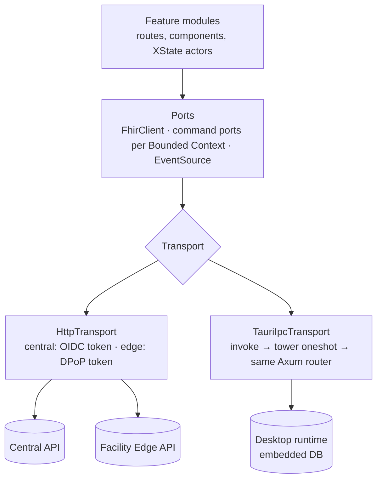

# Client application: one React app across runtimes

Status: **accepted** (ADRs 0036, 0037, 0038). Produced while resolving the Wayfinder ticket [How does one React app adapt across central, LAN and Tauri runtimes?](https://github.com/carapai/people-centered-healthcare/issues/29). Background: [docs/research/frontend.md](../research/frontend.md). Spec: MASTER_PROMPT §12, §74–78, §98–101. MASTER_PROMPT §8 lists no architecture doc for the client, so this page is an addition. Related decisions:
- app delivery and device keys on the LAN: [lan-security.md](lan-security.md);
- sessions: [offline-auth.md](offline-auth.md);
- sync item states: [synchronization.md](synchronization.md);
- the desktop's roles and packaging: [desktop-client.md](desktop-client.md).

## Layers



### Ports

- **`FhirClient`:** read, vread, search (GET and POST), history, `$match`, dry-run `$extract`, `$populate`.
- **Command ports per Bounded Context,** which mirror the server use cases:

  | Bounded Context | Example command |
  |---|---|
  | Clinical Records | `completeQuestionnaireResponse` |
  | Clinical Operations | `recordSpecimenCollected` |
  | Finance | `recordPayment`, `evaluateGate` |
  | Supply Chain | `completeDispense`, `reserveStock` |

  The UI never assembles the FHIR writes for a business operation.
- **`EventSource`:** server-sent events from central or the edge, or Tauri events. Events carry only invalidation hints (resource type and id, or a worklist key), which invalidate Query keys.

### Transports

| §78 name | Ports + transport | Auth |
|---|---|---|
| `CentralHttpRepository` | `HttpTransport(central)` | Central OIDC session, tokens in memory |
| `FacilityLanHttpRepository` | `HttpTransport(edge)` | Edge DPoP tokens (ADR 0009/0010) |
| `TauriLocalRepository` | `TauriIpcTransport` | Local desktop session, carried over IPC |

- **One envelope everywhere:** method, path, query, headers subset and body. On the desktop, Rust dispatches IPC envelopes into the shared Axum router in-process (tower `oneshot`), with no loopback port.
- **Decimals.** FHIR decimals and money are parsed with a lossless JSON parser in the transport.

### Composition boundary

- **Detection:**
  - The Tauri build is a Vite build mode.
  - Browser builds fetch `runtime.json` from their host (central or edge), because the same bundle is served by both.
- **`Platform`.** `src/platform/compose.ts` builds one `Platform`:

  ```ts
  interface Platform {
    transport: Transport
    session: SessionPort
    events: EventSourcePort
    capabilities: {
      offlineCapable: boolean
      persistsLocally: boolean
      nativeKeystore: boolean
      printing: boolean
      deviceIntegration: boolean
      syncStatus: boolean
    }
  }
  ```

- **Distribution.** It is provided through React context and the TanStack Router context. Repositories are created from it once.
- **Lint rules:** `@tauri-apps/*` may only be imported in `src/platform/**`, and no runtime checks are allowed in feature code.

### Types

- **FHIR R5 TypeScript types** are generated by our codegen from the same R5 definitions the Rust model uses, into a workspace package.
- **Command DTOs:**
  1. the Rust handlers produce an OpenAPI document (`utoipa`);
  2. TypeScript types and Zod schemas are generated from it;
  3. responses are validated with Zod at the transport boundary.

## State ownership (ADR 0037)

| State | Owner | Rule |
|---|---|---|
| Server state, FHIR resources | TanStack Query | Repositories are `queryFn`/`mutationFn`; keys per resource type, id and search |
| URL state | TanStack Router | Search params validated with Zod |
| Field drafts | TanStack Form | Autosave goes through command ports (server-side drafts) |
| Processes: encounter flow, sign/finalize, session lock, sync and conflict views | XState v5 | Actors hold **ids only** and invoke commands |
| Widget state | Ark UI / `useState` | |
| Table view state | TanStack Table | Persisted through the URL or user preferences |

- **TanStack DB:** not used in v1.
- **TanStack Store:** not used directly.
- **TanStack Pacer:** wrapped in one debounce module.
- **TanStack Devtools:** dev only; CI checks that the production bundle contains none of it.

## What may persist where (§74–77)

| Mode | Clinical data | May persist |
|---|---|---|
| A: central web | In-memory Query cache only, `gcTime` 5 min | User preferences (localStorage, keyed by user). The service worker caches static assets only |
| D: LAN browser | Same as A | Preferences; the DPoP key (non-extractable, IndexedDB); the app-shell service worker |
| B/C Tauri | In the Rust-side embedded database only; the webview is in memory only | Preferences |

- **Never in a browser or webview:** clinical data in IndexedDB, OPFS or localStorage; API responses in a service worker; a mutation queue.
- **Drafts** in browser modes are server-side (e.g. QuestionnaireResponse `in-progress`).
- **Connection loss** in A and D: unsaved input stays in memory, a banner appears, and the user retries.

## Writes

- **Clinical and financial writes always wait for confirmation.** In Tauri, the local Rust commit is the confirmation. Only non-clinical preferences may be optimistic.
- **Tauri record badges** show the sync item state: saved locally, synced, under review, or rejected (synchronization.md).

## Sessions in the client

- **Tokens** are held in memory only.
- **Idle lock (15 min) and PIN user switch:**
  1. clear the Query cache;
  2. unmount patient views;
  3. show the lock screen or the next user.
- **Logout** clears everything except preferences and the device's DPoP key.

## Forms (ADR 0038)

- **Renderer.** One `QuestionnaireRenderer` built on TanStack Form renders a Questionnaire with its Form Layout (configuration.md).
- **Live behaviour** is evaluated client-side with **fhirpath.js**: `enableWhenExpression`, `calculatedExpression`, answer constraints, population preview.
- **Server re-validation.** The server re-validates every submission, and extraction is Rust-only.
- **Conformance.** A shared FHIRPath conformance suite runs in CI against fhirpath.js and `octofhir-fhirpath`. Expressions in published Questionnaires must evaluate identically in both, and may use only constructs whose fixtures pass in both engines (ADR 0054); this is a publication gate. The suite includes decimal fixtures. The server recomputes `calculatedExpression` values on submit, and its value wins (ADR 0052).
- **Ordinary command forms** use TanStack Form with Zod schemas generated from the OpenAPI document.

## App shell

- **One route tree,** with lazily loaded feature modules per Bounded Context.
- **Gating.** Features are shown according to permission-snapshot claims, `Platform.capabilities` and configuration (active Healthcare Services and programs, ADR 0026).
- **Persistent status area (§101):**

  | Mode | Shows |
  |---|---|
  | A | Central reachable |
  | D | Edge reachable; edge ↔ central sync freshness |
  | Tauri | Local runtime; upstream reachable; outbox count; open conflicts and rejections; Authority Lease state |

## Serving and versions

- **The same build is served by:**
  - central (static hosting);
  - each edge, with assets embedded in the edge binary;
  - the Tauri bundle.

  LAN clients therefore always run their own edge's version.
- **Version check.** On load, the client checks its version against the API's supported range. On a mismatch it reloads (browser) or prompts the user to update (Tauri).

## Design system

- **Package:** `@health/design-system`, a Panda CSS 2 preset built with `panda lib`.
- **Tokens:** semantic tokens for light, dark and high-contrast. **Density** modes (comfortable and compact) as a `[data-density=compact] &` condition.
- **Components:**
  - our own slot recipes for Ark UI 5 components; Park UI is not used;
  - **DataTable** built on TanStack Table 9 and Virtual, with an ARIA grid, keyboard model and its own accessibility tests;
  - icons from Lucide.
- **Accessibility:** WCAG 2.2 AA; axe in CI; manual NVDA testing on Windows.
- **Hardware targets:** low-end Windows PCs at 1366×768, and tablets with touch-target sizes.
- **i18n:** ICU messages, externalized from the first screen. English first; the library is chosen in the scaffold.
- **Pinned majors:** React 19, Router 1, Query 5, Form 1, Table 9, Virtual 3, XState 5, Ark UI 5, Panda 2, Zod 4, Vite 8, Bun 1.4, TypeScript 7. Prerelease majors are not adopted.

## Toolchain verified (ADR 0054)

These were checked by the spike [Does the frontend scaffold build on Bun, Vite 8, Panda 2, React Compiler and TS 7?](https://github.com/carapai/people-centered-healthcare/issues/38).
- **Bun.** Dev and build run under `bunx --bun vite`, and Node is not required.
- **TypeScript 7.** We pin `typescript@7.0.2`. Tooling config files are checked separately with `skipLibCheck`.
- **Panda 2.4.** The presets must be listed explicitly, and CI asserts that emitted CSS contains token variables.
- **React Compiler.** It costs about 15 ms per component file.
- **Tauri.** The `oneshot` IPC round trip into the Axum router matches HTTP.
- **fhirpath.js 5.2:**
  - It runs only over `lossless-json`-parsed resources with `preciseMath` and `keepDecimalTypes` on.
  - It passes 1,139 of the official suite's 1,307 tests.
  - Published Questionnaire expressions are limited to constructs that pass in both engines.
