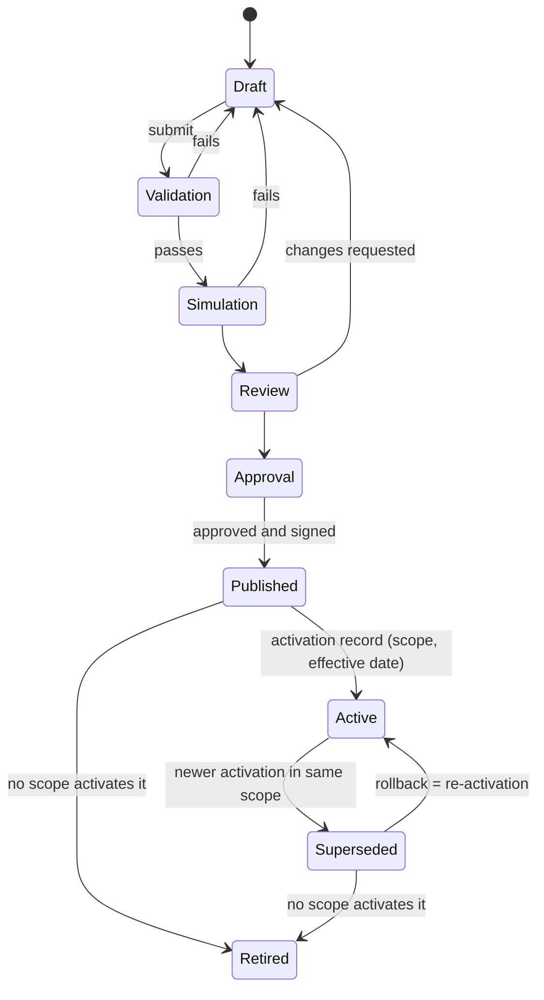
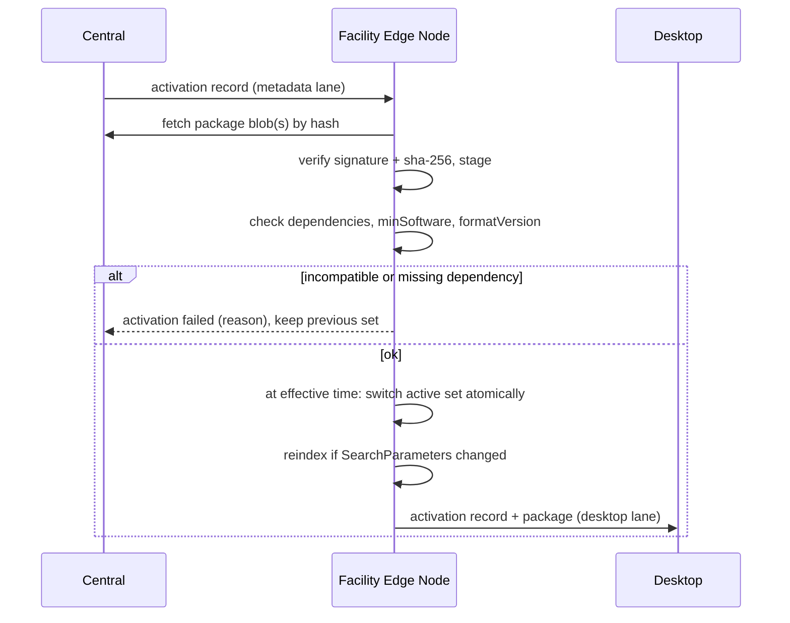

# Configuration, packages and publication

Status: **accepted** (ADRs 0024, 0025, 0026). Produced while resolving the Wayfinder ticket [How are terminology, metadata and configuration packaged and published?](https://github.com/carapai/people-centered-healthcare/issues/23). Related layers: [terminology.md](terminology.md) and [metadata.md](metadata.md). Background: [docs/research/metadata-terminology.md](../research/metadata-terminology.md).

## Three layers

| Layer | Module | Defines | Example |
|---|---|---|---|
| Terminology | terminology | Meaning | ValueSet of malaria test results |
| Metadata | metadata | Clinical structure | ANC visit Questionnaire, its profile and Extraction Mapping |
| **Configuration** | configuration | How the platform behaves in a place | Form Layout for that Questionnaire, which services a facility offers, role → permission mappings, snapshot lifetime |

- **Configuration can't change clinical meaning.** It references metadata and terminology, and never changes their meaning.
- **Presentation is kept apart (§42).** A **Form Layout** is a configuration artefact keyed to a Questionnaire `url|version`. The Questionnaire itself keeps only clinical structure.

Configuration artefacts are JSON documents in a package's `configuration/` folder. Each is validated against a JSON Schema that the platform release ships. Each carries its own `url` and `version`, and the manifest Library pins it as a `composed-of` `relatedArtifact` (ADR 0049).

## Package format (ADR 0024)

```text
ug.moh.anc-1.4.0.tgz
└── package/
    ├── package.json            name, version, fhirVersions ["5.0.0"], dependencies (exact after publication),
    │                           platform: { minSoftware, formatVersion }, kind
    ├── Library-manifest.json   CRMI-style manifest: every dependency url|version, pinned ValueSet expansions
    ├── *.json                  FHIR artefacts (Questionnaire, Extraction Mapping, PlanDefinition, …)
    ├── configuration/          Form Layouts, override points, settings (JSON Schema validated)
    ├── tests/                  extraction fixtures, simulation cases
    └── .index.json
ug.moh.anc-1.4.0.tgz.sig        detached signature (publication-signing certificate)
```

| Kind | Contents | Typical approver |
|---|---|---|
| National core | Profiles, base terminology, SearchParameters | MoH standards team (two approvers) |
| Terminology | Large code systems and expansions (ICD, LOINC, …) | Terminology lead (two approvers) |
| Program | Forms, mappings, workflow and program definitions for ART, TB, ANC, … | Program clinical leads (two approvers) |
| Country configuration | Roles and permissions, deployment settings | Platform admin (one approver) |
| Override | District or facility configuration at declared override points | See [Overrides](#overrides-adr-0026) |

- **Identity.** A package is identified by `name@version` and its sha-256.
- **Transport.** Packages travel as blobs through the content-addressed store (ADR 0021).
- **Pinned dependencies.** Authors write semver ranges. Publication resolves them and pins exact versions in `package.json` and the manifest.

## Lifecycle (§45; ADR 0025)



| Step | What happens |
|---|---|
| Draft | Authored in the Clinical Metadata Studio at **central only**. Drafts never sync |
| Validation | Automated: FHIR validation of every artefact; every profile carries a snapshot, compiles, and uses only constructs the tier 3 validator supports (ADR 0053); dependency resolution; FHIRPath type-checks; JSON Schema for configuration; the semver diff check; extraction fixtures; Owner opt-in check for mapping targets; override-point check; the R4 → R5 conversion report for imports |
| Simulation | `tests/` cases run in a sandbox: form fill and extraction, workflow paths, indicator outputs. The tooling UX is in the map's Studio fog |
| Review | A reviewer who is not the author |
| Approval | Two distinct approvers (neither the author) for clinical content (national core, terminology, program); one for configuration |
| Publication | Signed with the publication-signing certificate; immutable; CRMI `active` |
| Activation | A global record with package `name@version`, scope (national, district, facility or program) and effective date. Publication never activates anything by itself |
| Supersession | A newer activation in the same scope. The old version stays retrievable, and becomes `retired` once nothing activates it |

Every transition is a lifecycle record owned by configuration, and every transition is audited.

## Distribution and activation on nodes



- **Active set.** A node's active set is the merge of activations along its scope chain: national → district → facility, plus program activations for the facility.
- **Offline.** Packages can be applied from USB on an offline edge. The signature is verified the same way.
- **Software compatibility.** Each package declares `minSoftware` and `formatVersion`, and each software release declares the format versions it supports. Activation is refused on a mismatch, which is the same check as the sync handshake (synchronization.md).
- **Retention.** Nodes retain every package version ever activated in their scope for as long as referencing data exists (metadata.md).

## Rollback

- **Rollback is re-activation.** It is a new activation record pointing at an earlier version, so nothing is mutated or deleted.
- **Existing data is unaffected.** Records written under the rolled-back version keep their pinned versions and are still interpreted with them.
- **Always possible,** because packages never contain data migrations.

## Overrides (ADR 0026)

- **Override points.** Only configuration keys declared as **override points** by the base package can be overridden. Examples are layout, section visibility, which Healthcare Services and programs are active, worklist and queue settings, and local settings.
- **Never overridable:** profiles, terminology, Extraction Mappings, workflow definitions and clinical rules.
- **Layering.** Overrides are layered national → district → facility and merged key by key; the most specific value wins.
- **Approval.** Presentation-only overrides need the facility admin alone. Clinically visible overrides, such as hiding a form section or disabling a program form, also need a district or central reviewer.
- **Lifecycle.** Overrides follow the same lifecycle as any package.
- **Base upgrades.** A base package's major version may remove override points. Validation flags any override that becomes orphaned before the new base can be activated in that scope.

## Signing

- **Certificate.** Publication uses a dedicated **publication-signing intermediate** under the platform root (ADR 0008). Its EKU is limited to package signing, and it is separate from every TLS certificate.
- **Rotation.** It is rotated yearly, and its key is held in central's HSM or KMS.
- **Trust.** Nodes trust it through the root they already hold. Revocations arrive in the revocation lane.
- **Custody.** Who holds the national root is in the map's PKI governance fog.
