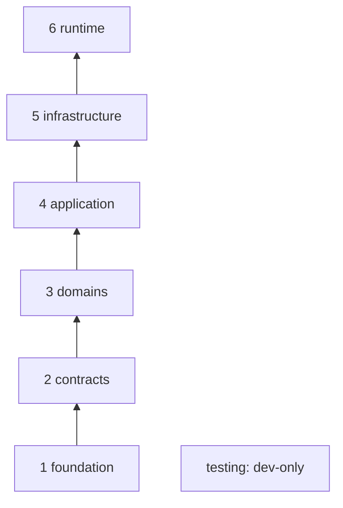

# Crate architecture

Status: **accepted** (ADRs 0005, 0006). Produced while resolving the Wayfinder ticket [What are the crate layers and the dependency rules that enforce them?](https://github.com/carapai/people-centered-healthcare/issues/14).

This document fixes the layer of every planned Rust crate, the dependency directions allowed between layers, the shape of ports and adapters, which planned crates start as Rust modules, and how the rules are checked automatically. Module and Owner names come from [resource-ownership.md](resource-ownership.md).

## Layers

Every crate belongs to exactly one layer. It may depend only on crates in **lower** layers, plus allowlisted external crates.

| # | Layer | Directory | Contains | May depend on |
|---|---|---|---|---|
| 1 | foundation | `crates/foundation/` | Typed identifiers, error primitives, shared value types, configuration loading, time | External allowlist only |
| 2 | contracts | `crates/contracts/` | Pure FHIR model, validation, search AST and mapping crates; sync protocol; persistence traits; one contract crate per Bounded Context | foundation |
| 3 | domains | `crates/domains/` | One crate per Module: rules, aggregates, port traits | foundation, contracts, domain allowlist |
| 4 | application | `crates/application/` | One crate per Bounded Context: use cases, transaction boundaries, adapters that implement domain ports by calling other Modules | foundation, contracts, any domain crate |
| 5 | infrastructure | `crates/infrastructure/` | Adapters that implement ports: SurrealDB, HTTP/Axum, auth, audit, messaging, files, crypto, FHIR server, sync server, external integrations | foundation, contracts, domains, application |
| 6 | runtime | `crates/edge/`, `crates/desktop/`, `apps/server/*`, `apps/client/src-tauri` | Composition roots and runtime-specific adapters (discovery, node identity, keyring, OS service hooks). **No business logic** | Anything below |
| — | testing | `crates/testing/` | Fixtures, fakes of ports, contract and integration harnesses | Anything, **as dev-dependency only** |



Arrows point from the depended-on layer to the dependent layer. "Presentation" (Axum routers, Tauri commands) is not a separate layer. Routers live in `health-http` / `health-fhir-server`, and Tauri commands live in the desktop runtime.

## Dependency rules

1. **Downward only.** No crate may depend on a crate in the same or a higher layer, with two exceptions: within contracts, per-context contract crates may depend on the FHIR and foundation contract crates; within infrastructure, adapters may depend on `health-surrealdb`, `health-http` and other infrastructure crates. The dependency graph is acyclic.
2. **No domain→domain edges** (ADR 0006), not even within one Bounded Context. A domain that needs another Module's data declares a port in its own crate. The application layer implements that port by calling the other Module (an anti-corruption seam).
3. **No application→application edges.** A use case that spans Bounded Contexts is composed in a runtime crate or integrated through events.
4. **Runtime crates are leaves.** Nothing depends on `crates/edge/*`, `crates/desktop/*` or `apps/*`.
5. **Domain crates are pure.** Allowed externals: `serde`, `thiserror`, `rust_decimal`, `uuid`, the chosen time crate, and `tracing` (macros only). Forbidden in domains: `tokio`, `axum`, `tower`, `surrealdb`, `reqwest`, `tauri`, `tracing-subscriber`, `opentelemetry`, `anyhow`. Any other crate needs an allowlist entry, reviewed like an ADR.
6. **No runtime-mode switches in domain or application crates.** These crates have no `[features]` and no `cfg` keyed on central/edge/desktop. Differences between runtimes (write authority, id minting, clock, which application crates are linked) are injected through ports and configuration. Cargo features are allowed in infrastructure and runtime crates only, to choose an adapter (e.g. embedded vs remote SurrealDB).
7. **`anyhow` only at boundaries.** It is allowed in runtime crates and in tooling; every other layer uses `thiserror` types.
8. **Workspace hygiene.**
   - Every external version is declared once in root `[workspace.dependencies]`, and crates use `{ workspace = true }`.
   - Every crate inherits `[workspace.lints]`, including `unsafe_code = "forbid"`, unless the crate is explicitly allowlisted.
   - The toolchain is pinned in `rust-toolchain.toml`.
   - Items default to `pub(crate)`. A crate's public API is what `lib.rs` re-exports.

## Ports, adapters, transactions and events

- **Port style.** Port traits use native return-position `impl Future<Output = …> + Send` (no `async-trait` macro). Application use cases are generic over their ports, and the runtime layer picks concrete adapters (static dispatch). `Arc<dyn …>` is used only at genuine plug-in points, such as payer or payment-gateway adapters. Those ports also offer a small dyn-compatible boxed-future variant.
- **Where ports live.** A Module's driven ports (its repository, plus anything it needs from other Modules) are defined in that Module's domain crate. Driving ports are the application use cases themselves.
- **Unit of work.** `health-persistence` (contracts layer) defines pure traits:
  - `UnitOfWork` / `Transaction`;
  - optimistic version checks;
  - transactional outbox append;
  - a retry-on-conflict policy. SurrealDB gives snapshot isolation only, so conflicts are retried and multi-record invariants are guarded explicitly.

  Domain repository ports are transaction-agnostic. A use case opens a unit of work and obtains repositories bound to it, and each Owner's repository writes only that Owner's records (ADR 0004). `health-surrealdb` implements all of this.
- **Events.** Domain functions are pure and return the new state plus `Vec<Event>`. The application layer appends those events, and any sync operations, to the outbox in the same unit of work. After commit, `health-messaging` dispatches them in-process to subscribers (Workflow, Finance, Supply Chain, Analytics Read Models), and the sync uploader reads the same outbox. Domains never publish directly.
- **Workflow actions** (ADR 0002). Typed action commands are defined in each target context's contract crate. Workflow's application crate invokes them through ports, which the runtime wires to the target context's application crate.

## Crate catalogue

"Starts as" says whether the crate exists from its first use, or begins as a Rust module inside a host crate and is split out when a second consumer or a different dependency set appears. Every crate is created lazily, when the first implementation task needs it.

### 1 · foundation

| Crate | Starts as |
|---|---|
| `health-identifiers` | crate |
| `health-errors` | crate |
| `health-types` | crate |
| `health-config` | crate |
| `health-time` | crate |

### 2 · contracts

| Crate | Starts as | Notes |
|---|---|---|
| `health-fhir-models` | crate | Facade over a generated R5 model; internals decided in [How are FHIR R5 resources modelled, validated and searched in Rust?](https://github.com/carapai/people-centered-healthcare/issues/15) |
| `health-fhir-validation` | crate | Pure; wraps the FHIRPath engine |
| `health-fhir-search` | crate | Parsed search AST + SearchParameter registry only; SurrealQL translation lives in `health-surrealdb` |
| `health-fhir-mapping` | crate | |
| `health-sync-protocol` | crate | Wire types; protocol decided in [What is the sync protocol and per-resource conflict policy?](https://github.com/carapai/people-centered-healthcare/issues/22) |
| `health-persistence` | crate | Moved here from §17 (ADR 0005): pure unit-of-work, outbox and versioning traits |
| `health-<context>-contract` | crate per Bounded Context | Events, typed Workflow actions, context ids, cross-context query DTOs; created when the context first publishes one |

### 3 · domains (one crate per Module)

| Bounded Context | Crates | Starts as modules inside |
|---|---|---|
| Registries | `health-client-registry`, `health-facility-registry`, `health-workforce-registry`, `health-location-registry`, `health-product-registry`, `health-service-catalogue` | — |
| Terminology & Metadata | `health-terminology`, `health-metadata`, `health-configuration` | `health-metadata-validation`, `health-questionnaire-engine` → `health-metadata`; `health-configuration-publisher` → `health-configuration`; `health-fhir-extraction` → `health-metadata` until [How are QuestionnaireResponses extracted into clinical resources?](https://github.com/carapai/people-centered-healthcare/issues/25) places it; guideline packages → `health-metadata` |
| Clinical Records | `health-encounters`, `health-clinical-data`, `health-orders`, `health-medications`, `health-clinical-documentation`, `health-shared-record` (Read Model) | — |
| Clinical Operations | `health-laboratory`, `health-imaging`, `health-immunization`, `health-scheduling`, `health-patient-flow` | — |
| Care Coordination | `health-referrals`, `health-care-plans` | — |
| Programs & Public Health | `health-programs`, `health-surveillance`, `health-population` | — |
| Finance | `health-pricing`, `health-coverage`, `health-billing`, `health-payments`, `health-financial-ledger` | — |
| Supply Chain | `health-inventory`, `health-procurement` | — |
| Identity & Access | `health-identity`, `health-consent`, `health-audit-domain` | — |
| Workflow | `health-workflow`, `health-decision-support` | `health-worklists` (Read Model) → `health-workflow` |
| Patient Engagement | `health-patient-requests`, `health-patient-engagement` | `health-patient-access` → `health-patient-engagement`; `health-care-journeys` (Read Model) → `health-patient-engagement` |
| Analytics | `health-analytics`, `health-reporting` | — |
| Platform | `health-communications`, `health-administration` | — |

`health-orders` and `health-clinical-documentation` follow from the Modules in the ownership matrix. The Audit Module's domain rules are named `health-audit-domain`, which keeps `health-audit` free for the infrastructure adapter that §17 names.

### 4 · application

| Crate | Notes |
|---|---|
| `health-<context>-app` | One per Bounded Context, e.g. `health-clinical-records-app`, `health-finance-app`; created with the context's first use case |

### 5 · infrastructure

| Crate | Starts as |
|---|---|
| `health-surrealdb` | crate (includes SurrealQL search translation) |
| `health-migrations` | module of `health-surrealdb` |
| `health-messaging` | crate |
| `health-http` | crate (Axum/Tower routers, middleware) |
| `health-fhir-server` | crate (FHIR REST handlers, per §16) |
| `health-auth` | crate |
| `health-audit` | crate |
| `health-observability` | crate |
| `health-files` | crate |
| `health-crypto` | crate |
| `health-sync-server` | crate |
| `health-integration` | crate (DHIS2, OpenMRS/UgandaEMR, lab, insurer, payment-gateway adapters) |

### 6 · runtime

| Crate / app | Starts as |
|---|---|
| `apps/server/central-server` | binary (gateway built in, ADR 0001) |
| `apps/server/facility-edge` | binary over `health-edge-runtime` |
| `health-edge-runtime` | crate; `health-edge-api`, `-storage`, `-sync`, `-discovery`, `-auth` and `-admin` start as its modules |
| `health-node-identity` | crate from the start (shared by edge and desktop) |
| `apps/client/src-tauri` | binary over `health-desktop-runtime` |
| `health-desktop-runtime` | crate; `health-desktop-storage`, `-sync`, `-auth`, `-workflow`, `-devices` and `-files` start as its modules |

The edge and desktop runtimes reuse the same domain and application crates as central. They add only runtime adapters (§32: "do not duplicate business logic inside edge-specific crates").

### testing

| Crate | Starts as |
|---|---|
| `health-test-support` | crate (fixtures, in-memory port fakes) |
| `health-contract-tests` | `tests/` directories in the crates exercised, until tests cross crates |
| `health-integration-tests` | `tests/` directories, until tests cross crates |

## Enforcement

1. **Layer metadata.** Every crate declares its layer and context:

   ```toml
   [package.metadata.health]
   layer = "domain"            # foundation | contracts | domain | application | infrastructure | runtime | testing
   context = "clinical-records" # omitted for foundation, shared contracts and infrastructure
   ```

2. **`tools/architecture-checks`** is a Rust binary that reads `cargo metadata` and fails when:
   - a crate has no layer tag;
   - a normal or build dependency points to the same or a higher layer, outside the exceptions in rule 1;
   - there is a domain→domain or application→application edge;
   - a domain crate has an external dependency outside the allowlist;
   - a domain or application crate declares `[features]`;
   - a testing crate is used as a non-dev dependency;
   - a dependency declares an inline version instead of `workspace = true`;
   - a crate does not inherit workspace lints;
   - there is a dependency cycle.
3. **`cargo-deny`** checks licences, advisories, duplicate versions and workspace-wide bans.
4. **Workspace lints** in the root `Cargo.toml`, plus `clippy` with `-D warnings`.
5. All of these run in CI on every pull request and as a pre-commit target. The CI wiring is decided in [What are the CI/CD, release and production-operations rules?](https://github.com/carapai/people-centered-healthcare/issues/31).

## Out of this decision

Import rules for the Bun `packages/*` belong to [How does one React app adapt across central, LAN and Tauri runtimes?](https://github.com/carapai/people-centered-healthcare/issues/29).
