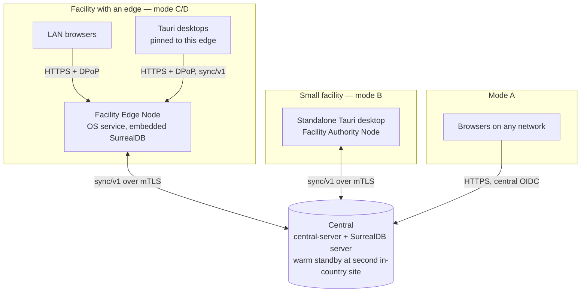
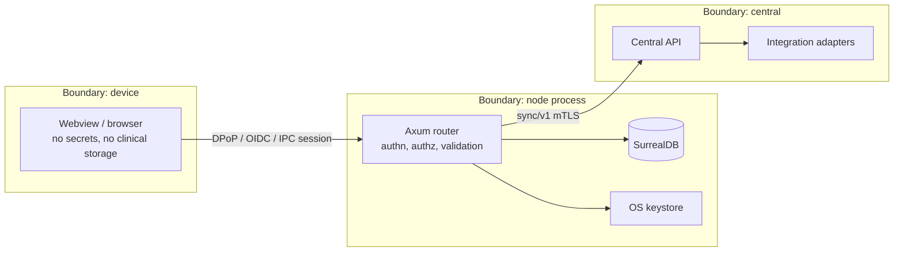

# Deployment topology

This page consolidates the network topology and trust boundaries for each deployment mode. Every rule here is decided elsewhere; the source is linked beside it. Spec: MASTER_PROMPT §74–86.

## Tree, not mesh

- **Topology.** Central ↔ Facility Edge Node ↔ desktops. There is no peer-to-peer sync, and LAN browsers never sync (§86).
- **Pinning.** A desktop has exactly one upstream. Re-pointing it needs a drained outbox (write-authority.md).
- **One edge per facility.** There is no hot standby in v1 (ADR 0007). Multiple edges per facility are in the map's fog.

## Per mode

| Mode | Client → server | Transport and trust | Data held by the client | Sources |
|---|---|---|---|---|
| A: central web | Browser → central | HTTPS with a public certificate; central OIDC tokens in memory | None persistent (ADR 0037) | [client-application.md](client-application.md) |
| B: standalone desktop | Desktop → central | sync/v1 over mTLS with a node certificate issued at provisioning | Full facility scope in an embedded database | [desktop-client.md](desktop-client.md) |
| C: edge ↔ central | Edge → central | sync/v1 over mTLS; edge node certificate | The facility's records (authoritative) | [facility-edge.md](facility-edge.md), [synchronization.md](synchronization.md) |
| D: LAN browser | Browser → edge | HTTPS on the LAN, certificate chained to the private national root installed at enrollment; DPoP-bound tokens with a non-extractable WebCrypto key | None persistent; app-shell service worker only | [lan-security.md](lan-security.md), [offline-auth.md](offline-auth.md) |
| D: LAN Tauri | Desktop → edge | HTTPS, pinning the facility intermediate and node id; DPoP; sync/v1 | Sync Scope (service points, worklists, leases, plus 90 days) | [lan-security.md](lan-security.md), [desktop-client.md](desktop-client.md) |

## LAN details

| Concern | Decision | Source |
|---|---|---|
| Discovery | Pairing code or QR code is the primary path; mDNS `_health-edge._tcp` is only a hint, for Tauri | lan-security.md |
| Names | `<node-id>.local` plus the configured facility name, under a name-constrained facility intermediate | ADR 0008 |
| App delivery | The edge serves the React shell from its own origin. Central web never calls an edge directly | lan-security.md |
| Devices | Every device is enrolled and approved by a facility admin; device keys are bound to tokens | ADR 0009 |
| Database | Nothing on the LAN reaches SurrealDB; only the edge's Axum API is exposed | facility-edge.md |
| Unsupported | iOS devices and unmanaged phone browsers (fog) | lan-security.md |

## Central

- **Server:** `central-server`, a modular monolith with all contexts plus the gateway (ADR 0001).
- **Database:** SurrealDB as a separate single-node server, on localhost or a private network (persistence.md).
- **Recovery:** hourly logical export to a warm standby at a second in-country site (ADR 0046).
- **Integrations** run only here: payers, mobile money, NIRA, suppliers, DHIS2.
- **Observability** stack is self-hosted in-country (ADR 0047).

## Trust boundaries

- **Authority.** Every node re-validates whatever it receives: profile, references, authorization at action time, and invariants (ADR 0016).
- **Clients are untrusted.** Clients are never trusted with authorization decisions. Permissions are enforced in the Rust services (§95).

Security mechanisms are summarised in [security.md](security.md).

## Failure scenarios

| Failure | Effect | Handling | Source |
|---|---|---|---|
| Internet down at a facility | Edge works fully; central-only functions pause | Sync resumes from checkpoints | synchronization.md |
| LAN down | Browsers stop; Tauri desktops fail over after 30 s | Candidates sync when the edge is back | ADR 0039 |
| Edge hardware lost | Facility is down until a spare is ready | Cold spare, re-provision, import the outbox from backup, RTO < 1 h | backup-and-recovery.md |
| Power cut | In-flight transaction is lost; committed work survives (`sync=every`) | UPS-triggered graceful stop | facility-edge.md |
| Central down | Facilities continue offline | Warm standby restore, RTO 4 h; edges re-push after the epoch change | ADR 0046 |
| Offline beyond 90 days | `reseed_required` | Re-seed, then re-push the outbox | synchronization.md |
| Compromised device | Session refused | Revocation and wipe | desktop-client.md, lan-security.md |
