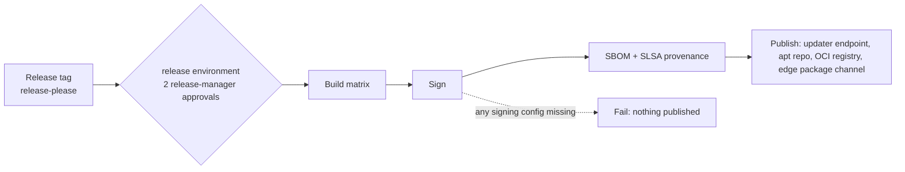

# Deployment: CI/CD, releases, environments, observability and recovery

Status: **accepted** (ADRs 0045, 0046, 0047). Produced while resolving the Wayfinder ticket [What are the CI/CD, release and production-operations rules?](https://github.com/carapai/people-centered-healthcare/issues/31). Spec: MASTER_PROMPT §92–94, §109–115. Related docs:
- the test strategy: [testing.md](testing.md);
- architecture checks: [dependency-rules.md](dependency-rules.md);
- edge backups: [backup-and-recovery.md](backup-and-recovery.md);
- desktop packaging: [desktop-client.md](desktop-client.md).

## Git and merge rules (§110)

- **`main`:** protected, behind a **merge queue**, squash merges, linear history.
- **Commit format:** Conventional Commits, enforced on PR titles. Branches are short-lived.
- **Reviews:**
  - one approval;
  - **CODEOWNERS** review for `docs/adr/`, `docs/architecture/`, `tools/architecture-checks/`, security, sync crates and `.github/`;
  - ADR changes need **two** approvals.
- **Dependencies:**
  - lockfiles are committed (`Cargo.lock`, `bun.lock`);
  - Renovate groups updates weekly, auto-merges dev-dependency patches after checks, and raises security updates immediately.

## Workflows (§111–113)

| Workflow | Trigger | Jobs |
|---|---|---|
| `rust-ci.yml` | PR, merge queue, main | `cargo fmt --check`; `cargo clippy -D warnings`; build; `cargo nextest` (unit, domain); doc tests; `cargo doc -D warnings`; `tools/architecture-checks`; `cargo-deny`; `cargo-llvm-cov` ≥ 80% lines on domain and application crates |
| `frontend-ci.yml` | PR, merge queue, main | `bun install --frozen-lockfile`; `tsc`; lint (including the `src/platform` import rule); `panda codegen`; Vitest; component tests; production build; bundle scan (no `@tauri-apps`, no devtools); regenerated OpenAPI/TS types must match the committed ones |
| `integration-tests.yml` | PR (fast tier), nightly (full) | Repository tests against the pinned SurrealDB; `EXPLAIN` plan tests; migrations, then `INFO FOR DB` compared with the schema snapshot; export → import round trip; API contract tests; workflow scenarios; extraction and pricing fixtures; multi-node sync simulation |
| `security.yml` | PR, weekly | `cargo-deny` advisories; `osv-scanner` on `bun.lock`; `gitleaks`, plus GitHub secret scanning with push protection; `zizmor`; CodeQL for JS/TS (for Rust only once GA; unverified today) |
| `dependency-review.yml` | PR | `actions/dependency-review-action`, with the licence allowlist |
| `desktop-build.yml` | PR (unsigned), release (signed) | Tauri on Windows x64 and Ubuntu 22.04 x64 |
| `edge-build.yml` | PR (unsigned), release (signed) | `facility-edge` on Windows x64 and Ubuntu x64, built separately from Tauri |
| `release.yml` | Release tag | Build matrix, signing, SBOMs, provenance, publishing (below) |
| `documentation.yml` | PR touching `docs/` or `*.surql` | markdownlint; `lychee` link check; Mermaid render; `surreal validate` plus `surql-fmt --check`; ADR numbering and index check |

### Architecture enforcement (§109)

| Detects | Check |
|---|---|
| Circular dependencies, forbidden imports | `tools/architecture-checks`; ESLint import rules |
| Cross-domain database access | Repositories declare the tables they own. A test asserts that every table has exactly one owner, and that each repository's queries touch only its own tables or the shared infrastructure tables |
| Duplicate resource ownership | An ownership registry in code, with a doc-sync test against `resource-ownership.md` |
| Desktop imports in web builds | Lint rule, plus a scan of the production bundle |
| Contract inconsistencies | Regenerated OpenAPI and TS types diffed against the committed ones; fixtures validated against FHIR profiles |
| Missing migrations | Fresh-database migration plus a schema snapshot comparison |
| Required tests | Coverage floor on domain and application crates; fixture requirements as publication gates for definitions |

### Workflow security (§115; ADR 0045)

- **Pinning.** Third-party actions are pinned to **full commit SHAs** with version comments, set by Renovate or `pinact`, never hand-typed.
- **Permissions.** Each job declares `permissions:`, defaulting to `contents: read`.
- **No `pull_request_target`** with a PR checkout.
- **Cloud access** uses GitHub OIDC federation (Azure Artifact Signing, KMS). There are no long-lived cloud secrets.

### Licences

- **Allowed:** MIT, Apache-2.0, BSD-2/3-Clause, ISC, Unicode-3.0, Zlib, MPL-2.0.
- **SurrealDB's BSL 1.1:** an explicit, documented exception.
- **GPL and AGPL** need an ADR.

## Build matrix (§114)

| Artifact | Targets | Package |
|---|---|---|
| Facility Edge Node | Windows 10/11 x64 | MSI that registers the Windows service |
| | Ubuntu 22.04 / 24.04 x64 | deb with a systemd unit |
| Desktop | Windows 10/11 x64 | NSIS (bootstrapper and offline-WebView2 variants) |
| | Ubuntu 22.04 / 24.04 x64 | AppImage, deb |
| Central | Linux x64 | OCI image |
| Web | — | Static bundle (served by central, embedded in the edge) |

macOS is not a supported target for any artifact in v1, so no macOS build is produced or claimed.

## Releases (ADR 0045)

- **One platform SemVer** across central, edge, desktop and web, with a changelog from Conventional Commits.
- **Signing:**

  | Artifact | Signing |
  |---|---|
  | Windows edge and desktop installers | Authenticode via Azure Artifact Signing |
  | Tauri updater artifacts | Updater key in KMS |
  | AppImage, apt repository | GPG |
  | Edge update packages | Release-signing key, separate from the metadata publication key (ADR 0024) |
  | Central OCI image | `cosign` keyless (Sigstore) |

- **Attestations:** SLSA provenance (`actions/attest-build-provenance`), plus CycloneDX SBOMs for Rust (`cargo-cyclonedx`) and Bun, attached to every release.
- **Signed or failed.** The release job **fails** if any signing configuration is missing. PR builds are labelled `unsigned-dev`.

## Environments and rollout

| Environment | Contents |
|---|---|
| CI | Ephemeral |
| Staging | Central, plus simulated edges and desktops on VMs, with synthetic data |
| Pilot | A small set of real facilities |
| Production | All facilities, in district waves |

- **Staged rollout.** Each node's allowed version is a per-facility record at central, used by both the desktop updater endpoint and the edge package channel.
- **Promotion between waves** requires the previous wave's telemetry to be within thresholds: error rate, sync lag, failed migrations.
- **Release block.** A release is blocked if any migration lacks its export → import round-trip test.

## Observability (ADR 0047)

- **Collection:** OpenTelemetry from central, edges, desktops and frontend error reporting. Edges buffer locally and ship when online (facility-edge.md).
- **Stack:** self-hosted **in-country**: an OTel collector, Prometheus-compatible metrics, Loki, Tempo and Grafana.
- **No personal health data in telemetry.** A tracing-layer attribute allowlist and a CI redaction test enforce it.
  - **Allowed:** UUIDs, node and facility ids, operation names, non-sensitive codes, durations and counts.
  - **Never allowed:** names, phone numbers, NINs, free text, or codes from sensitive ValueSets.
- **Indicators and alerts:**

  | Area | Indicators |
  |---|---|
  | Sync | Lag; outbox depth; open conflicts and rejections, and their age; `reseed_required` |
  | Storage | Backup freshness and verification; free disk; reindex jobs |
  | Platform | UPS state; clock skew against the clock floor; certificate and permission-snapshot expiry; software version against the allowed version |
  | Finance and stock | Pending-payment age; reconciliation exceptions; stock drift alerts |
  | Workflow | Stuck or overdue timers; queue wait times |

  Alerts go to central operations and are shown on the edge admin page.

## Disaster recovery (§92–94; ADR 0046)

| | Central | Edge / mode B desktop |
|---|---|---|
| Backup | Snapshot-consistent logical export **hourly** | Encrypted logical export hourly (ADR 0007) |
| Recovery path | Restore onto a **warm standby VM** at a second in-country site | Restore in place, or onto a cold spare |
| RPO | **1 h** for global records; facility records are re-pushed by edges after the epoch change (ADR 0019) | One backup interval (1 h) for unsynced work |
| RTO | **4 h** | < 1 h with a spare |
| Retention | 35 daily, 12 weekly, 12 monthly, plus an offsite in-country copy | 48 hourly, 14 daily |
| Keys | Backup master key under 3-of-5 Shamir custody, custodians named in the runbook | Per-node backup key, wrapped and escrowed in central KMS |
| Drills | Quarterly restore into staging, with integrity validation | Weekly automatic test restore into a temporary directory; restore drill at commissioning, then yearly |

- **After a central restore,** the sync servers rate-limit edge re-pushes.
- **Post-recovery reconciliation** compares the ledger digests and receipt counts for each node.
- **Enterprise or TiKV high availability** and the BSL "Database Service" question remain in the map's legal fog.
