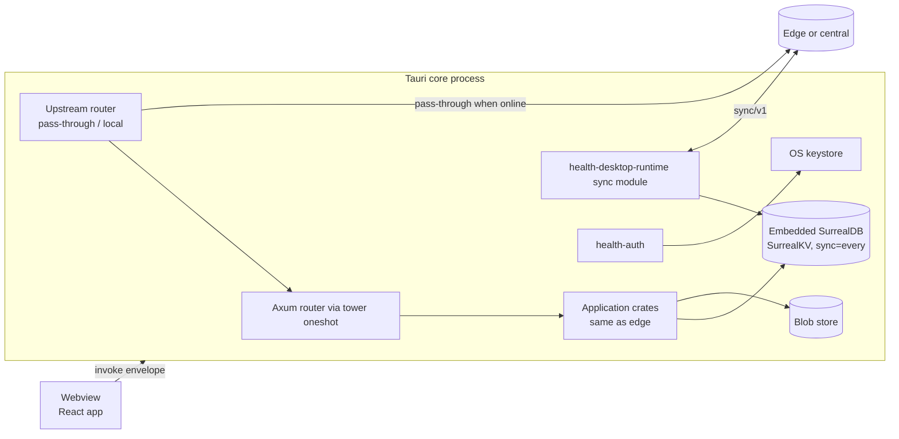
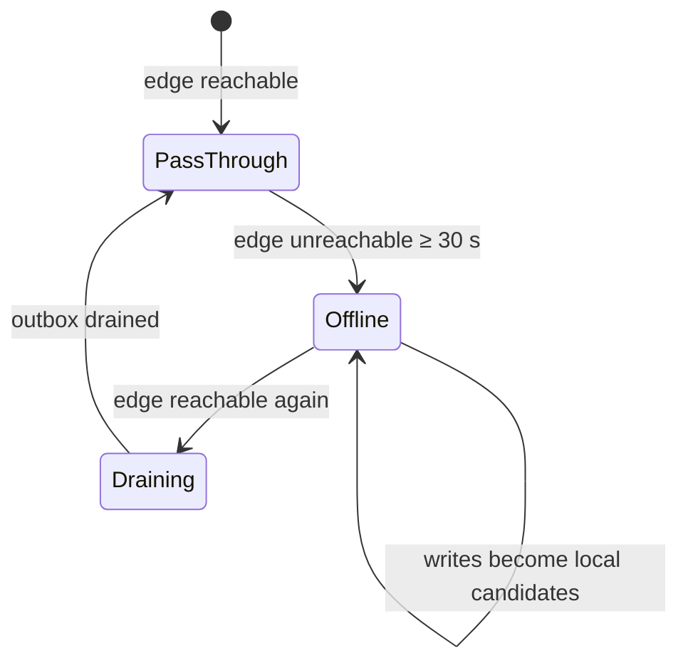

# Tauri desktop client

Status: **accepted** (ADRs 0039, 0040, 0041). Produced while resolving the Wayfinder ticket [What can a standalone Tauri client do offline, and how is it packaged?](https://github.com/carapai/people-centered-healthcare/issues/30). Background: [docs/research/tauri.md](../research/tauri.md). Spec: MASTER_PROMPT §31, §75, §77, §90, §114. MASTER_PROMPT §8 lists no desktop doc, so this page is an addition. Related decisions:
- roles and leases: [write-authority.md](write-authority.md);
- transport: [client-application.md](client-application.md) (ADR 0036);
- embedded storage: [persistence.md](persistence.md);
- sync scope: [synchronization.md](synchronization.md);
- enrollment: [lan-security.md](lan-security.md);
- sessions: [offline-auth.md](offline-auth.md).

## Roles (ADR 0039)

One binary (`apps/client/src-tauri` over `health-desktop-runtime`) links the same application crates as the edge. Its role is set at provisioning.

| | Mode B: standalone | Under an edge |
|---|---|---|
| Authority | Facility Authority Node for its facility | Candidate Versions; an Authority Lease for outreach |
| Upstream | Central | Its edge (pinned) |
| Sync Scope | Full facility scope | Its service points, worklists and leased sub-stores, plus the last 90 days |
| Serves the LAN | No | No |
| Offline: available | Everything the facility does | Registration (provisional), triage, consultation, forms, orders, dispensing (candidates or leased sub-store), worklists |
| Offline: unavailable | Central-only functions: payer and payment integrations, NIN checks, golden-record matching, claims, analytics, metadata and price authoring | Those, plus admin, conflict resolution, count approval, and user and device administration |

## Process

- **Lifetime.** Services and sync run while the app runs. In mode B, closing the window minimizes it to the tray, and starting at login is optional. The desktop never installs an OS service; a facility that needs always-on uses a Facility Edge Node.
- **Commands.** All commands are `async`. Large payloads use raw IPC bodies, and progress streams use `Channel`.
- **Single instance.** The single-instance plugin prevents a second app instance, and the engine's lock on its data directory backs it up.

## Online and offline under an edge

- **PassThrough.** The Rust runtime forwards commands to the edge, which confirms them as the authority. The local replica follows by pull.
- **Offline.** A "working offline" banner is shown. Writes become local Candidate Versions in the outbox.
- **Draining.** Writes stay local until the outbox has drained, to keep ordering, then pass-through resumes.
- **Invisible to the UI.** The UI never sees the switch: it always uses `TauriIpcTransport`.

## Storage and backup (ADR 0040)

- **Data directory:** per machine (`%ProgramData%\<app>` on Windows, `/var/lib/<app>` on Linux), shared by every user's sessions on that PC.
- **Engine:** embedded SurrealDB 4 on SurrealKV with `sync=every` (ADR 0060), plus the content-addressed blob store (ADR 0021).
- **Encryption at rest.** SurrealDB has no native encryption at rest. Provisioning checks for **OS full-disk encryption** (BitLocker or LUKS), and country configuration decides whether its absence warns or blocks.
- **Backups:**

  | Role | Backup |
  |---|---|
  | Mode B | Edge design: hourly encrypted logical export, to a second volume or USB, key escrowed at central (backup-and-recovery.md) |
  | Under an edge | Hourly encrypted export, protecting the unsent outbox |

- **Validation gate.** §75 allows embedded SurrealDB on the desktop only after validation: [Does embedded SurrealDB run reliably inside the Tauri process on facility PCs?](https://github.com/carapai/people-centered-healthcare/issues/39). If it fails, those facility types run an edge instead.

## Secrets

- **Where:** the device and node keys, tokens and the backup key live in the **OS keystore**, through the `keyring` crate called from Rust: Windows Credential Manager, or Linux Secret Service.
- **Never in JavaScript.**
- **No keystore, no install.** Provisioning is refused without a working keystore. There is no Stronghold or file fallback.
- **TPM-backed keys** are a later hardening step.

## Provisioning

| Role | Steps |
|---|---|
| Under an edge | 1. Pairing and device enrollment with the edge (lan-security.md) 2. Seed of the Sync Scope from the edge |
| Mode B | 1. A central admin issues a one-time provisioning code for the facility 2. The desktop gets a key on record at central and signs its sync requests with it (ADR 0062) 3. Seed of the full facility scope from central, over the network or signed USB |

- **Local login (ADR 0010).** In mode B and in offline fallback, the desktop runs `health-auth` itself, with the same rules as the edge: snapshot expiry, PIN switching, a 15-minute idle lock and the clock floor.
- **Who can log in offline:** only staff whose permission snapshot is on the device. Mode B gets snapshots for all of the facility's staff. A desktop under an edge gets them for staff assigned to its service points.
- **Online under an edge,** the edge is the authorization server. The session travels over IPC (ADR 0036).

## Revocation

| Kind | Behaviour |
|---|---|
| `retire` | Push the outbox, then wipe local data and keys |
| `compromised` | Session refused. The desktop wipes on its next contact; unsynced data is lost |
| Scope shrink | Audited purge of out-of-scope records (persistence.md) |

## Platforms and packaging (ADR 0041)

- **Tauri** at least 2.11.6 (2026 origin and channel advisories), pinned to the 2.12 line.
- **Targets:**

  | Platform | Packages | Webview |
  |---|---|---|
  | Windows 10/11 x64 | Per-machine NSIS: a standard bootstrapper, and a WebView2 `offlineInstaller` variant (+127 MB) for offline provisioning | WebView2 |
  | Ubuntu 22.04 / 24.04 LTS x64 | AppImage, deb | WebKitGTK 4.1 |

- **macOS is deferred** (see the map's Not yet specified).
- **Web baseline.** The React build targets es2022, and end-to-end tests run on WebView2 and WebKitGTK.
- **Capabilities.** One main window with an explicit command allowlist (`AppManifest::commands`). No remote URLs are granted capabilities.

## Signing and updates

| Artifact | Signing |
|---|---|
| Windows installer | Authenticode via Azure Artifact Signing |
| Tauri updater artifacts | Updater key in central's KMS/HSM, with an offline backup from a key ceremony; `TAURI_SIGNING_*` is never exposed to Vite |
| AppImage | GPG (`APPIMAGETOOL_FORCE_SIGN=1`) |
| deb | Signed apt repository |

- **Staged roll-out.** A dynamic updater endpoint at central returns the version allowed for each facility, like package activations.
- **Offline sites** install a signed installer from USB.
- **When updates install:** at the next restart, never mid-session.
  1. A local backup is taken.
  2. Forward-only migrations run before the app reports ready.
- **Version range.** A desktop must stay within N-1 of its upstream (sync handshake). Otherwise it can only push, quarantined.
- **deb installs** update through apt.

## Peripherals

- **Printing** (receipts, labels) goes through the OS.
- **Barcode scanners** are supported in keyboard-wedge mode, with no driver work.
- **Serial or HL7 analyser links** are out of v1 and sit in the map's integration-catalogue fog.

## In code

- **#132, part 1:** `health-desktop-runtime` (`crates/desktop/`).
  - `ipc::dispatch` answers the webview's `api_request` envelope through the shared router.
  - `data_dir::per_machine` gives the per-machine data directory.
  - `keystore` is the keystore port, with the check that refuses an install without a working keystore.
  - The client's contract suite runs against a desktop node over IPC as well as over HTTP.
- **#132, part 2:** the Tauri binary, `apps/client/src-tauri` (`health-desktop`).
  - **Its own workspace.** WebKitGTK is needed to build on Linux, so it is excluded from the main workspace and built by `desktop.yml` on Linux and Windows. Its lock file was seeded from the main workspace's so the shared crates resolve alike, and it copies the main workspace's patches and lints.
  - **Pinned.** Tauri 2.12.5, the single-instance plugin, and `keyring` 4 for Windows Credential Manager and the Linux Secret Service.
  - **One command.** `api_request` is the only one, and it is listed in `AppManifest::commands` and granted to the main window alone. The CSP is the web app's, plus Tauri's IPC origin.
  - **Startup.** Without a working keystore the app does not start. It opens the embedded store in the per-machine directory (`HEALTH_DESKTOP_DATA_DIR` in development) and migrates it.
  - **No records yet.** The router serves only the system routes until local sign-in arrives (#133, #134).
  - **Policy exceptions.** `cargo deny` checks it under the repository's policy. Four advisories deep in Tauri's Linux stack (unmaintained crates, no vulnerability) are ignored with reasons in `deny.toml`. GitHub's dependency review allows one more, with the maintainer's approval: `glib` 0.18's `VariantStrIter` unsoundness (GHSA-wrw7-89jp-8q8g). Tauri 2's WebKitGTK bindings are tied to gtk-rs 0.18, so it can't be upgraded until Tauri 3. It is listed in `.github/dependency-review-config.yml`, to be removed then.
- **#132, part 3: full-disk encryption.** At startup the system volume and the data directory's are probed with `health-node-identity`'s check, the edge's, shared.
  - Only encryption counts: BitLocker or LUKS, not suspended. No TPM or Secure Boot is required on a desktop, unlike an edge (ADR 0048).
  - A shortfall blocks the client unless `HEALTH_DESKTOP_ENCRYPTION=warn`, the country's choice until country configuration carries it.
  - `GET /api/desktop/encryption` reports the policy, the shortfalls and the probe to the app either way.
- **#134, part 2: provisioning a standalone desktop (mode B).** `health-desktop provision --code CODE --central URL --root FILE [--central-ca FILE]` runs once, by an admin, before the client is used.
  - It needs a working keystore. It probes the volumes and tells central whether they are encrypted; an unencrypted machine is accepted only under an exemption on the code.
  - It refuses a machine that is already provisioned.
  - The node key is made in the OS keystore and never written to disk. An unfinished attempt's key is reused.
  - It redeems the code at central with a request for that key, through `health-sync-client`, as the edge does.
  - It keeps the chain only once it verifies against the national root, then writes the root, the chain and the node's identity under the data directory's `pki/`.
- **#134, part 3: the provisioned desktop syncs.**
  - Once provisioned, it runs `health-sync-client`'s sync with central as an edge does. Requests are signed with the node key from the OS keystore. It pushes what it wrote, pulls its facility's records into a store indexed as the clinical API searches, and re-seeds from central's streamed snapshot when told to. Attachments go to `files/` beside the store, and it activates the packages its activation records name for its facility. `HEALTH_SYNC_INTERVAL_SECS` sets the polling interval (default 300).
  - `health-desktop seed import <file>`, with the client closed, applies a signed seed for its facility from removable media (`health_sync_client::seed`, moved there from the edge runtime and shared).
- **#134, part 4: local sign-in and the clinical API.**
  - `health-desktop accounts import <bundle.jws> --snapshot-keys <keys.json>` imports central's provisioning bundle, opened with the node key from the keystore, and keeps central's snapshot keys beside the chain.
  - The `sign_in` command takes the username and password over IPC. It runs the authorization-code flow with PKCE against `health_auth::AuthServer` in process, the same code, with the same lockout, snapshot, clock and idle-lock checks, as edges and central.
  - The access token stays in Rust: `api_request` attaches it and drops any credential the webview put in the envelope. `sign_out` ends the session.
  - The clinical API (`health-node-api`) answers behind it, under the bundle's rules. Before the accounts are imported there is no sign-in and no record route.
  - The pepper and token-signing keys are made on first use, in the OS keystore.
- **The client's sign-in on the desktop:** the Tauri platform's `signIn.password` invokes `sign_in` and keeps only a marker in the webview's session, never a token. The sign-in page shows a plain form for it, with no redirect, and a temporary password is replaced first and then used. `signOut` invokes `sign_out`.
- **#134, part 5: backups.** Once provisioned, the desktop takes the edge's scheduled backups (`health_backup::node`, shared in part 5a). They are encrypted, to `HEALTH_BACKUP_DIR` (a second volume or USB), with the key in `HEALTH_BACKUP_KEY_FILE`, hourly, with the newest test-restored weekly; the two intervals are set as on the edge. Without a backup directory it starts and warns that backups are off.
- **Not yet:**
  - packaging and signing (#136);
  - end-to-end tests on WebView2 and WebKitGTK.
