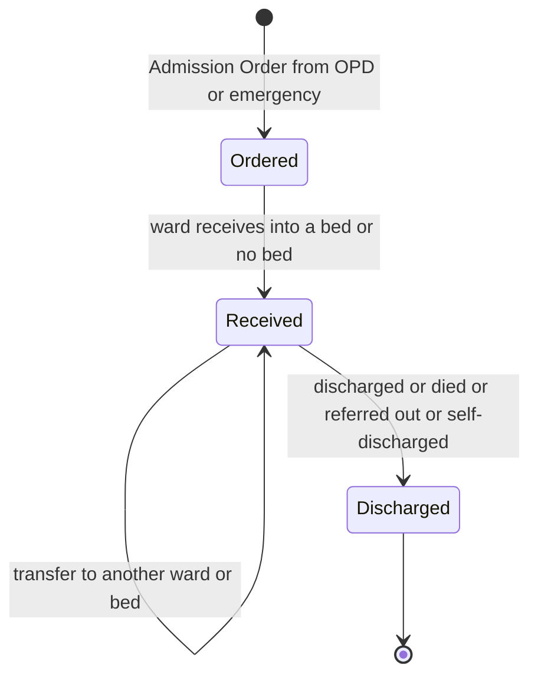

# Inpatient and emergency care

Admission, wards and beds, charting, ward rounds, discharge, deaths, emergency triage and the HMIS 108 census. Decided in [How does the platform support inpatient and emergency care: admission, wards, beds, rounds and discharge?](https://github.com/carapai/people-centered-healthcare/issues/625) ([ADR 0078](../adr/0078-inpatient-stays-are-received-into-wards-and-counted-from-location-history.md)). The facts are in the research note on branch `research/clinical-operations`.

## Emergency

### Triage

- The **triage scale** ships in a package and is configurable per deployment. The default is:

  | Category | Seen within |
  |---|---|
  | Red | 10 minutes |
  | Yellow | 1 hour |
  | Green | After red and yellow |

- The triage form uses UTAT or IITT discriminators, plus ETAT emergency signs for children.
- The category is an `Observation`. It orders the queue (emergency, then urgent, then longest waiting; [clinical-workspaces.md](clinical-workspaces.md)) and always defers payment gates (ADR 0033).
- The queue shows the time waited against the target.

### The emergency visit

An emergency `Encounter` records:
- **Case category:** medical, obstetrics and gynaecology, surgical, road traffic injury.
- **Road traffic injury mechanism:** motor vehicle, motorcycle, bicycle, pedestrian, other.
- **External haemorrhage:** controlled or not.
- **Outcome:** admitted, discharged, referred ([referrals.md](referrals.md)), died.

Observation in the emergency unit stays within this Encounter; only admission starts an inpatient Encounter. These records feed HMIS 105 rows ES01–ES09.

### Unknown patients

A patient who can't be identified is registered with sex, estimated age and a temporary name ("Unknown male 3"), and treated at once. Once identified, the record is linked or merged through the golden record ([patient-identity.md](patient-identity.md)).

## Admission

1. A clinician signs an **Admission Order**: a `ServiceRequest` naming the ward, with the reason and a provisional diagnosis. The patient appears on the ward's incoming list.
2. The ward in-charge **receives** the patient into a bed. This creates the inpatient `Encounter`, which holds:
   - the admit source;
   - "referred from";
   - the **Inpatient Number**, a per-facility sequence that restarts each July.
3. The originating OPD or emergency Encounter is closed and linked to the inpatient one.

## Wards and beds

- A ward is a facility `Location` with:
  - a **Ward Type**, one of HMIS 108's 20: male medical, female medical, male surgical, female surgical, paediatrics, maternity, gynaecology, emergency, ICU, neonatal, TB, psychiatric, eye, ENT, orthopaedic, nutrition, palliative, rehabilitation, acute care, other;
  - a designated bed count.
- Beds are child Locations of their ward.
- Placement lives in `patient-flow`. The Encounter's location history keeps each ward and bed period, so a transfer stays within one Encounter.
- A patient can be placed **without a bed**. They are in the census and the ward shows as over capacity.

## Charting

| Chart | Records | Replaces |
|---|---|---|
| Administration chart | Each scheduled dose of each medication order: given, not given (reason) or held, as `MedicationAdministration` | HMIS 034 tick grid |
| Nursing Orders | Recurring instructions such as "BP twice daily", done or not done | HMIS 034 instruction rows |
| Vital signs | `Observation`s, charted | Temperature chart |
| Fluid balance | Intake and output `Observation`s, with running totals | Fluid balance chart |

Ward stores that track stock at administration post consumption from each dose (ADR 0035). There is no early-warning score in v1.

## Ward rounds

- The **ward round list** shows the ward's patients in bed order, with new results and doses not given since the last round.
- The **Ward Round Note** (`Composition`) records the assessment and plan. Orders are started and stopped from it.

## Discharge

- **Statuses** (from the inpatient register):
  - discharged;
  - died;
  - referred out, which creates a Referral;
  - self-discharged or absconded.

  A ward transfer is not a discharge.
- The **Discharge Summary** (`Composition`) carries the HMIS 052 fields: admission and discharge dates, status, provisional and final diagnoses, clinical presentation, investigations, treatment and procedures, recommendations, follow-up date and place, and the discharging officer. It is signed and printed for the patient. For a referred-in patient it fills the Referral Feedback.
- **Payment never blocks clinical discharge.** An unpaid balance stays on the Account ([billing-and-payments.md](billing-and-payments.md)).

## Deaths

A death is recorded as the discharge status "died", or as an emergency outcome. It holds:
- the date and time;
- a cause-of-death certificate in the WHO MCCD layout, coded in ICD-11.

The Patient is marked deceased, which stops reminders, Messages and Due List entries.

## Census and HMIS 108

- **Patient days** follow the midnight-census rule:
  - the admission day counts;
  - the discharge day does not;
  - a same-day stay counts as one;
  - a transfer day counts for the new ward only.
- Per Ward Type, per month:
  - beds;
  - admissions;
  - deaths;
  - patient days;
  - average length of stay = patient days / admissions;
  - bed occupancy = patient days / days in month × 100 / beds.
- Diagnoses coded at discharge map to HMIS 108 item 6, by under 5 / 5 and over and sex.
- Bed-day charges use the same day-counting rule.
- The current HMIS 108 layout and DHIS2 identifiers are not yet verified.

## Not in v1

- Operating theatre: decided separately in [operating-theatre.md](operating-theatre.md) (ADR 0082).
- Blood transfusion (item 5): decided separately in [blood-transfusion.md](blood-transfusion.md) (ADR 0084).
- Labour ward and the partograph: decided separately in [labour-and-delivery.md](labour-and-delivery.md) (ADR 0083).
- ICU.
- The mortuary.
- Early-warning scores.
- Death notification to NIRA.
