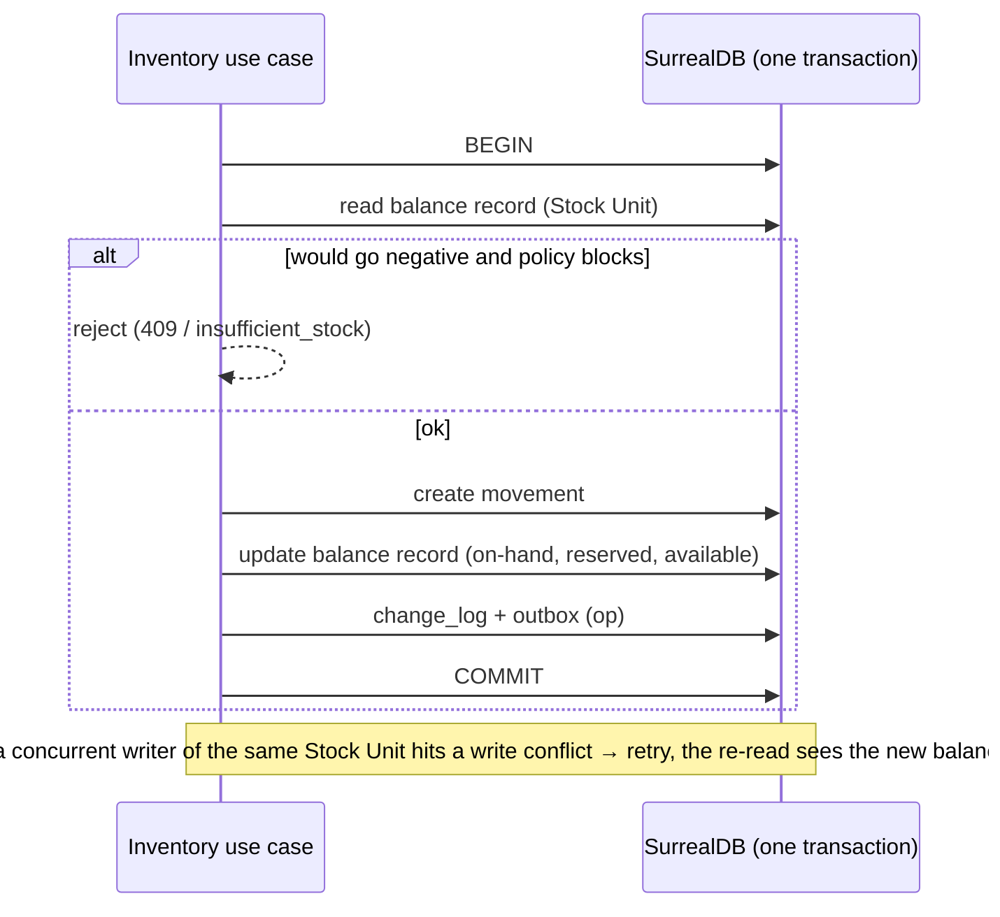
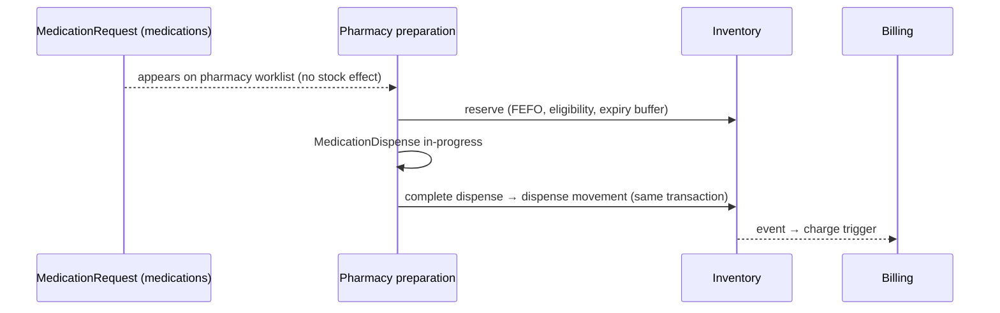
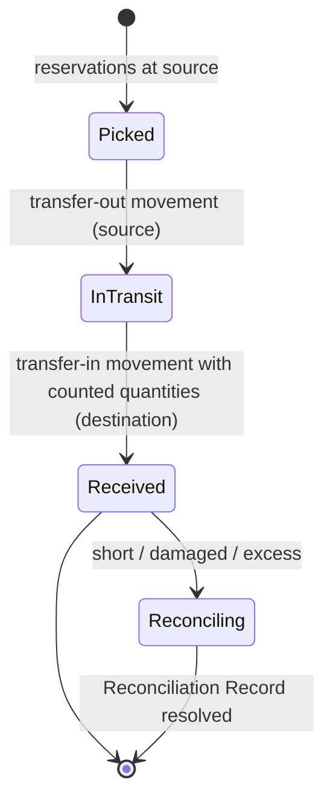

# Inventory and procurement

Status: **accepted** (ADRs 0034, 0035). Produced while resolving the Wayfinder ticket [How do stock transactions stay consistent across stores, edges and dispensing?](https://github.com/carapai/people-centered-healthcare/issues/28). Background: [docs/research/inventory.md](../research/inventory.md). Spec: MASTER_PROMPT §71–73. Related decisions:
- authority, the stock ledger per store, Authority Leases and inter-facility matching: [write-authority.md](write-authority.md);
- stock as `kind: op` items: [synchronization.md](synchronization.md);
- financial postings: [billing-and-payments.md](billing-and-payments.md).

## Records

| Record | Owner | Authority | FHIR façade |
|---|---|---|---|
| Product master, GTIN, pack sizes | product-registry | central | Medication, Device definitions, InventoryItem |
| Stores (pharmacy, lab, ward, warehouse) | facility-registry (Locations) | facility | Location |
| Stock movement | inventory | the store's Facility Authority Node, or the lease holder | SupplyDelivery (receipts and transfers), MedicationDispense (patient issues) |
| Stock Unit balance | inventory | same | InventoryItem (current stock view) |
| Reservation | inventory | same | — (internal) |
| Stock count | inventory | same | InventoryReport (`snapshot`) |
| Reorder policy (min/max) | inventory | facility | — |
| Requisition | inventory (internal), procurement (upward) | facility / central | SupplyRequest |
| Supplier, purchase order, goods-received note against a purchase order, supplier invoice | procurement | central | Organization, SupplyRequest, SupplyDelivery |

All FHIR inventory resources are at maturity levels 0–1, so they are **façades only**, with locally pinned profiles. Ledger entries, reservations and balances stay internal.

## Stock Unit and movements (ADR 0034)

- **Stock Unit key:**

  ```text
  store × product × batch × expiry × funding source (program / donor) × ownership (owned | consignment) × status (usable | quarantine | restricted)
  ```

- **Movement types:**

  | Movement | Effect |
  |---|---|
  | Receipt | Increases on-hand |
  | Issue | Decreases on-hand |
  | Dispense | Decreases on-hand |
  | Transfer-out | Decreases on-hand; moves stock to in-transit |
  | Transfer-in | Moves stock from in-transit; increases on-hand |
  | Return | Increases on-hand, in quarantine by default |
  | Adjustment | Increases or decreases on-hand; needs a reason code |
  | Count variance | Increases or decreases on-hand |
  | Expiry write-off | Decreases on-hand |
  | Status change | Moves stock between status values in one transaction (e.g. usable → quarantine) |

- **What each movement carries:**
  - a signed quantity in **base units**, plus the pack size used;
  - unit cost;
  - `occurred_at` and `recorded_at`;
  - source document;
  - actor, node and `op_id`.
- **Corrections are reversals.** Nothing is edited or deleted.

## Balances and concurrency



- **The balance record is the guard.** Each Stock Unit has exactly one balance record, written in every movement's transaction (persistence.md guard-record pattern).
- **Derived values.** `available = on-hand − reserved − on-hold`.
- **Stock card.** A running balance per Stock Unit, ordered by `occurred_at`, then `recorded_at`, then movement id. A backdated movement recomputes it from that date. Reports use `occurred_at`.
- **Nightly check.** A job rebuilds balances from the ledger, compares them with the balance records, and alerts on any drift.
- **Code.** `health-inventory` (the Stock Unit, movements, the policy and the stock card), `health-inventory-app` (`Inventory::record`, rerun on a write conflict) and SurrealDB migration `0011_stock`.

## Negative stock

| Situation | Behaviour |
|---|---|
| Issue, transfer or adjustment at the authority that would go negative | Blocked |
| Dispense at the authority that would go negative | Allowed only with the "emergency dispense" permission and a reason; flagged |
| Late operation (offline candidate) that drives a balance negative | Appended; raises a Reconciliation Record; Stock Unit flagged until a count resolves it |
| Store-level configuration | May tighten (block emergency dispense) or relax (allow-and-flag issues) |

## Reservations and batch selection (ADR 0035)

- **Reservations:**
  - **Contents:** store, Stock Unit, quantity, reason, reference and expiry.
  - **Created by:** dispense preparation (4 h lifetime), transfer picks (72 h) and procedure kits. **Never by a MedicationRequest.**
  - **Effect:** they reduce *available*, never *on-hand*.
  - **Release:** on cancellation, completion or expiry.
  - **Sync:** up for visibility only; central ignores them for balances.
- **FEFO selection:**
  1. Candidates are Stock Units that are usable, not on hold, and eligible under the configured funding-source rules, e.g. donor ART stock only for enrolled patients.
  2. A candidate's expiry must be after the end of the course plus a configurable buffer.
  3. The earliest expiry wins; ties go to the smallest quantity.
  4. Overriding the choice needs a recorded reason.
- **Substitution:**

  | Kind | Who may approve |
  |---|---|
  | Generic equivalence (product registry + formulary) | Allowed by default |
  | Brand or pack substitution | Pharmacist |
  | Therapeutic substitution | Prescriber confirmation |

  Every substitution is recorded on the MedicationDispense.

## Dispensing and other consumption (§73)



- **Partial dispenses** post partial movements, and the remainder stays on the worklist.
- **Patient returns** go to quarantine by default. Releasing them back to usable is a status-change movement by a pharmacist.
- **Ward stock:**
  - an issue to a ward store is a transfer;
  - ward stores configured to "track at administration" post consumption from MedicationAdministration;
  - otherwise, the issue to the ward counts as consumption.
- **Lab consumables:** consumption is derived from periodic counts by default. Per-test consumption rules (e.g. reagent per test) are optional configuration.

## Transfers



- **Within a facility:** the same two steps apply between stores. A one-step "direct transfer" is allowed only when one user both sends and receives, and is audited.
- **Between facilities:** each side records its own movement at its own Authority Node, and central matches dispatch with receipt (write-authority.md).

## Stock counts

- **Lifecycle:** Draft → Submitted → Approved, with full, cycle and blind count modes.
- **No freeze.** Variance = counted − (balance at count start + movements since the count started).
- **Approval.** Variance movements are posted on approval, with reason codes. A supervisor must approve any variance above a configurable threshold.
- **Root cause.** A count that resolves a flagged negative balance closes its Reconciliation Record with a recorded cause (WHO GSDP §13.2).
- **Export:** FHIR `InventoryReport` (`snapshot`).

## Valuation

- **Valuation is a projection**, never stored as truth:
  - weighted average by default, or FIFO receipt layers, set per store;
  - cost is recorded on each receipt;
  - donor-funded stock is valued at the donor-declared price;
  - consignment stock is not owned, so it carries no value.
- **Financial postings.** Facilities with "inventory accounting" enabled, typically private ones, also post inventory-asset and cost-of-goods entries to the financial ledger (ADR 0030). It is off by default for public facilities.

## Receiving, requisitions and reorder

- **Goods received.** A goods-received note is recorded at the facility authority against a supplier delivery (NMS or JMS). It is entered by hand, or pre-filled from a supplier advance shipping notice where an adapter in `health-integration` exists.
- **Scanning.** GS1 DataMatrix (GTIN `01`, expiry `17`, batch `10`, serial `21`) is supported where barcodes exist, but never required.
- **Requisitions:**
  - **within the facility** (ward → pharmacy): SupplyRequest;
  - **upward** to the district or NMS: through procurement adapters at central.
- **Reorder.** Min/max policy per store and product. Suggested order quantities are computed at the edge from consumption.

## Offline and leases

- **LAN clients** write through the edge synchronously.
- **Planned outreach** takes an **Authority Lease** over a sub-store, so the desktop is the authority for that stock while away (write-authority.md).
- **Unleased offline dispensing** from an edge-owned store is **allowed by default**:
  - it is written as candidate operations;
  - the edge accepts them on sync;
  - negative balances raise Reconciliation Records.

  Each store can forbid it in configuration.

## Central reconciliation and reporting

- **No overwrites.** Central keeps a read-only copy of every store's movement stream and re-derives balances. It never accepts a balance overwrite.
- **Daily check.** Central's re-derived balances are compared with each edge's reported balance digest. Differences are raised as alerts.
- **Reports** are all derived from the ledger:
  - HMIS 105 §6 values (stock on hand, dispensed, expired);
  - NMS/JMS order quantities;
  - donor stock reports.

  The DHIS2 export mechanism stays in the map's analytics fog.
