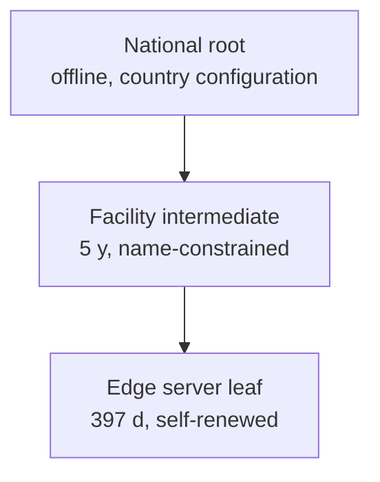

# LAN connectivity: discovery, TLS trust and device enrollment

Status: **accepted** (ADRs 0008, 0009). Produced while resolving the Wayfinder ticket [How do LAN clients find and trust the Facility Edge Node?](https://github.com/carapai/people-centered-healthcare/issues/19). Background: [docs/research/facility-edge.md](../research/facility-edge.md). The process model is in [facility-edge.md](facility-edge.md). Staff login on top of device enrollment is decided in [How do staff authenticate and get authorized offline?](https://github.com/carapai/people-centered-healthcare/issues/20).

## Supported LAN clients (v1)

| Client | Trust mechanism | Supported |
|---|---|---|
| Tauri desktop app (Windows/Linux PCs) | Pins the facility intermediate + node ID; no OS trust needed | Yes |
| Browsers (Chrome, Edge, Firefox) on enrolled PCs | Private national root installed by GPO, Firefox policy (`Certificates.Install` / `ImportEnterpriseRoots`) or the enrollment installer | Yes |
| Tauri Android build (tablets, phones) | Pins in the app | Yes |
| iOS devices, browsers on unmanaged phones | Manual root trust, and Android Chrome support for user CAs is unverified | No (fog) |

## Certificate hierarchy

- **Root.** The root is offline and held as country configuration. For Uganda the platform operator holds it until MoH governance is decided (see the map's Not yet specified). It is installed on browser client PCs at enrollment.
- **Facility intermediate.** Central issues one per facility at edge provisioning, valid 5 years. Its name constraints permit only that facility's DNS names (`<node-id>.local` and the configured facility name) and the RFC 1918 / ULA IP ranges, so a compromised edge cannot mint certificates for other names. Its private key sits in the edge's OS keystore.
- **Leaf.** The edge issues its own server certificate with `rcgen` and serves it with rustls.
  - ECDSA P-256, serverAuth EKU.
  - SANs: the node's static IP(s), `<node-id>.local`, and the optional configured DNS name. Names go in SANs, never in the CN alone.
  - Valid 397 days, inside Apple's 825-day ceiling for user-added roots.
  - Renewed automatically at two-thirds of its lifetime, with no internet needed. A certificate-expiry alert fires at less than 30 days remaining.
- **Rejected for production:** plain HTTP, self-signed click-through, and Chrome's insecure-origin override. Public DNS-01 certificates may be added later as an optional extra for connected sites.
- **Tauri pinning.** Tauri pins the facility intermediate's SPKI and the node ID, both received at pairing, rather than the leaf. Leaf renewal therefore needs no client action.

## Addressing and discovery

- The edge **requires a static IP or a DHCP reservation**. If the IP changes, the leaf is reissued and an alert is raised.
- **Pairing is the primary path.** The edge admin page shows a QR code or pairing code carrying the node URL, node ID and intermediate SPKI fingerprint. Browser PCs get the URL as a managed bookmark or shortcut from the enrollment installer.
- **mDNS is only a hint.** The service type is `_health-edge._tcp` (via `mdns-sd`), and its TXT record carries the node ID and protocol version. Only Tauri apps browse it, because browsers cannot.
- Clients identify the node by **node ID and key fingerprint, never by IP**. A spoofed announcement fails the fingerprint check.
- **Deployment rule:** use a wired LAN, or Wi-Fi access points without client isolation. If multicast-to-unicast conversion is available, turn it on.

## App delivery to browsers

- The edge serves the React app shell **from its own origin**. A service worker caches the shell across edge restarts.
- A centrally hosted web app never calls a LAN edge directly. This avoids Chrome Local Network Access prompts and mixed trust.

## Device enrollment

1. The client generates a key pair:
   - Tauri: in the OS keyring, with Stronghold as a fallback.
   - Browser: a non-extractable WebCrypto key (ECDSA P-256) stored in IndexedDB.
2. The client sends an enrollment request with its public key and device metadata, and shows a short pairing code.
3. A facility admin approves the request on the edge admin page. Approval matches the pairing code, names the device, and assigns it to a location or ward. Pending requests expire after 10 minutes.
4. The edge records the device in its **device registry**: public key thumbprint, name, location, enrolled-by, enrolled-at, and status. The registration syncs to central.
5. From then on, the device's key is the **DPoP key** for every token. A token request whose DPoP proof is not from an enrolled, active key is refused, so staff credentials alone never work from an unknown device.

Clearing browser storage loses the key, so the device must be re-enrolled. Admins see the old registration as stale.

## Revocation

- **Devices.** A device is revoked on the edge admin page, or at central with the change synced down. The edge removes the key from its registry, rejects that key's next token request, and ends its open sessions immediately. Because tokens are short-lived DPoP tokens, nothing outlives one token lifetime. The revocation is audited.
- **Facility intermediates.** Central revokes a compromised intermediate and issues a new one. Tauri clients receive revocations and new pins through sync. Browsers cannot check private-CA revocation offline, so they rely on the leaf lifetime and re-provisioning. This is a known, accepted limitation.

## Denying unauthorized LAN devices

- The edge listens on **TCP 443 only**. The installer configures the host firewall to deny other inbound traffic, and there is no database port (SurrealDB is embedded).
- **Reachable without an enrolled device:** the app shell, the enrollment flow and `/health/live`. Everything else requires a device-bound DPoP token.
- The enrollment endpoint is rate-limited per source address.
- Failed enrollments, unknown-key token attempts and repeated authentication failures are audited, and an alert is raised on the edge status page and at central.
- Network controls (Wi-Fi password, VLAN) are an extra layer, never the only control.
