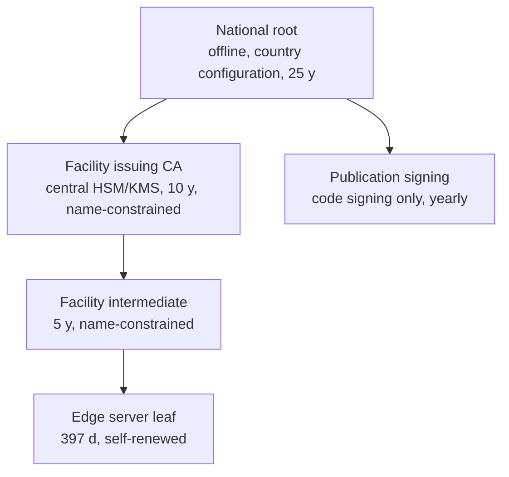

# LAN connectivity: discovery, TLS trust and device enrollment

Status: **accepted** (ADRs 0008, 0009, 0058). Produced while resolving the Wayfinder ticket [How do LAN clients find and trust the Facility Edge Node?](https://github.com/carapai/people-centered-healthcare/issues/19). Background: [docs/research/facility-edge.md](../research/facility-edge.md). The process model is in [facility-edge.md](facility-edge.md). Staff login on top of device enrollment is decided in [How do staff authenticate and get authorized offline?](https://github.com/carapai/people-centered-healthcare/issues/20).

## Supported LAN clients (v1)

| Client | Trust mechanism | Supported |
|---|---|---|
| Tauri desktop app (Windows/Linux PCs) | Pins the facility intermediate + node ID; no OS trust needed | Yes |
| Browsers (Chrome, Edge, Firefox) on enrolled PCs | Private national root installed by GPO, Firefox policy (`Certificates.Install` / `ImportEnterpriseRoots`) or the enrollment installer | Yes |
| Tauri Android build (tablets, phones) | Pins in the app | Yes |
| iOS devices, browsers on unmanaged phones | Manual root trust, and Android Chrome support for user CAs is unverified | No (fog) |

## Certificate hierarchy

- **Root.** The root is offline and held as country configuration. For Uganda the platform operator holds it until MoH governance is decided (see the map's Not yet specified). It is installed on browser client PCs at enrollment.
- **Facility issuing CA (ADR 0058).** The root issues it at a ceremony, and central holds its key non-exportable in its HSM or KMS. It is valid 10 years and issues only in its first 5, after which a successor takes over. Its name constraints permit only `.local`, the country's configured facility DNS suffixes and the private IP ranges, so even its key cannot mint a certificate for a public name.
- **Facility intermediate.** Central's issuing CA issues one per facility at edge provisioning, valid 5 years. The edge generates the key in its keystore and sends a certificate signing request; central keeps only the public key and sets everything else from the facility registry. Its name constraints permit only that facility's DNS names (`<node-id>.local` and the configured facility name) and the RFC 1918 / ULA IP ranges, so a compromised edge cannot mint certificates for other names. Its private key sits in the edge's OS keystore.
- **Leaf.** The edge issues its own server certificate with `rcgen` and serves it with rustls.
  - ECDSA P-256, serverAuth EKU.
  - SANs: the node's static IP(s), `<node-id>.local`, and the optional configured DNS name. Names go in SANs, never in the CN alone.
  - Valid 397 days, inside Apple's 825-day ceiling for user-added roots.
  - Renewed automatically at two-thirds of its lifetime, with no internet needed. A certificate-expiry alert fires at less than 30 days remaining.
- **Rejected for production:** plain HTTP, self-signed click-through, and Chrome's insecure-origin override. Public DNS-01 certificates may be added later as an optional extra for connected sites.
- **Tauri pinning.** Tauri pins the facility intermediate's SPKI and the node ID, both received at pairing, rather than the leaf. Leaf renewal therefore needs no client action.

## Addressing and discovery

- The edge **requires a static IP or a DHCP reservation**. If the IP changes, the leaf is reissued and an alert is raised.
- **Pairing is the primary path.** The edge admin page shows a QR code or pairing code carrying the node URL, node ID and intermediate SPKI fingerprint. Browser PCs get the URL as a managed bookmark or shortcut from the enrollment installer.
- **mDNS is only a hint.** The service type is `_health-edge._tcp` (via `mdns-sd`), and its TXT record carries the node ID and protocol version. Only Tauri apps browse it, because browsers cannot.
- Clients identify the node by **node ID and key fingerprint, never by IP**. A spoofed announcement fails the fingerprint check.
- **Deployment rule:** use a wired LAN, or Wi-Fi access points without client isolation. If multicast-to-unicast conversion is available, turn it on.

## App delivery to browsers

- The edge serves the React app shell **from its own origin**. A service worker caches the shell across edge restarts.
- A centrally hosted web app never calls a LAN edge directly. This avoids Chrome Local Network Access prompts and mixed trust.

## Device enrollment

1. The client generates a key pair:
   - Tauri: in the OS keyring, with Stronghold as a fallback.
   - Browser: a non-extractable WebCrypto key (ECDSA P-256) stored in IndexedDB.
2. The client sends an enrollment request with its public key and device metadata, and shows a short pairing code.
3. A facility admin approves the request on the edge admin page. Approval matches the pairing code, names the device, and assigns it to a location or ward. Pending requests expire after 10 minutes.
4. The edge records the device in its **device registry**: public key thumbprint, name, location, enrolled-by, enrolled-at, and status. The registration syncs to central.
5. From then on, the device's key is the **DPoP key** for every token. A token request whose DPoP proof is not from an enrolled, active key is refused, so staff credentials alone never work from an unknown device.

Clearing browser storage loses the key, so the device must be re-enrolled. Admins see the old registration as stale.

## Revocation

- **Devices.** A device is revoked on the edge admin page, or at central with the change synced down. The edge removes the key from its registry, rejects that key's next token request, and ends its open sessions immediately. Because tokens are short-lived DPoP tokens, nothing outlives one token lifetime. The revocation is audited.
- **Facility intermediates.** Central revokes a compromised intermediate on the issuing CA's CRL and issues a new one. The root's CRL, reissued at each ceremony and at least every 13 months, covers issuing CAs and publication-signing certificates (ADR 0058). Tauri clients receive revocations and new pins through sync. Browsers cannot check private-CA revocation offline, so they rely on the leaf lifetime and re-provisioning. This is a known, accepted limitation.

## Denying unauthorized LAN devices

- The edge listens on **TCP 443 only** on the LAN. Its plain-HTTP console is bound to the loopback address, so only the edge's own screen reaches it. The installer configures the host firewall to deny other inbound traffic, and there is no database port (SurrealDB is embedded).
- **Reachable without an enrolled device:** the app shell, the enrollment flow and `/health/live`. Everything else requires a device-bound DPoP token.
- The enrollment endpoint is rate-limited per source address.
- Failed enrollments, unknown-key token attempts and repeated authentication failures are audited, and an alert is raised on the edge status page and at central.
- Network controls (Wi-Fi password, VLAN) are an extra layer, never the only control.

## In code

- **#67:** `health-pki` issues every tier from a PKCS#10 request, keeping only its public key, and refuses names outside the issuer's constraints, public IPs and certificates that would outlive their issuer. It publishes numbered CRLs, and its `Trust` verifies served chains against the root and CRLs. `tools/pki` runs the ceremonies, with a draft runbook (`tools/pki/RUNBOOK.md`).
- **#73:** `facility-edge provision request` passes the encryption gate, generates the intermediate's key on the edge, seals it in the keystore (systemd-creds or DPAPI) and writes the request. `provision install` keeps a chain only if a leaf it issues for `<node-id>.local` verifies against the root. The systemd unit unseals the key for the service with `LoadCredentialEncrypted=`.
- **#74, part 1:** the device registry and enrollment. A device's request carries a DPoP proof by its key and gets a 6-digit pairing code; the admin approves by typing it, with a name and a location, or revokes a device, and both are audited. Pending requests expire after 10 minutes and are rate-limited per address. Every other edge API route needs a fresh, unreplayed DPoP proof by an enrolled, active key (`health_auth::DeviceGate`), so an unenrolled or revoked device is refused at its next request. Until staff sign-in (#75), approval and revocation are served to the edge's own console.
- **#74, part 2a:** the edge issues its own leaf under the installed intermediate for `<node-id>.local`, the configured name and its private addresses, with a fresh key in `HEALTH_TLS_DIR`. It serves HTTPS only (rustls), renews the leaf at two-thirds of its life or when its addresses change with no restart, and raises the certificate alerts on the status page. Before provisioning it opens no LAN listener. Either way, a plain-HTTP console on the loopback address (`HEALTH_CONSOLE_BIND`) serves the edge's own screen, where the admin pages answer until staff sign-in (#75).
- **#74, part 2b:** pairing and discovery. The edge's status page shows a QR code and its text for `health-edge://pair?v=1&node=…&url=…&spki=…`: the node's https origin, its node ID and its facility intermediate's SPKI fingerprint (`GET /api/admin/pairing`, console only). While it serves HTTPS it announces `_health-edge._tcp` over mDNS with TXT `node` and `v`, at its leaf's addresses.
- **#74, part 3:** the browser client. On an edge, `src/platform/device.ts` makes a non-extractable ECDSA P-256 key in IndexedDB. Every request then carries a DPoP proof by it: alone before sign-in, bound to the token after. `/enroll` asks, shows the pairing code and waits for approval. The edge status page lists pending requests, approves one by its typed code with a name and a location, and revokes devices. The edge e2e suite shows an unknown device refused, an approved one let in, and a revoked one shut out.
- **#268, part 1:** central's node registry (`health-provisioning`).
  - `central-server provision code` issues a one-time code for a facility. It may carry an audited encryption exemption, which then stands as an hourly alert.
  - An edge redeems the code at `POST /api/provisioning/nodes` with its certificate request and encryption state.
  - Central mints the `node_id` and the next short code (`E1`, `E2`, …), and has the issuing CA issue the intermediate for `<node-id>.local` and the facility's names, all in one audited transaction.
  - The issuing CA's key is read from a file behind an `Issuer` port, until the KMS adapter.
- **#268, part 2:** `facility-edge provision --code … --central … --root …` provisions the edge online.
  - It runs the gate, and seals the key, or resumes an unfinished attempt.
  - It redeems the code at central over HTTPS, with `hyper-rustls` verifying central against the OS trust store or a given CA. There is no bundled root store.
  - It installs the chain for the node ID central minted, and records `node.json`, which the node runs under.
- **Still to come:**
  - recovery-key escrow, decommissioning, and HSM or KMS signing for the issuing CA (#268);
  - the Tauri apps' keyring key and their pinning of the intermediate's SPKI from the pairing code (with the desktop and Android builds);
  - device registrations and revocations syncing to central;
  - CRL delivery in the sync revocation lane;
  - the real ceremony and root custody (#265).
