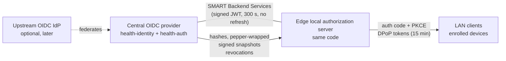
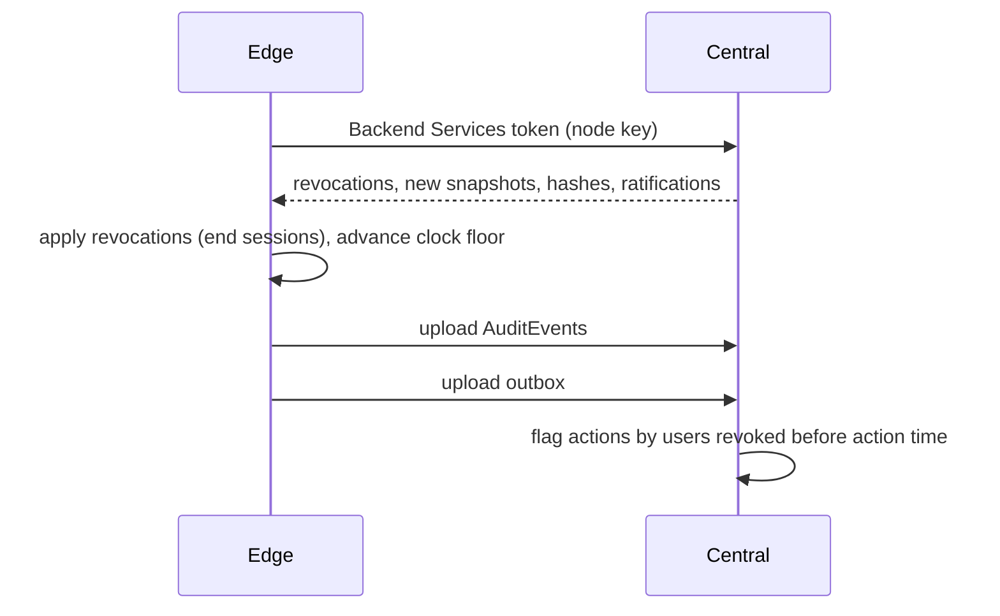

# Offline authentication and authorization

Status: **accepted** (ADRs 0010, 0011). Produced while resolving the Wayfinder ticket [How do staff authenticate and get authorized offline?](https://github.com/carapai/people-centered-healthcare/issues/20). Background: [docs/research/offline-auth.md](../research/offline-auth.md). This builds on device enrollment in [lan-security.md](lan-security.md) (ADR 0009). The desktop's local authentication is in [desktop-client.md](desktop-client.md).

## Identity provider shape

- **Central** is the identity provider of record. It holds Login Accounts, credentials, role assignments and snapshot signing keys.
- **The edge** is always the authorization server for LAN clients, online or offline (ADR 0010).
  - Clients use the authorization code flow with PKCE (RFC 8252) and SMART App Launch v2 scopes.
  - The password grant is never used (RFC 9700).
  - Both central and edge run one Rust implementation.
- **Edge ↔ central** uses SMART Backend Services. The edge is a confidential client authenticating with its node key, gets 300 s tokens and no refresh tokens.

## Credentials

| Item | Rule |
|---|---|
| Session start | Username and password on an **enrolled device**. Minimum 8 characters, checked against a breached-password list, because the enrolled device key is the second factor. Where no device factor exists, the minimum is 15 characters. |
| Hash | Argon2id, m=19456 KiB, t=2, p=1, provisioned by central. Only staff assigned to the facility are provisioned. |
| Pepper | In the edge's OS keystore: a CNG machine key on Windows (the service runs without a user profile), TPM-backed where present. The Linux keystore choice falls to implementation. |
| PIN | 6 digits. Used only to resume or switch to a user who already has a live session on that device. Never used to start a session. |
| Lockout | 10 failures trigger a 15-minute lock; the hard cap is 100. Lockout counters are per user per edge. |

Whether PIN plus an enrolled device counts as MFA for MoH policy is tracked in the map's legal/regulatory fog.

## Permission snapshots (ADR 0011)

- **Contents.** One snapshot per user per facility: roles, ABAC attributes (facility, locations/wards, program assignments), `issued_at` (central time), `not_after` and `snapshot_version`. Central signs it.
- **Expiry.** The default lifetime is **14 days**, configurable from 7 to 30 in the country configuration package. A warning shows from 3 days before expiry. An expired snapshot means the user cannot log in.
- **Extension.** District or central admins may extend a snapshot. The facility in-charge may grant **one** emergency 7-day extension, which is audited and flagged at central.
- **Clock floor.** The edge persists a monotonic "last known central time", advanced by every snapshot, sync response and token exchange with central. If the local clock reads earlier than the floor, the edge treats the clock as broken: it refuses logins, raises an alert, and expiry checks use the floor.

## Tokens and sessions

| Item | Rule |
|---|---|
| Access token | Issued by the edge. Lifetime **15 min**. DPoP-bound to the enrolled device key. Claims: `sub`, facility, `snapshot_version`, `auth_time`, `amr`, `acr` (`central` / `offline-local`). |
| Session | Refreshable up to a **12 h** hard cap, after which a full password login is required. |
| Idle lock | After **15 min**; a PIN unlocks it. |
| Shared workstation | One session per user per device. Switching users by PIN hides the previous user's view completely before the next user's view loads. |

### In code

- **`health-identity`** (domain): the lockout, password-length, session-lifetime and SMART v2 scope rules above.
- **`health-auth`** (infrastructure): the authorization server.
  - authorization code with PKCE S256;
  - ES256 access tokens, DPoP-bound when the client sends a proof (always on an edge);
  - rotating refresh tokens up to the 12 h cap; a replayed one ends the session;
  - logout through `/revoke`;
  - `AccessVerifier` for resource routes, which checks that the session is live on every request.
- **Its READMEs** cover the details: [health-identity](../../crates/domains/health-identity/README.md), [health-auth](../../crates/infrastructure/health-auth/README.md).
- **Follow-ups:**
  - persistence ([#187](https://github.com/carapai/people-centered-healthcare/issues/187));
  - mounting it, with key storage and the web client's sign-in ([#188](https://github.com/carapai/people-centered-healthcare/issues/188));
  - the breached-password list ([#189](https://github.com/carapai/people-centered-healthcare/issues/189)).

## Authorization model

- **RBAC.**
  - Roles are assigned through the workforce registry (PractitionerRole), for a facility and optionally specific locations.
  - Role → permission mappings are Published Definitions in the country configuration package.
- **ABAC attributes:** facility, location/ward, program assignment, and purpose of use.
- **Sensitive data.**
  - Resources carrying `meta.security` sensitivity labels (v3 InformationSensitivityPolicy: HIV, TB, mental health, SRH, SUD, …) and confidentiality `R` need a program assignment matching the label, in addition to the role.
  - Patient-sensitive access declares a PurposeOfUse.
- **SMART v2 scopes** (`user/*.cruds`) are the coarse grant in the token. Fine-grained decisions are made server-side.
- **Policy decision point.**
  - Identity & Access owns it, and it runs in the application layer.
  - Use cases call it before acting.
  - Repository searches receive its decision as a query filter, so restricted resources are excluded inside the database query, not after it.
  - Nothing is enforced only in the UI.

## Break-glass

1. **Who:** only clinical roles flagged "may break glass" in the configuration package.
2. **What it requires:** a reason code (`v3-ActReason#BTG`) and free text.
3. **What it grants:** access scoped to **one patient** for **1 hour**, with no extension.
4. **Audit:** an AuditEvent with BTG in `authorization`, and break-the-glass security labels on the access.
5. **Alert:** an immediate alert to the facility in-charge on the LAN, through the edge status page and notifications.
6. **Review:** mandatory review by a designated privacy officer within **72 h** of the event reaching central. Overdue reviews escalate.

## Offline user and role administration (ADR 0011)

- A facility admin may **revoke** any local access offline at any time. The revocation takes effect immediately on the edge and syncs to central.
- A facility admin may **grant** offline only roles on the country-configured "locally grantable" list, and only to staff already provisioned to the facility. The edge signs these grants with its node key. They last until central ratifies them, at most 7 days.
- **New staff offline:** a provisional local account with the same limits, reconciled into the workforce registry at central.
- **Never granted offline:** administration, privacy officer, sensitive-program access, and break-glass eligibility.

## Reconciliation on reconnect

- Actions by a user who was revoked before the action time are **accepted and flagged** for review. Clinical records are never discarded for authorization reasons, and the user is locked out on the edge from then on.
- Actions under an expired snapshot cannot exist, because the edge refuses them.
- Local grants and provisional accounts are either ratified, or revoked with their actions flagged.

## Legal basis

Under Uganda's DPPA 2019, health data is special personal data (s.9), and s.24(1)(c) gives patients the right to know who accessed their data. Per-user attribution therefore stays mandatory offline, and shared logins are a compliance failure, not just a security weakness. Open legal questions stay in the map's fog.
