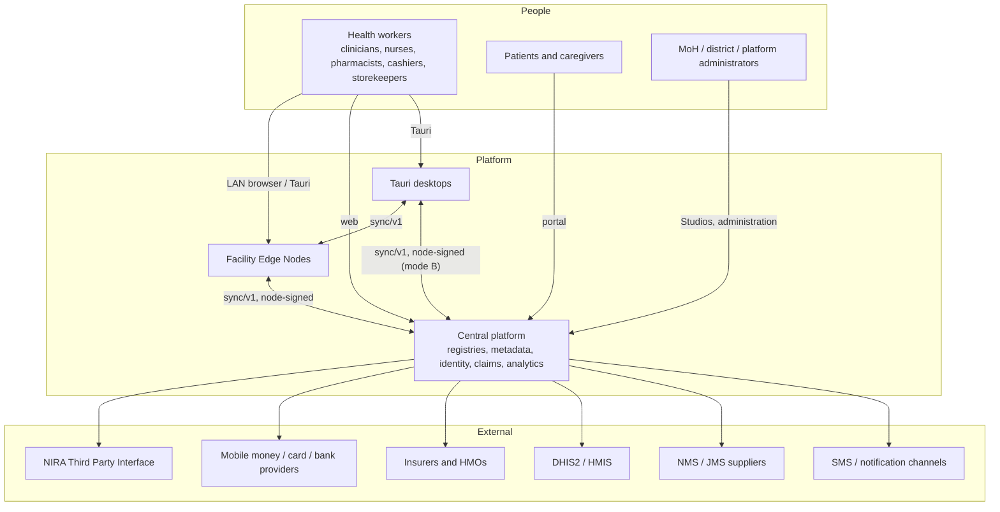

# Architecture overview

The entry point to the architecture. This page summarises the platform and links to the decision documents; each linked document is authoritative for its topic. Decisions were reached through the Wayfinder map [Wayfinder: FHIR R5 healthcare platform architecture](https://github.com/carapai/people-centered-healthcare/issues/1) and are recorded as ADRs (index below). The specification is `MASTER_PROMPT.md`; vocabulary is in [GLOSSARY.md](../../GLOSSARY.md).

## What the platform is

A FHIR R5–native, people-centred health platform for national deployment, with Uganda as the reference deployment. It runs:
- at **central** (national services, registries, analytics);
- on a **Facility Edge Node** per facility (LAN server that works without internet);
- on **Tauri desktops** (standalone for small facilities, or an offline fallback under an edge);
- in **browsers** (central web, or LAN clients of an edge).

One Rust codebase (Axum, Tokio, SurrealDB) runs on all nodes, and one React app serves every runtime.

## System context

All external integrations run at central; edges and desktops never call external systems directly ([billing-and-payments.md](billing-and-payments.md), [patient-identity.md](patient-identity.md)).

## Deployment modes

| Mode | Runtime | Facility Authority Node | Offline | Doc |
|---|---|---|---|---|
| A | Central online web | Central | No; server-confirmed writes only | [client-application.md](client-application.md) |
| B | Standalone Tauri desktop | That desktop | Yes | [desktop-client.md](desktop-client.md) |
| C | Facility Edge Node + LAN clients (+ optional Tauri) | The edge | Yes, LAN-wide | [facility-edge.md](facility-edge.md) |
| D | LAN browser / Tauri client of an edge | The edge | Browsers no; Tauri yes (fallback) | [lan-security.md](lan-security.md), [desktop-client.md](desktop-client.md) |

Topologies and trust boundaries: [deployment-topology.md](deployment-topology.md).

## Bounded Contexts

Thirteen Bounded Contexts, built as modules of a modular monolith (ADR 0001) and hosted by three Deployables: `central-server`, `facility-edge` and the Tauri desktop host ([resource-ownership.md](resource-ownership.md), [service-catalogue.md](service-catalogue.md)).

| Area | Decisions |
|---|---|
| Ownership, crates, layering | [resource-ownership.md](resource-ownership.md), [crate-catalogue.md](crate-catalogue.md), [dependency-rules.md](dependency-rules.md) |
| FHIR model, persistence, ids | [fhir-r5-model.md](fhir-r5-model.md), [persistence.md](persistence.md), [identifiers.md](identifiers.md) |
| Authority and sync | [write-authority.md](write-authority.md), [synchronization.md](synchronization.md) |
| Terminology, metadata, configuration | [terminology.md](terminology.md), [metadata.md](metadata.md), [configuration.md](configuration.md), [facility-configuration.md](facility-configuration.md) |
| Forms and programs | [questionnaire-extraction.md](questionnaire-extraction.md), [program-designer.md](program-designer.md) |
| Authoring (Studio) | [studio.md](studio.md) |
| Workflow and decision support | [workflow-engine.md](workflow-engine.md), [decision-support.md](decision-support.md) |
| Patients | [patient-identity.md](patient-identity.md), [patient-portal.md](patient-portal.md), [care-journeys.md](care-journeys.md) |
| Health workers | [clinical-workspaces.md](clinical-workspaces.md) |
| Immunization | [immunization.md](immunization.md) |
| Referrals | [referrals.md](referrals.md) |
| Emergency transport | [emergency-transport.md](emergency-transport.md) |
| Surveillance | [surveillance.md](surveillance.md) |
| Inpatient and emergency | [inpatient-and-emergency.md](inpatient-and-emergency.md) |
| Imaging | [imaging.md](imaging.md) |
| Integrations | [integrations.md](integrations.md) |
| Operating theatre | [operating-theatre.md](operating-theatre.md) |
| Labour and delivery | [labour-and-delivery.md](labour-and-delivery.md) |
| Blood transfusion | [blood-transfusion.md](blood-transfusion.md) |
| ICU, early warning and the mortuary | [icu-early-warning-and-mortuary.md](icu-early-warning-and-mortuary.md) |
| Messages to patients and staff | [communications.md](communications.md) |
| Finance | [pricing-and-insurance.md](pricing-and-insurance.md), [billing-and-payments.md](billing-and-payments.md) |
| Supply chain | [inventory-and-procurement.md](inventory-and-procurement.md) |
| Edge, LAN, auth | [facility-edge.md](facility-edge.md), [lan-security.md](lan-security.md), [offline-auth.md](offline-auth.md), [backup-and-recovery.md](backup-and-recovery.md) |
| Clients | [client-application.md](client-application.md), [desktop-client.md](desktop-client.md) |
| Security | [security.md](security.md) |
| Operations | [deployment.md](deployment.md), [testing.md](testing.md) |

## Core principles, as decided

- **One Authority Node per record**, derived from scope; others write Candidate Versions (ADR 0012).
- **No universal last-write-wins**: whole-version conflict detection, Conflict Records, ledgers for stock and money (ADRs 0020, 0030, 0034).
- **Same code everywhere**: one Rust implementation of APIs, auth and workflow on central, edge and desktop (ADRs 0010, 0036, 0039).
- **Definitions are data**: forms, mappings, workflows, matching rules, prices and gates are versioned, published and pinned by the records that use them (ADRs 0024, 0025).
- **No clinical data in browser storage**, and confirmed writes only (ADR 0037).
- **No personal health data in telemetry** (ADR 0047).

## ADR index

| ADR | Decision |
|---|---|
| [0001](../adr/0001-modular-monolith-first.md) | Modular monolith first: central-server and facility-edge |
| [0002](../adr/0002-workflow-owns-tasks.md) | Workflow owns every Task; dependencies run one way |
| [0003](../adr/0003-metadata-owns-published-definitions.md) | Terminology & Metadata owns every Published Definition |
| [0004](../adr/0004-transactions-within-one-deployable.md) | Cross-module transactions only inside one Deployable |
| [0005](../adr/0005-six-layer-crate-stack.md) | Six-layer crate stack with a separate application layer |
| [0006](../adr/0006-pure-isolated-domain-crates.md) | Domain crates are pure, per-Module and never depend on each other |
| [0007](../adr/0007-embedded-single-process-edge-with-cold-spare.md) | Facility Edge is one process embedding SurrealDB, recovered by cold spare |
| [0008](../adr/0008-private-pki-name-constrained-facility-intermediate.md) | LAN TLS uses a private PKI with a name-constrained intermediate per facility |
| [0009](../adr/0009-device-bound-enrollment-on-the-lan.md) | Every LAN device is enrolled, and its key is the DPoP key for every token |
| [0010](../adr/0010-edge-is-always-the-local-authorization-server.md) | The edge is always the authorization server for LAN clients, built by the same Rust code as central |
| [0011](../adr/0011-expiring-signed-permission-snapshots.md) | Offline permissions are expiring, central-signed snapshots, and offline grants are narrow and provisional |
| [0012](../adr/0012-authority-node-follows-record-scope.md) | Each record has one Authority Node, derived from its scope and never switched implicitly |
| [0013](../adr/0013-uuidv7-ids-and-uuidv5-derived-ids.md) | Client-generated UUIDv7 resource ids; UUIDv5 for anything derived |
| [0014](../adr/0014-node-prefixed-local-sequences-for-human-readable-numbers.md) | Human-readable numbers come from node-prefixed local sequences, not reserved pools |
| [0015](../adr/0015-adopted-r5-model-crate-behind-a-facade.md) | FHIR R5 models come from an adopted crate behind our own facade; search and persistence are ours |
| [0016](../adr/0016-validate-on-the-writing-node-and-again-at-authority.md) | Resources are validated on the writing node and again at the Authority Node and central |
| [0017](../adr/0017-head-history-and-range-keyed-index-tables.md) | FHIR resources are stored as head and history tables per type, with array-keyed search index tables |
| [0018](../adr/0018-version-id-is-the-op-id.md) | `meta.versionId` is the op_id of the write, and our clients create with PUT |
| [0019](../adr/0019-own-sync-protocol-with-commit-ordered-cursors.md) | Sync uses its own protocol, with commit-ordered sequence cursors and a transactional outbox |
| [0020](../adr/0020-whole-version-conflicts-without-merge.md) | Conflicts are detected per whole resource version, and nothing is merged automatically |
| [0021](../adr/0021-content-addressed-blob-store-for-attachments.md) | Attachments live in a content-addressed blob store outside SurrealDB |
| [0022](../adr/0022-template-extraction-with-separate-mappings-re-derived-at-authority.md) | QuestionnaireResponses are extracted by SDC templates held in separate Extraction Mappings, and re-derived at authority |
| [0023](../adr/0023-managed-and-seed-extraction-targets.md) | Extracted resources are either managed by their form or seeded once, and each is written by its own Owner |
| [0024](../adr/0024-signed-fhir-npm-packages-with-pinned-manifests.md) | Published Definitions ship as signed, immutable FHIR NPM packages with pinned manifests |
| [0025](../adr/0025-publication-separate-from-scoped-activation.md) | Publishing a package never activates it; activation is a scoped, dated record, and rollback is re-activation |
| [0026](../adr/0026-overrides-only-at-declared-configuration-override-points.md) | District and facility overrides change configuration only, at override points their base package declares |
| [0027](../adr/0027-platform-client-registry-with-linked-golden-records.md) | The platform is the client registry; source Patients link to a central golden record, and nothing is merged by default |
| [0028](../adr/0028-layered-matching-from-published-rules.md) | Patient matching is layered (deterministic, blocking, Fellegi–Sunter) and driven by published Matching Rules |
| [0029](../adr/0029-assurance-gated-accounts-and-caregiver-access.md) | Accounts reach patient data only through a Person, at a verified assurance level, and caregivers only through RelatedPerson plus Consent |
| [0030](../adr/0030-double-entry-ledger-is-the-financial-source-of-truth.md) | An internal double-entry ledger is the financial source of truth; FHIR financial resources are projections and exchange formats |
| [0031](../adr/0031-staged-pricing-from-versioned-price-books.md) | Prices come from versioned Price Books through a fixed sequence of stages, evaluated wherever the charge is recorded |
| [0032](../adr/0032-provider-confirmed-two-phase-payments-via-central.md) | Non-cash payments are two-phase and confirmed only by provider evidence; provider integrations run only at central |
| [0033](../adr/0033-financial-gates-are-configuration-and-urgent-care-always-defers.md) | Payment steps are configured Financial Gates, and clinically urgent care always defers rather than blocks |
| [0034](../adr/0034-stock-movement-ledger-with-guarding-balance-records.md) | Stock is an append-only movement ledger per Stock Unit, and each Stock Unit's balance record guards concurrent issues |
| [0035](../adr/0035-stock-moves-on-fulfilment-with-reservations-and-fefo.md) | Stock moves only on fulfilment; preparation reserves stock, and FEFO with policy chooses the batch |
| [0036](../adr/0036-ports-over-swappable-transport-with-tauri-ipc-into-the-shared-router.md) | The one React app uses ports over a swappable transport, and Tauri IPC dispatches into the same Axum router in-process |
| [0037](../adr/0037-no-clinical-data-in-browser-or-webview-storage.md) | No browser or webview ever persists clinical data, and clinical writes are confirmed, never optimistic |
| [0038](../adr/0038-fhirpath-js-for-live-form-behaviour.md) | Live form behaviour uses fhirpath.js in the browser, and the server re-validates every submission |
| [0039](../adr/0039-one-desktop-binary-two-roles-with-rust-side-failover.md) | One desktop binary serves two roles, and a desktop under an edge fails over to local work inside Rust |
| [0040](../adr/0040-desktop-secrets-in-os-keystore-and-disk-encryption-check.md) | Desktop secrets live only in the OS keystore, and provisioning checks full-disk encryption |
| [0041](../adr/0041-desktop-platforms-signing-and-staged-updates.md) | v1 desktops target Windows and Ubuntu LTS, are signed through cloud HSMs, and update in stages from central |
| [0042](../adr/0042-engine-native-statecharts-with-plandefinition-as-import.md) | Workflows run as engine-native statecharts in our own Rust interpreter; PlanDefinition is an import source, never the runtime |
| [0043](../adr/0043-typed-actions-fhirpath-guards-and-a-bounded-workflow-principal.md) | Workflow actions are typed Rust registrations, guards are FHIRPath only, and system transitions run as a bounded workflow principal |
| [0044](../adr/0044-workflow-instances-history-and-timers-at-the-authority.md) | Workflow instances keep an append-only history, transitions commit with their actions, and timers fire only at the instance's authority |
| [0045](../adr/0045-pinned-least-privilege-ci-and-signed-or-failed-releases.md) | CI runs pinned, least-privilege workflows behind a merge queue, and a release is either fully signed with provenance or it fails |
| [0046](../adr/0046-central-recovery-by-hourly-export-and-warm-standby.md) | Central recovers from hourly exports to a warm standby, and edges re-push facility data after a central restore |
| [0047](../adr/0047-no-health-data-in-telemetry-and-in-country-observability.md) | Telemetry never carries personal health data, and the observability stack is self-hosted in-country |
| [0048](../adr/0048-mandatory-tpm-unlocked-full-disk-encryption-on-edges.md) | Facility Edge Nodes require full-disk encryption with TPM-only unlock, so they still restart unattended |
| [0049](../adr/0049-engine-native-definitions-as-profiled-library-and-plandefinition.md) | Engine-native Published Definitions are profiled Library resources, programs are profiled PlanDefinitions, and configuration stays JSON pinned by the manifest |
| [0050](../adr/0050-fhir-r5-is-the-adopted-model-crate.md) | `fhir-r5` is the adopted R5 model crate, pinned exactly and guarded by a corpus round-trip in CI |
| [0051](../adr/0051-raw-json-structural-check-before-typed-parsing.md) | Tier 1 runs on raw JSON before typed parsing; stored JSON is the validated input; failed external payloads go to an Inbound Dead Letter |
| [0052](../adr/0052-fhirpath-decimals-are-exact-or-fail-closed.md) | FHIRPath decimals are exact or fail closed: a patched `octofhir-fhirpath`, and explicitly rounded stored computed values |
| [0053](../adr/0053-own-snapshot-driven-profile-validator.md) | Tier 3 profile validation is our own snapshot-driven validator, sharing the raw-JSON walker with tier 1 |
| [0054](../adr/0054-frontend-toolchain-and-precise-fhirpath-js.md) | The frontend runs on Bun with TypeScript 7, and fhirpath.js runs in lossless precise mode over a gated expression subset |
| [0055](../adr/0055-default-blocking-keys-and-stop-list.md) | Default blocking uses five narrow keys with an hourly stop-list, and blocking recall is proven before launch |
| [0056](../adr/0056-central-sessions-act-for-one-facility-with-patient-confined-shared-reads.md) | Central sessions act for one facility, other facilities' records open only to patient-confined reads, and purpose of use is a header defaulting to TREAT |
| [0057](../adr/0057-facility-scope-records-carry-a-facility-tag.md) | Facility-scope records carry a facility tag that the server stamps, and searches filter by it |
| [0058](../adr/0058-online-issuing-ca-under-the-offline-root.md) | Facility intermediates come from an online, name-constrained issuing CA under the offline national root |
| [0059](../adr/0059-password-hashes-encrypted-at-rest-and-to-the-edge.md) | Password hashes are plain Argon2id, encrypted at rest under each node's keystore pepper key, and encrypted to the edge in its provisioning bundle |
| [0060](../adr/0060-surrealdb-4-with-embedded-surrealkv.md) | SurrealDB 4 on every node, with SurrealKV (`sync=every`) as the embedded engine, after RUSTSEC-2026-0454 |
| [0061](../adr/0061-change-log-seq-taken-under-a-commit-lock.md) | The change log's `seq` is taken under an in-process commit lock, not a counter record written in every transaction (amends 0019) |
| [0062](../adr/0062-nodes-sign-their-sync-requests.md) | Nodes sign each sync request with their facility-intermediate key, checked against the node registry, in place of mTLS (settles 0058's open point) |
| [0063](../adr/0063-an-edge-gives-its-desktops-their-staff.md) | An edge gives each enrolled desktop the staff at its location for offline sign-in, hashes encrypted to the device key, the bundle signed with the facility intermediate key (extends 0059) |
| [0064](../adr/0064-equipment-is-a-supply-chain-module-and-device-means-medical-devices.md) | Equipment is owned by a new Supply Chain `equipment` module, facility-scope and written by the edge; FHIR `Device` is split into equipment and patient-assigned, and enrolled client devices become `EnrolledDevice` |
| [0065](../adr/0065-edges-re-push-what-a-restored-central-lost.md) | Edges report in each Hello what the upstream acknowledged; a restored upstream answers what its backup kept and its new epoch, and the edge re-queues its log after that point (amends 0019, 0046) |
| [0066](../adr/0066-translations-ship-as-language-packs.md) | Translations ship as Language Packs (one package per package and language, one approver), merged in when served; stale or missing strings fall back to English; records keep English text and the capture language |
| [0067](../adr/0067-facility-settings-three-classes-of-override-point-set-at-central.md) | Override points come in three classes; presentation and operational changes are applied by the facility admin at once, clinically visible ones wait for a district or central reviewer; set on the Facility settings page at central only; overrides never hide a question (amends 0026) |
| [0068](../adr/0068-indicators-are-fhirpath-measures-computed-on-each-edge.md) | Indicators are published FHIR R5 Measures with FHIRPath criteria, computed incrementally on each Facility Edge Node and at central; only summary MeasureReports sync up, and central sums facility reports |
| [0069](../adr/0069-hmis-reports-are-signed-off-at-the-facility-and-sent-by-central.md) | HMIS forms are signed off by the facility in-charge and sent to DHIS2 by central, through Reporting package mappings with effective dates; corrections are re-signed and resent whole |
| [0070](../adr/0070-reports-are-configuration-that-lay-out-indicators-and-carry-the-dhis2-mapping.md) | A Report is configuration laying out indicators for one period type and the levels it runs for; summaries carry what roll-up needs, medians and distinct counts stay at facility level; HMIS forms are Reports whose cells carry the DHIS2 mapping (amends 0068, 0069) |
| [0071](../adr/0071-population-estimates-ship-as-yearly-population-packages.md) | Population Estimates ship as a yearly Population package with estimate types given per place or derived by percentage, pro-rated to a Report's period; Age Band Sets live in the national core and program packages, a band change being major |
| [0072](../adr/0072-report-sections-carry-their-own-disaggregations-and-line-lists-stay-at-the-facility.md) | Each Report section is a table with its own Disaggregations as rows or columns, totals and % change, or a line list of enrollments or visits with any attribute or concept as a column, facility only (amends 0070) |
| [0073](../adr/0073-messages-are-sent-by-central-over-sms-through-a-local-aggregator.md) | Messages go to patients by SMS from central through a local aggregator behind one `MessageSender` port, with no health detail in the text; templates in Language Packs; opt-in per category for reminders; retried until expiry, no automatic fallback; staff get in-app Notifications |
| [0074](../adr/0074-decision-support-is-fhirpath-decision-tables-translated-from-who-content-with-no-cql-runtime.md) | Decision support is FHIRPath decision tables (Decision Support Rules) translated from WHO SMART content at import, with no CQL runtime; evaluated on the node holding the record at patient-view, form save and order-sign; Advice as cards, only critical Advice at order-sign needs an override, recorded as DetectedIssue |
| [0075](../adr/0075-dashboards-read-indicator-reports-only-over-standard-periods.md) | Dashboards arrange Visualizations over Indicator Reports only, at central for district and above and on the edge for the facility; any range of standard periods, no arbitrary dates; standard Dashboards in the Reporting package, saved ones as user content; scoped to the user's area; missing never shown as zero |
| [0076](../adr/0076-immunization-is-a-core-record-with-a-hand-authored-schedule-and-computed-due-doses.md) | Immunization is a core lifelong record with no enrollment; the schedule is hand-authored Decision Support Rules in the national Immunization package (not imported from WHO SMART IMMZ); due doses are computed into a Due List, never stored as ImmunizationRecommendation; doses come from Stock with open-vial tracking; Historical Doses count for the schedule, not for reporting; children are Patients from first contact with a Caregiver; Defaulters traced from the Due List |
| [0077](../adr/0077-referrals-carry-a-summary-into-the-receivers-sync-scope-and-close-with-feedback.md) | A Referral is between facilities: the sender owns the ServiceRequest and a signed Referral Summary, which enter the receiver's Sync Scope; the receiver owns a fulfilment Task and the Referral Feedback that closes the loop; the referral grants shared-record access until closed plus 90 days; printed HMIS 032-style note with QR when the receiver is not on the platform |
| [0078](../adr/0078-inpatient-stays-are-received-into-wards-and-counted-from-location-history.md) | Admission is an Admission Order that a ward receives into a bed (or none), creating the inpatient Encounter with an Inpatient Number; transfers are location-history periods; administration chart, Nursing Orders and Ward Round Notes; discharge never blocked by payment; configurable triage scale defaulting to UTAT timings; HMIS 108 census from location history by the midnight rule |
| [0079](../adr/0079-imaging-is-report-centred-and-the-platform-never-stores-dicom.md) | Imaging is report-centred: request with an accession number, examination as a Procedure (films from Stock), DiagnosticReport with a required conclusion, obstetric ultrasound template; the platform never stores or syncs DICOM; an optional Orthanc beside the edge gives ImagingStudy and viewing; up to 5 JPEG key images in the blob store |
| [0080](../adr/0080-the-design-system-copies-park-ui-recipes-as-source-onto-radix-colors.md) | The design system copies Park UI recipes as source (gaps from Chakra's Panda preset), ported to Panda 2, on Radix Colors with Park UI's token vocabulary, Park UI's defaults taken as delivered; no package dependency; our themes, system-wide density and messages kept; migration in green steps with old token names as aliases |
| [0081](../adr/0081-deployment-branding-is-a-named-palette-setting-applied-by-attributes-at-runtime.md) | Deployment Branding (accent and gray as named Radix scales from a contrast-tested allowed list, radius, product name, inert SVG logos) lives in the Country Configuration package, is served by the node and applied by attributes on `<html>` at runtime with no rebuild; high contrast ignores it |
| [0082](../adr/0082-operations-are-booked-onto-theatre-lists-and-recorded-without-moving-the-ward-placement.md) | An Operation Request is scheduled onto a Theatre List; a Procedure Consent is required (emergency override with reason); the WHO Surgical Safety Checklist is recorded, not enforced; Anaesthesia Record and signed Operation Note; theatre time is on the Procedure, so the ward placement and census do not move; operations coded from a local catalogue mapped to HMIS 108 rows; HMIS 057 register view |
| [0083](../adr/0083-labour-is-an-inpatient-maternity-stay-and-every-live-birth-is-a-patient-from-birth.md) | Labour is a maternity inpatient stay with a Maternity Number; the Labour Chart is a package form (partograph in v1, Labour Care Guide ready); a Delivery records an outcome per baby; every live birth is a Patient from birth with the mother as Caregiver, healthy newborns outside the census; stillbirths are outcomes; maternal and perinatal death notifications and reviews as timed Tasks; weekly NIRA Birth Return; HMIS 072 view |
| [0084](../adr/0084-blood-units-are-single-unit-stock-issued-only-when-cross-matched.md) | Each Blood Unit is a single-unit Stock Unit and a BiologicallyDerivedProduct; a Transfusion Request leads to grouping and a Compatibility Test per unit; incompatible units cannot be issued (emergency uncross-matched O with reason); Blood Issue with return window; bedside two-person check and administration on the chart; Transfusion Reactions as AdverseEvents; HMIS 091 view and UT01–UT04 |
| [0085](../adr/0085-icu-and-the-mortuary-build-on-wards-and-deaths-and-early-warning-is-advisory.md) | A ward has a level of care (ICU or HDU) beside its HMIS 108 Ward Type; ICU Chart package and ICU register view; an advisory Early Warning Score package (MEWS default, per ward, off by default) raising escalation Tasks; Mortuary Admission and Body Release with gate pass, never gated by unpaid fees; police cases need clearance; weekly NIRA Death Return for every facility death |
| [0086](../adr/0086-campaigns-are-configured-centrally-and-tallied-unless-individual-recording-is-chosen.md) | Campaigns are central configuration with a recording mode: tally per post and day (default for mass campaigns) or individual Immunizations (targeted); campaign doses do not replace routine doses unless set to; Child Health Days are tagged routine sessions; micro-plans are planned sessions; daily Campaign Report; no EpiVac or ODK export |
| [0087](../adr/0087-surveillance-reports-are-computed-from-records-and-handed-to-existing-national-channels.md) | Weekly HMIS 033b computed from records, signed by the in-charge and sent on mTrac; immediately reportable conditions raise a 24-hour Task; AEFI on IDSR Annex 11A filled from the dose; AFP, measles and NNT case forms filled from the record with specimens referred to UVRI; response prompts as Advice; no electronic eIDSR or VigiFlow submission in v1 |
| [0088](../adr/0088-emergency-transport-is-recorded-at-the-facilities-and-dispatch-stays-outside-the-platform.md) | A Referral by ambulance creates a Transport Request (AS1–AS3) updated by hand; Ambulance Trips record vehicle or service, crew and times for response-time Indicators; Handover at the emergency unit; no dispatch console or in-ambulance app, a FHIR port instead; community and MoH e-referral stay paper with the HMIS 032 QR bridge |
| [0089](../adr/0089-orthanc-gets-worklists-from-the-edge-keeps-images-and-forwards-studies-to-in-country-reporters.md) | The edge feeds Orthanc's Worklists plugin over REST when a request is ready and removes the entry on study arrival; arrival prefills the examination; Orthanc never recycles, keeps images at least 5 years and is backed up in Uganda; studies go to in-country Remote Reporting Services by Transfers Accelerator, reported in the platform when the service is on it; remote reporters carry a UMDPC number |
| [0090](../adr/0090-drug-interactions-come-from-a-curated-national-interaction-list-not-a-licensed-knowledge-base.md) | Drug interactions come from a curated national Interaction List package of `ClinicalUseDefinition` pairs (ingredients or drug classes, no ATC), seeded from the ONC high-priority list and the Uganda Clinical Guidelines ART table; one built-in rule checks at order-sign and dispense against current orders, active prescriptions and 30 days of dispenses; contraindicated is critical with an override, major a warning, moderate info; overrides persist for the pair; no licensed knowledge base in v1 |
| [0091](../adr/0091-outbreak-alerts-are-computed-from-a-national-surveillance-package-and-033b-may-go-to-dhis2.md) | A national Surveillance package holds IDSR threshold rules (single case, count, rate, normal channel; Section 11 wins), run weekly on the edge for facility rules and at central for district rules, with DHIS2 baselines (3+ years for a normal channel); crossing one creates an Outbreak Alert with a line list, a 24-hour Task and an SMS to the district team; 033b may go to DHIS2 when MoH permits, mTrac keying stays the default; eIDSR and VigiFlow deferred |
| [0092](../adr/0092-integrations-are-a-catalogue-of-configured-connections-with-one-inbox-for-failed-messages.md) | Each external connection is a configured Integration in one central catalogue; analyser links (ASTM/HL7 over TCP, GeneXpert first, and export files) run on the edge, results preliminary and matched by barcode, Unmatched Results held for the lab; CPHL viral load through UgISL off until credentials; a one-time UgandaEMR R4 migration, no R4 API, HIE adapters deferred; payer claim exports, no insurer API; an Integration Inbox replays or discards failed messages, never edits them |

## Still open

The map's "Not yet specified" section lists what is deliberately undecided (legal and regulatory review, national PKI and identity governance, the Studio's screens ([studio.md](studio.md)) and workspace UX, surveillance alerting ([analytics.md](analytics.md)), R4 adapters and the integration catalogue, hot standby edges, immunization campaigns, ambulance dispatch, specialist units beyond the theatre, teleradiology). Validation spikes that gate implementation are listed in [docs/planning/current-state.md](../planning/current-state.md).
