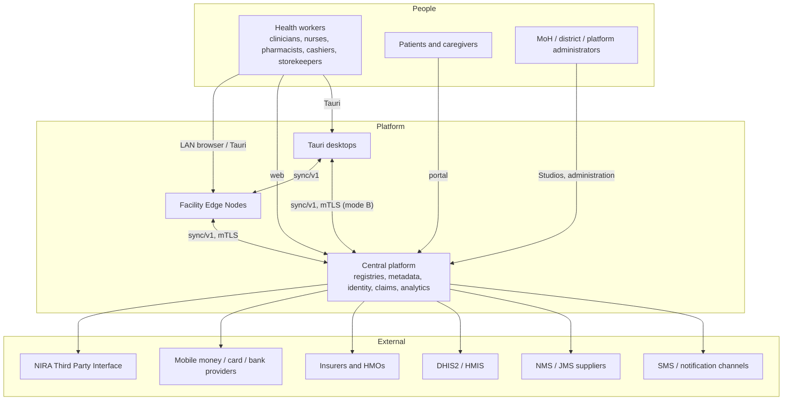

# Architecture overview

The entry point to the architecture. This page summarises the platform and links to the decision documents; each linked document is authoritative for its topic. Decisions were reached through the Wayfinder map [Wayfinder: FHIR R5 healthcare platform architecture](https://github.com/carapai/people-centered-healthcare/issues/1) and are recorded as ADRs (index below). The specification is `MASTER_PROMPT.md`; vocabulary is in [GLOSSARY.md](../../GLOSSARY.md).

## What the platform is

A FHIR R5–native, people-centred health platform for national deployment, with Uganda as the reference deployment. It runs:
- at **central** (national services, registries, analytics);
- on a **Facility Edge Node** per facility (LAN server that works without internet);
- on **Tauri desktops** (standalone for small facilities, or an offline fallback under an edge);
- in **browsers** (central web, or LAN clients of an edge).

One Rust codebase (Axum, Tokio, SurrealDB) runs on all nodes, and one React app serves every runtime.

## System context

All external integrations run at central; edges and desktops never call external systems directly ([billing-and-payments.md](billing-and-payments.md), [patient-identity.md](patient-identity.md)).

## Deployment modes

| Mode | Runtime | Facility Authority Node | Offline | Doc |
|---|---|---|---|---|
| A | Central online web | Central | No; server-confirmed writes only | [client-application.md](client-application.md) |
| B | Standalone Tauri desktop | That desktop | Yes | [desktop-client.md](desktop-client.md) |
| C | Facility Edge Node + LAN clients (+ optional Tauri) | The edge | Yes, LAN-wide | [facility-edge.md](facility-edge.md) |
| D | LAN browser / Tauri client of an edge | The edge | Browsers no; Tauri yes (fallback) | [lan-security.md](lan-security.md), [desktop-client.md](desktop-client.md) |

Topologies and trust boundaries: [deployment-topology.md](deployment-topology.md).

## Bounded Contexts

Thirteen Bounded Contexts, built as modules of a modular monolith (ADR 0001) and hosted by three Deployables: `central-server`, `facility-edge` and the Tauri desktop host ([resource-ownership.md](resource-ownership.md), [service-catalogue.md](service-catalogue.md)).

| Area | Decisions |
|---|---|
| Ownership, crates, layering | [resource-ownership.md](resource-ownership.md), [crate-catalogue.md](crate-catalogue.md), [dependency-rules.md](dependency-rules.md) |
| FHIR model, persistence, ids | [fhir-r5-model.md](fhir-r5-model.md), [persistence.md](persistence.md), [identifiers.md](identifiers.md) |
| Authority and sync | [write-authority.md](write-authority.md), [synchronization.md](synchronization.md) |
| Terminology, metadata, configuration | [terminology.md](terminology.md), [metadata.md](metadata.md), [configuration.md](configuration.md), [facility-configuration.md](facility-configuration.md) |
| Forms and programs | [questionnaire-extraction.md](questionnaire-extraction.md), [program-designer.md](program-designer.md) |
| Workflow | [workflow-engine.md](workflow-engine.md) |
| Patients | [patient-identity.md](patient-identity.md), [patient-portal.md](patient-portal.md), [care-journeys.md](care-journeys.md) |
| Health workers | [clinical-workspaces.md](clinical-workspaces.md) |
| Finance | [pricing-and-insurance.md](pricing-and-insurance.md), [billing-and-payments.md](billing-and-payments.md) |
| Supply chain | [inventory-and-procurement.md](inventory-and-procurement.md) |
| Edge, LAN, auth | [facility-edge.md](facility-edge.md), [lan-security.md](lan-security.md), [offline-auth.md](offline-auth.md), [backup-and-recovery.md](backup-and-recovery.md) |
| Clients | [client-application.md](client-application.md), [desktop-client.md](desktop-client.md) |
| Security | [security.md](security.md) |
| Operations | [deployment.md](deployment.md), [testing.md](testing.md) |

## Core principles, as decided

- **One Authority Node per record**, derived from scope; others write Candidate Versions (ADR 0012).
- **No universal last-write-wins**: whole-version conflict detection, Conflict Records, ledgers for stock and money (ADRs 0020, 0030, 0034).
- **Same code everywhere**: one Rust implementation of APIs, auth and workflow on central, edge and desktop (ADRs 0010, 0036, 0039).
- **Definitions are data**: forms, mappings, workflows, matching rules, prices and gates are versioned, published and pinned by the records that use them (ADRs 0024, 0025).
- **No clinical data in browser storage**, and confirmed writes only (ADR 0037).
- **No personal health data in telemetry** (ADR 0047).

## ADR index

| ADR | Decision |
|---|---|
| [0001](../adr/0001-modular-monolith-first.md) | Modular monolith first: central-server and facility-edge |
| [0002](../adr/0002-workflow-owns-tasks.md) | Workflow owns every Task; dependencies run one way |
| [0003](../adr/0003-metadata-owns-published-definitions.md) | Terminology & Metadata owns every Published Definition |
| [0004](../adr/0004-transactions-within-one-deployable.md) | Cross-module transactions only inside one Deployable |
| [0005](../adr/0005-six-layer-crate-stack.md) | Six-layer crate stack with a separate application layer |
| [0006](../adr/0006-pure-isolated-domain-crates.md) | Domain crates are pure, per-Module and never depend on each other |
| [0007](../adr/0007-embedded-single-process-edge-with-cold-spare.md) | Facility Edge is one process embedding SurrealDB, recovered by cold spare |
| [0008](../adr/0008-private-pki-name-constrained-facility-intermediate.md) | LAN TLS uses a private PKI with a name-constrained intermediate per facility |
| [0009](../adr/0009-device-bound-enrollment-on-the-lan.md) | Every LAN device is enrolled, and its key is the DPoP key for every token |
| [0010](../adr/0010-edge-is-always-the-local-authorization-server.md) | The edge is always the authorization server for LAN clients, built by the same Rust code as central |
| [0011](../adr/0011-expiring-signed-permission-snapshots.md) | Offline permissions are expiring, central-signed snapshots, and offline grants are narrow and provisional |
| [0012](../adr/0012-authority-node-follows-record-scope.md) | Each record has one Authority Node, derived from its scope and never switched implicitly |
| [0013](../adr/0013-uuidv7-ids-and-uuidv5-derived-ids.md) | Client-generated UUIDv7 resource ids; UUIDv5 for anything derived |
| [0014](../adr/0014-node-prefixed-local-sequences-for-human-readable-numbers.md) | Human-readable numbers come from node-prefixed local sequences, not reserved pools |
| [0015](../adr/0015-adopted-r5-model-crate-behind-a-facade.md) | FHIR R5 models come from an adopted crate behind our own facade; search and persistence are ours |
| [0016](../adr/0016-validate-on-the-writing-node-and-again-at-authority.md) | Resources are validated on the writing node and again at the Authority Node and central |
| [0017](../adr/0017-head-history-and-range-keyed-index-tables.md) | FHIR resources are stored as head and history tables per type, with array-keyed search index tables |
| [0018](../adr/0018-version-id-is-the-op-id.md) | `meta.versionId` is the op_id of the write, and our clients create with PUT |
| [0019](../adr/0019-own-sync-protocol-with-commit-ordered-cursors.md) | Sync uses its own protocol, with commit-ordered sequence cursors and a transactional outbox |
| [0020](../adr/0020-whole-version-conflicts-without-merge.md) | Conflicts are detected per whole resource version, and nothing is merged automatically |
| [0021](../adr/0021-content-addressed-blob-store-for-attachments.md) | Attachments live in a content-addressed blob store outside SurrealDB |
| [0022](../adr/0022-template-extraction-with-separate-mappings-re-derived-at-authority.md) | QuestionnaireResponses are extracted by SDC templates held in separate Extraction Mappings, and re-derived at authority |
| [0023](../adr/0023-managed-and-seed-extraction-targets.md) | Extracted resources are either managed by their form or seeded once, and each is written by its own Owner |
| [0024](../adr/0024-signed-fhir-npm-packages-with-pinned-manifests.md) | Published Definitions ship as signed, immutable FHIR NPM packages with pinned manifests |
| [0025](../adr/0025-publication-separate-from-scoped-activation.md) | Publishing a package never activates it; activation is a scoped, dated record, and rollback is re-activation |
| [0026](../adr/0026-overrides-only-at-declared-configuration-override-points.md) | District and facility overrides change configuration only, at override points their base package declares |
| [0027](../adr/0027-platform-client-registry-with-linked-golden-records.md) | The platform is the client registry; source Patients link to a central golden record, and nothing is merged by default |
| [0028](../adr/0028-layered-matching-from-published-rules.md) | Patient matching is layered (deterministic, blocking, Fellegi–Sunter) and driven by published Matching Rules |
| [0029](../adr/0029-assurance-gated-accounts-and-caregiver-access.md) | Accounts reach patient data only through a Person, at a verified assurance level, and caregivers only through RelatedPerson plus Consent |
| [0030](../adr/0030-double-entry-ledger-is-the-financial-source-of-truth.md) | An internal double-entry ledger is the financial source of truth; FHIR financial resources are projections and exchange formats |
| [0031](../adr/0031-staged-pricing-from-versioned-price-books.md) | Prices come from versioned Price Books through a fixed sequence of stages, evaluated wherever the charge is recorded |
| [0032](../adr/0032-provider-confirmed-two-phase-payments-via-central.md) | Non-cash payments are two-phase and confirmed only by provider evidence; provider integrations run only at central |
| [0033](../adr/0033-financial-gates-are-configuration-and-urgent-care-always-defers.md) | Payment steps are configured Financial Gates, and clinically urgent care always defers rather than blocks |
| [0034](../adr/0034-stock-movement-ledger-with-guarding-balance-records.md) | Stock is an append-only movement ledger per Stock Unit, and each Stock Unit's balance record guards concurrent issues |
| [0035](../adr/0035-stock-moves-on-fulfilment-with-reservations-and-fefo.md) | Stock moves only on fulfilment; preparation reserves stock, and FEFO with policy chooses the batch |
| [0036](../adr/0036-ports-over-swappable-transport-with-tauri-ipc-into-the-shared-router.md) | The one React app uses ports over a swappable transport, and Tauri IPC dispatches into the same Axum router in-process |
| [0037](../adr/0037-no-clinical-data-in-browser-or-webview-storage.md) | No browser or webview ever persists clinical data, and clinical writes are confirmed, never optimistic |
| [0038](../adr/0038-fhirpath-js-for-live-form-behaviour.md) | Live form behaviour uses fhirpath.js in the browser, and the server re-validates every submission |
| [0039](../adr/0039-one-desktop-binary-two-roles-with-rust-side-failover.md) | One desktop binary serves two roles, and a desktop under an edge fails over to local work inside Rust |
| [0040](../adr/0040-desktop-secrets-in-os-keystore-and-disk-encryption-check.md) | Desktop secrets live only in the OS keystore, and provisioning checks full-disk encryption |
| [0041](../adr/0041-desktop-platforms-signing-and-staged-updates.md) | v1 desktops target Windows and Ubuntu LTS, are signed through cloud HSMs, and update in stages from central |
| [0042](../adr/0042-engine-native-statecharts-with-plandefinition-as-import.md) | Workflows run as engine-native statecharts in our own Rust interpreter; PlanDefinition is an import source, never the runtime |
| [0043](../adr/0043-typed-actions-fhirpath-guards-and-a-bounded-workflow-principal.md) | Workflow actions are typed Rust registrations, guards are FHIRPath only, and system transitions run as a bounded workflow principal |
| [0044](../adr/0044-workflow-instances-history-and-timers-at-the-authority.md) | Workflow instances keep an append-only history, transitions commit with their actions, and timers fire only at the instance's authority |
| [0045](../adr/0045-pinned-least-privilege-ci-and-signed-or-failed-releases.md) | CI runs pinned, least-privilege workflows behind a merge queue, and a release is either fully signed with provenance or it fails |
| [0046](../adr/0046-central-recovery-by-hourly-export-and-warm-standby.md) | Central recovers from hourly exports to a warm standby, and edges re-push facility data after a central restore |
| [0047](../adr/0047-no-health-data-in-telemetry-and-in-country-observability.md) | Telemetry never carries personal health data, and the observability stack is self-hosted in-country |
| [0048](../adr/0048-mandatory-tpm-unlocked-full-disk-encryption-on-edges.md) | Facility Edge Nodes require full-disk encryption with TPM-only unlock, so they still restart unattended |
| [0049](../adr/0049-engine-native-definitions-as-profiled-library-and-plandefinition.md) | Engine-native Published Definitions are profiled Library resources, programs are profiled PlanDefinitions, and configuration stays JSON pinned by the manifest |
| [0050](../adr/0050-fhir-r5-is-the-adopted-model-crate.md) | `fhir-r5` is the adopted R5 model crate, pinned exactly and guarded by a corpus round-trip in CI |

## Still open

The map's "Not yet specified" section lists what is deliberately undecided (legal and regulatory review, national PKI and identity governance, CQL for decision support, Studio and workspace UX, analytics and DHIS2 integration, communications, R4 adapters and the integration catalogue, FHIR `Device` ownership, hot standby edges). Validation spikes that gate implementation are listed in [docs/planning/current-state.md](../planning/current-state.md).
