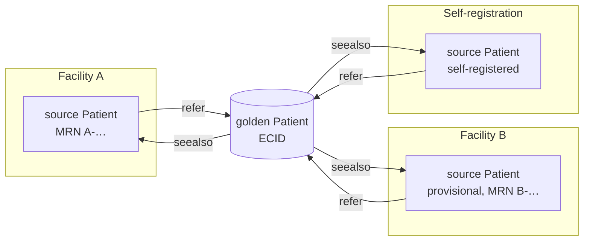
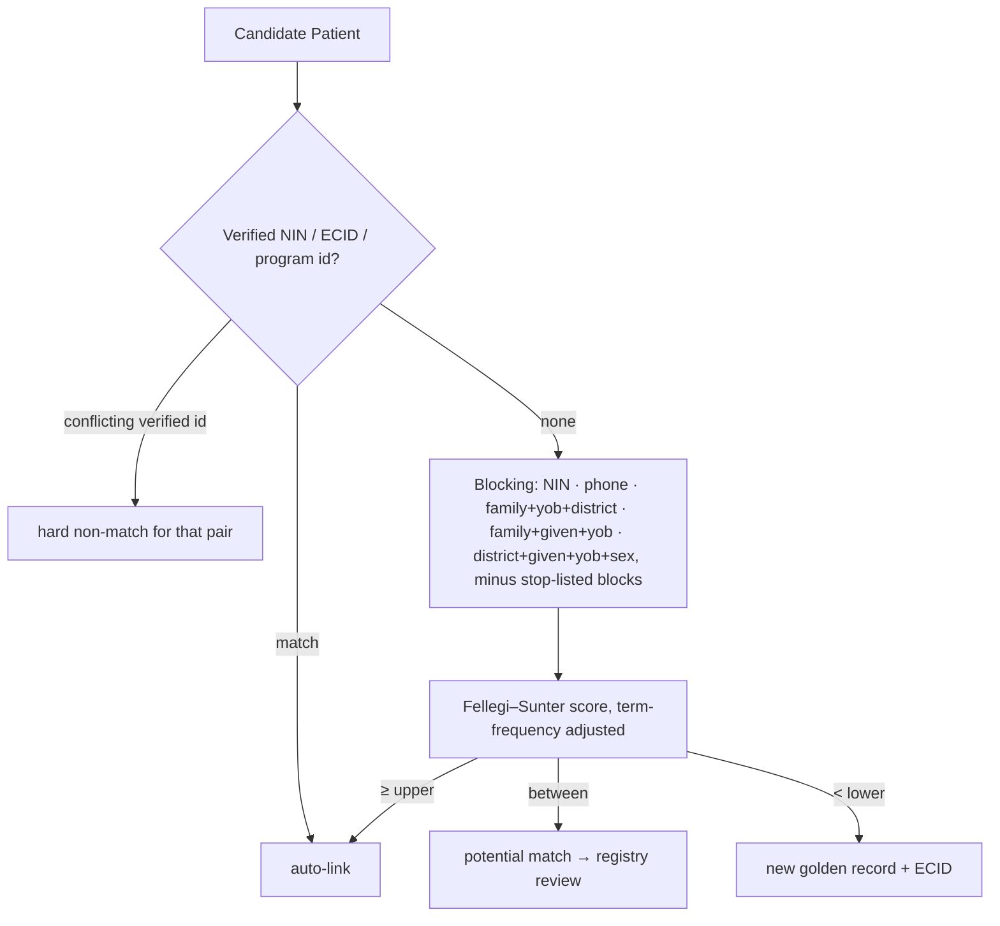
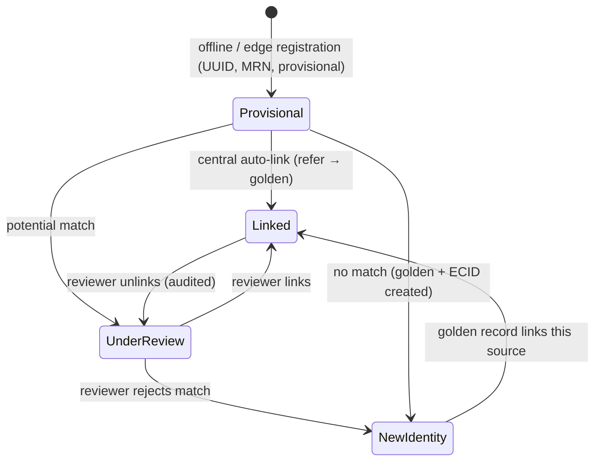
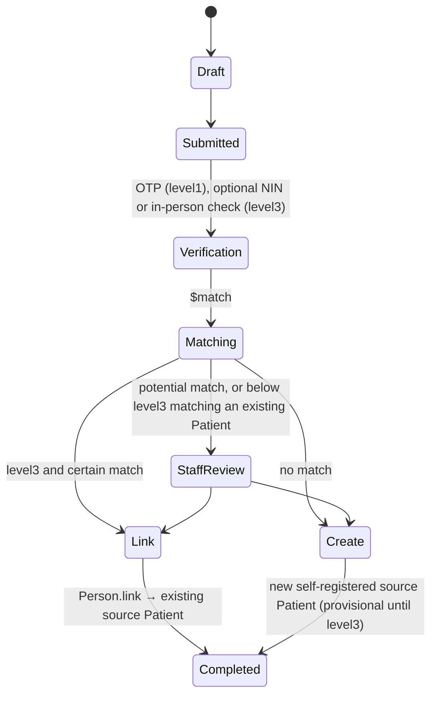

# Patient identity: registry, matching, self-registration and caregivers

Status: **accepted** (ADRs 0027, 0028, 0029). Produced while resolving the Wayfinder ticket [How do patient matching, self-registration and caregiver delegation work?](https://github.com/carapai/people-centered-healthcare/issues/26). Background: [docs/research/patient-identity.md](../research/patient-identity.md). Spec: MASTER_PROMPT §57–62, §87. Related decisions:
- Patient authority: [write-authority.md](write-authority.md);
- the ECID and MRNs: [identifiers.md](identifiers.md);
- provisional states on the wire: [synchronization.md](synchronization.md);
- authorization and confidentiality labels: [offline-auth.md](offline-auth.md).

## Registry stance

- **The platform is the client registry for v1.** `client-registry` runs at central and exposes:
  - FHIR `Patient`, `Person` and `RelatedPerson`, plus `Patient/$match`;
  - IHE **PDQm** (query) and **PIXm** (cross-reference) as a server;
  - **PMIR** as the feed for external systems.
- **Federation port.** If MoH mandates an external national registry, an adapter makes us its PMIR/PIXm/PDQm client without changing facilities.
- **Governance stays in the map's fog:** who governs health IDs, and NIRA access.

## Golden record model (ADR 0027)

- **Source Patients.**
  - Every registration is a source Patient with its own id.
  - Clinical records always reference the source Patient.
  - Every Patient has central as its Authority Node, so facility demographic edits are Candidate Versions (write-authority.md).
- **The golden Patient.**
  - It is created and owned only by `client-registry` at central, and it carries the ECID.
  - Search, the Care Journey and the shared record go through it, so linked sources appear as one person.
  - Each node receives golden records only for patients who have records in its Sync Scope.
- **Survivorship** of golden-record field values:

  | Trust | Source of the value |
  |---|---|
  | 1 (highest) | NIRA-verified |
  | 2 | Staff-verified in person against an ID document |
  | 3 | Staff-entered |
  | 4 | Self-reported |

  - The most recent value wins within a level.
  - A lower-trust value never overwrites a higher-trust one; a conflicting update opens a review item (§62).
  - Each field records its origin with Provenance.
- **Link, merge, unlink:**

  | Action | When | Effect |
  |---|---|---|
  | Link | Auto-link or reviewer decision | Source `refer` → golden; golden `seealso` → source |
  | Unlink | Reviewer decision (audited) | Splits the golden record; an adjudication marker stops later automatic runs from re-linking the pair |
  | Merge (`$merge`) | Two source records **from the same facility** are the same person; human approval after preview | Source `replaced-by` → target, `active=false`; references are never rewritten |

### In code

- **`health-client-registry`** (domain): survivorship, the golden record with link, unlink and adjudication markers, merge planning, and the ECID.
- **`health-registries-app`** (application): the link, unlink and `$merge` use cases over the store, with the FHIR mapping. Each use case runs in one transaction and audits every version it writes.
- **Not yet:**
  - Provenance per surviving value is [#196](https://github.com/carapai/people-centered-healthcare/issues/196). For now each value's origin is an extension on the golden Patient.
- **HTTP operations** (#197): `FhirServer::with_client_registry` serves, for reviewers:
  - **The operations:** `POST /Patient/$merge` (`source-patient`, `target-patient`, `preview`), `POST /Patient/{id}/$link` (`golden`, optional) and `POST /Patient/{id}/$unlink`.
  - **Who may use them:** the reviewer is the request's subject, from the verified token. Their roles must map to `registry.review` and `Patient` update.
  - **Merges:** a merge is previewed, then approved by that reviewer. It is for records of the reviewer's own facility only (403): the session's facility code is the managing Organization's id or one of its identifiers. Records of two facilities are refused (422).
  - **Audit and review:** every version written is audited in its transaction, naming the reviewer, and a link's survivorship disagreements go to the review queue.
  - Central serves them when `HEALTH_REGISTRY_NIN_SYSTEM` is set.
- **ECID:** 11 random characters plus the check character.
- **Matching** (#69): `health_client_registry::matching` holds the rules, the deterministic layer, the five blocking keys with the stop-list plan, and Fellegi–Sunter scoring with grades. Double Metaphone comes from `rphonetic`, through a port.
  - The CI corruption benchmark gives blocking recall 99.85%, candidate sets at most 97, and auto-link precision 100% on 60,000 synthetic people.
  - **Storage and `$match`** (#199): `idx_block` rows are written in each source Patient's write transaction (`SurrealStore::with_blocking` with `RegistryBlocking`). `block_count` is recomputed in the background. `Matcher::find` and `bundle` answer `$match` with scores, `match-grade`, and the insufficient-data outcome.
  - **Still to come:** serving `Patient/$match` over HTTP ([#216](https://github.com/carapai/people-centered-healthcare/issues/216)), and loading the rules from the configuration package. The 45M load test is [#200](https://github.com/carapai/people-centered-healthcare/issues/200).
- **Review queue** (#70): `RegistryReview` matches each registration.
  - It auto-links certain and probable matches, queues possible ones, and creates new identities. It skips every golden record that carries an adjudication marker for the source, so a separated pair is never re-linked automatically.
  - Reviewers' decisions run in one transaction and are audited. Items pending more than 7 days are listed as overdue.
  - Storage: the `registry_review` table, owned by the client registry.
  - The screen is [#203](https://github.com/carapai/people-centered-healthcare/issues/203).

## Matching (ADR 0028)

- **Matching Rules.** The rules are a versioned Published Definition, owned by metadata and published through the normal lifecycle (configuration.md). They cover:
  - fields as FHIRPath;
  - comparators: exact, Jaro-Winkler, Damerau-Levenshtein, phonetic;
  - m/u values;
  - null handling: conservative, moderate or greedy;
  - blocking keys;
  - auto-link and potential thresholds.
- **Calibration.** m/u values are calibrated offline with Splink EM on de-identified data, then exported into the rules. Reviewer decisions feed precision and recall reports.
- **Launch thresholds.** Auto-link happens only on a deterministic verified-identifier match, or a score above a threshold set to measured precision ≥ 99.9%. Relaxing thresholds requires a new rules version.
- **Phone numbers** get a low weight and term-frequency adjustment, because family members share phones.
- **API.** `Patient/$match` returns `search.score` and the `match-grade` extension.
- **Candidate generation.**
  - Blocking keys and phonetic codes are written to SurrealDB array-keyed tables `idx_block:[key_type, key_value, patient_uuid]` in the Patient's write transaction (ADR 0017).
  - **Scale.** The reduced-scale spike [Can SurrealDB blocking indexes serve patient matching at 45M-person scale?](https://github.com/carapai/people-centered-healthcare/issues/37) used SurrealDB 3.3.5.
    - Range-scan cost follows the block size, not the table size (about 4 µs per row).
    - The storage design holds, and the tantivy fallback is **not** needed for exact-key candidate generation.
    - The base key set is too broad: 99% of queries exceed 2,000 candidates at 45M, mostly because of district + given initial.
    - **Default keys (ADR 0055):**
      - `nin` and `phone`;
      - `fam_yob_dist`;
      - `fam_given_yob`, with the phonetic codes sorted and birth year ±1, or ±5 when the birth date is estimated;
      - `dist_given_yob_sex`.
    - **Stop-list.** Block counts are recomputed hourly into `block_count`, and blocks over `max_block` (1,000) are skipped.
    - **Too little data.** If every key is absent or skipped, `$match` returns an OperationOutcome and the clerk falls back to manual search.
    - **Blocking recall** must be ≥ 99% on a CI corruption benchmark, and is measured on NIN-verified real pairs before launch.
    - Latency at 45M on central hardware, under concurrent load, is an acceptance criterion of the matching task.

### "Did you mean" at registration

1. **Online:** the edge first calls central's `$match`, with a 3 s timeout.
2. **Offline or timed out:** the same engine runs against the edge's **own local scope**, i.e. patients who already have records at the facility. The edge holds no extra regional cache purely for matching.
3. **The clerk** picks a candidate or registers a new patient. If `$match` reports too little identifying data (ADR 0055), the clerk searches the registry manually by name, birth year, and village or parish first.

## Provisional registration and reconciliation

- **Offline creation.** An edge or desktop creates a source Patient with a client UUID, a facility MRN (node-prefixed sequence, ADR 0014) and `provisional: true`. No ECID is minted offline.
- **Matching at central.** When central accepts the Patient, it runs `$match`, and the result syncs down.
- **While under review,** the Patient stays provisional and **fully usable for care**.
- **Review queue.** Registry staff work potential matches at central, with an ageing alert after 7 days.

## Identity verification

- **NIN checks.**
  - NIN verification runs **only at central**, asynchronously, through the NIRA Third Party Interface in its consent-based YES/NO mode.
  - Edges never call NIRA.
  - A NIN is never required for registration or care.
- **Recording.** Each outcome is a FHIR **VerificationResult** owned by `client-registry`. It targets the Patient's identifier and records the method, the assurance level and Provenance.

## The five separate concepts (§58; ADR 0029)

| # | Concept | Record | Owner |
|---|---|---|---|
| 1 | Authentication account | Login Account, one per verified phone number | identity |
| 2 | Registration request | Registration Request: a patient-reported QuestionnaireResponse plus §59 state, projected as a Task | patient-engagement |
| 3 | Identity verification | VerificationResult, plus assurance level | client-registry |
| 4 | Patient | Source and golden Patients | client-registry |
| 5 | Caregiver relationship | RelatedPerson, plus Consent | client-registry, consent |

- **Account to Person.** Each Login Account maps to one `Person`. `Person.link` points to the holder's own Patient and to the RelatedPersons the holder may act as, each with an assurance level:
  - `level1`: phone one-time code;
  - `level3`: a NIRA NIN check, or an in-person check of an ID document at a facility.
- **No automatic linking.** A phone account is never linked to an existing Patient automatically.
- **Shared family phone.** One account; other family members are reached through caregiver links.
- **Person links are sensitive.** The policy decision point filters Person links by confidentiality, because a link can itself disclose a sensitive association.

## Self-registration (§59)

- **Below `level3`,** the account sees only what the patient submitted themselves.
- **Released clinical records** require `level3` and a link to a Patient.

## Caregiver delegation

- **Three requirements:** a `RelatedPerson` for the dependent, a **Consent** and verification.
  - **Consent contents:** scope (view records, book appointments, request refills, receive messages) and an expiry date.
  - **Verified by** facility staff checking documents. Mother–newborn links recorded at a facility delivery are `level3` automatically, which also covers multiple births.
- **Minors.** A guardian has access up to a configurable age of majority (default 18).
- **Adolescent confidentiality.** From a configurable age (default 12), records with sensitive labels (HIV, SRH, mental health) are excluded from guardian access unless the adolescent consents.
- **Revocation.** Access can be revoked by the patient once of age, by a guardian with authority, or by staff. Revocation takes effect at the next sync.
- **Enforcement.** The policy decision point evaluates Person links, Consent scope, assurance level and confidentiality labels together (ADR 0011).

## Patient-initiated workflows and patient-reported data (§60, §62)

- **Requests are proposals.** A patient request never becomes an order by itself:

  | Request | Created as |
  |---|---|
  | Lab or care request | `ServiceRequest`, `intent=proposal` |
  | Medication refill | `MedicationRequest`, `intent=proposal` |
  | Appointment | `Appointment`, `status=proposed` |
  | Anything else | `Task` |

  A clinician or staff member turns a proposal into an order or a booking.
- **Patient-reported forms** are QuestionnaireResponses owned by patient-engagement.
  - Their extraction targets are always `seed` (questionnaire-extraction.md), tagged `patient-reported`, with `verificationStatus=unconfirmed` where the type has one.
  - They never overwrite clinician-verified records. A conflict goes to the "to reconcile" list at the next encounter.
- **Demographic updates** from patients are self-reported Candidate Versions, reviewed by the registry under survivorship rules.
