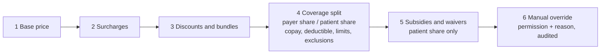

# Pricing and insurance

Status: **accepted** (ADRs 0030, 0031). Produced while resolving the Wayfinder ticket [How do pricing, coverage, billing, payments and the ledger fit together?](https://github.com/carapai/people-centered-healthcare/issues/27). Background: [docs/research/health-financing.md](../research/health-financing.md). Spec: MASTER_PROMPT §63–67, §69. The ledger, charges and payments are in [billing-and-payments.md](billing-and-payments.md).

## Records

| Record | Owner | Authority | FHIR representation |
|---|---|---|---|
| Healthcare Service | service-catalogue | central | HealthcareService (independent of price, §65) |
| Price Book (versioned) | pricing | central | Profiled ChargeItemDefinition per entry |
| Price Rule | pricing | central | Profiled ChargeItemDefinition `propertyGroup` with `applicability` FHIRPath, plus a priority extension |
| Payer, payer contract | coverage | central | Organization, Contract |
| Benefit Plan (copay, deductible, limits, exclusions) | coverage | central | InsurancePlan |
| Coverage | coverage | central (the payer confirms) | Coverage, with `order` for primary and secondary |
| Eligibility | coverage | central | CoverageEligibilityRequest/Response |
| Preauthorization, claim | coverage | central | Claim (`use = preauthorization \| claim`), ClaimResponse, ExplanationOfBenefit |
| Accumulators (deductible and limit consumption) | coverage | central | Internal; projected into ExplanationOfBenefit |

- **Price Books and rules:**
  - effective-dated, and immutable once approved by **one finance approver** at central;
  - facility finance staff edit their own facility's books at central, so prices cannot be changed offline;
  - they are **not** configuration packages: they sync down as signed global records in the metadata lane, like other global replicas.
- **Local profiles.** Every financial profile is pinned locally (ADR 0030).

## Pricing context

Each Price Rule's FHIRPath applicability is evaluated against a pricing context built for each ChargeItem:
- the ChargeItem: code, quantity, service time;
- the Encounter: class, service point, department, triage category, after-hours flag;
- the program (EpisodeOfCare type);
- the ordered Coverages and their Benefit Plans;
- patient-eligibility categories, e.g. an exemption category, age band or refugee status. These come from configuration, never hardcoded.

## Precedence (§64; ADR 0031)

**Base price.** It is taken from the most specific Price Book that contains the item:

```text
payer contract → program → department → facility → organization → tenant
```

**Adjustments** run in fixed stages. Within a stage, priority decides. Two rules with the same priority that could both apply are rejected when rules are validated.



- **Bundles** (e.g. an ANC package) price a set of items together. Items inside a bundle carry zero-priced components that reference the bundle line.
- **Quantity tiers** apply within the stage-1 base price.
- **Secondary coverage** applies at stage 4 to the remainder after primary coverage.
- **Multi-currency.** Prices are in the facility ledger's functional currency. A Price Book in another currency is converted at the configured rate table at charge time, and the rate is recorded.

## Where pricing runs

- **Where:** on the node where the charge is recorded (edge, central, or a leased desktop), using the replicated Price Books and rules and the cached Coverage and Benefit Plans.
- **What is recorded.** Every ChargeItem stores:
  - its price components (`base`, `surcharge`, `discount`, `deduction`, `tax`, `informational`);
  - the Price Book version;
  - the ids and versions of every rule applied;
  - the coverage split.
- **Check at authority.** The Authority Node checks that every recorded version was active at the service time. A mismatch becomes a Reconciliation Record, never a silent re-price.

## Accumulators

- **Kept at central.** Deductible and limit counters are kept per Coverage across facilities.
- **Offline.** A facility uses its last cached accumulator snapshot and marks the stage-4 split as an **estimate**.
- **Correction.** At claim time, central recomputes the split. A difference becomes a Reconciliation Record, and patient-share corrections become adjustment postings.

## Eligibility, preauthorization and claims

```mermaid
sequenceDiagram
  participant E as Facility (edge)
  participant C as Central coverage
  participant P as Payer adapter
  E->>C: eligibility request (when online)
  C->>P: CoverageEligibilityRequest / payer format
  P-->>C: response
  C-->>E: CoverageEligibilityResponse (cached with age)
  Note over E: offline → last cached response, status "pending verification"
  E->>C: charges sync up (ledger ops)
  C->>C: assemble Claim per Account and payer
  C->>P: submit (FHIR Claim or export format)
  P-->>C: ClaimResponse / remittance
  C->>C: ExplanationOfBenefit; PaymentReconciliation → ledger postings
  C-->>E: claim status and adjustments sync down
```

- **Payer adapters.** The payer port is defined in the `coverage` domain crate (dependency-rules.md: driven ports belong to the Module), and there is one adapter per payer in `health-integration`. It uses FHIR Claim where the payer supports it, and an export format or portal file otherwise. No national payer or claim format is assumed; Uganda's NHIS is not in force.
- **Preauthorization** is a Claim with `use=preauthorization`. A financial gate can require an approved preauthorization (billing-and-payments.md).
- **Denials** are a ClaimResponse outcome. **Appeals** are resubmissions referencing the original.
- **Government and donor funding** are funding sources with their own "payer" records. Their claims are reports or exports, not payer adjudication.
