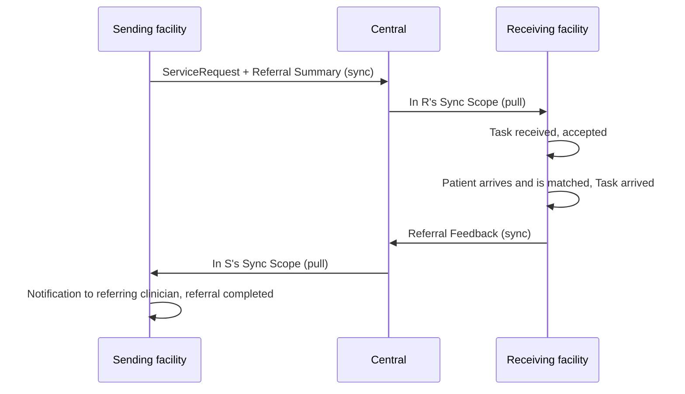

# Referrals

Sending a patient to another facility, and getting the answer back. Decided in [How do referrals work between facilities, including feedback and offline?](https://github.com/carapai/people-centered-healthcare/issues/624) ([ADR 0077](../adr/0077-referrals-carry-a-summary-into-the-receivers-sync-scope-and-close-with-feedback.md)). The facts are in the research note on branch `research/clinical-operations`.

## Terms

- **Referral:** a request that another facility take over or add to a patient's care. A Back-referral down a level is also a Referral.
- **Referral Summary:** the sender's signed snapshot, the top half of HMIS 032.
- **Referral Feedback:** the receiver's reply, the bottom half of HMIS 032.

Sending a patient to another department in the same facility is an order or a queue transfer, not a Referral.

## Resources and owners

| Resource | Owner (Authority Node) | Holds |
|---|---|---|
| `ServiceRequest` (category referral) | Sending facility | Patient, receiving facility, optional Healthcare Service or clinician, priority, reason, transport mode, referral number |
| `Composition` Referral Summary | Sending facility | History, investigations, diagnosis, treatment given, reason; signed |
| `Task` | Receiving facility | Status: `received`, `accepted` or `declined` (with reason), `arrived`, `completed` |
| `Composition` Referral Feedback | Receiving facility | Arrival and discharge dates, findings, diagnosis, treatment, what to continue, whether the referral was appropriate |

Neither facility edits the other's resources (ADR 0012).

## Flow

Each step works offline at its own facility and syncs when the link returns.

## Sending

1. The clinician picks the destination from the facility registry, filtered by Healthcare Service. The next tier in the catchment is suggested first, but any facility can be chosen.
2. They choose a priority (routine, urgent, emergency) and a transport mode (ambulance, private, own).
3. They review and sign the Referral Summary, which is prefilled from the record.
4. If the destination is not on the platform, a referral note with the HMIS 032 layout is printed, with a QR code of the referral number.

## Receiving

- **Sync Scope:** a facility's scope includes every referral addressed to it, with its Referral Summary, so it is on the edge offline ([synchronization.md](synchronization.md)).
- **Incoming list:** referrals by priority and expected arrival. Urgent and emergency referrals raise an immediate Notification.
- **Access:** while the referral is open, and for 90 days after it closes, the receiving facility may read the shared record through central. A patient's recorded objection blocks this read but not the summary. Confidential categories keep their own rules.
- **Arrival:** the patient is matched from the incoming list, by referral number, or by scanning the QR code. Matching links the patient and marks the Task `arrived`.
- **Without a note:**
  - A patient who self-refers is recorded as a self-referral.
  - A patient referred by a VHT or community provider is recorded with that source.
  - A patient referred by a facility that is not on the platform is recorded with free-text "referred in from".

## Feedback and closing

- The receiver records Referral Feedback at discharge or after the consultation. It syncs back, notifies the referring clinician and completes the referral.
- The sender can record a returned paper note as Referral Feedback.
- **Open referrals:** the sender's list of referrals with no feedback after 14 days (a setting), which also gives the return rate.

## Reporting

- **Referrals out:** counted from the sender's `ServiceRequest`s.
- **Referrals in:** counted from arrivals, whether matched, self-reported with a note, or from a VHT or community source.
- Both feed HMIS 105 (OR01 and OR02, and the ANC and maternity rows) and HMIS 108 item 2, through package Indicators ([analytics.md](analytics.md)).

## Not in v1

- Ambulance dispatch: the 912 number, call and dispatch centres, KDETS.
- Referrals sent by VHTs from an app.
- Exchange with outside e-referral systems.
