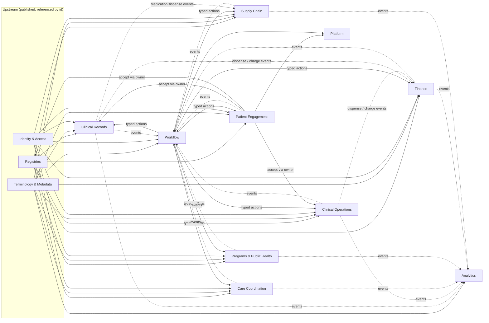

# Resource ownership

Status: **accepted** (ADRs 0001–0004) — produced while resolving the Wayfinder ticket [Which bounded context owns each resource, and which deployables ship first?](https://github.com/carapai/people-centered-healthcare/issues/13).

This document names the single **Owner** (a Module inside a Bounded Context) of every authoritative resource and transaction. Write authority per runtime (central / edge / desktop), sync direction and conflict policy are decided separately in [Who holds write authority for each resource at central, edge and desktop?](https://github.com/carapai/people-centered-healthcare/issues/21) and will extend this table.

## Rules

1. Every resource instance has exactly one Owner. Only the Owner's rules create or change it.
2. Ownership is declared per **resource type + profile/category** where a type is produced by several domains (e.g. Observation).
3. Ordering side owns the request; performing side owns what it produces.
4. Workflow owns every FHIR Task and RequestOrchestration. Workflow calls domains through typed registered actions; domains never call Workflow, they emit events.
5. Terminology & Metadata owns every **Published Definition**. Other contexts use pinned published versions and own only runtime records.
6. Patient-originated Records belong to Patient Engagement until staff accept them through the owning clinical context.
7. Provenance is owned by the Owner of its target and written in the same transaction. AuditEvent is owned by Audit; every context emits audit events, only Audit writes them.
8. Read Models own nothing and are rebuilt from events.
9. Within one Deployable, one application-layer transaction may span several Owners, each writing only through its own repository. Across Deployables, contexts integrate by events and sagas.

## Bounded contexts and modules

| Bounded Context | Modules |
|---|---|
| Registries | client-registry, facility-registry, workforce-registry, location-registry, product-registry, service-catalogue |
| Terminology & Metadata | terminology, metadata, configuration |
| Clinical Records | encounters, clinical-data, orders, medications, clinical-documentation, shared-record (Read Model) |
| Clinical Operations | laboratory, imaging, immunization, scheduling, patient-flow |
| Care Coordination | referrals, care-plans |
| Programs & Public Health | programs, surveillance, population |
| Finance | pricing, coverage, billing, payments, financial-ledger |
| Supply Chain | inventory, procurement |
| Identity & Access | identity, consent, audit |
| Workflow | workflow, decision-support, worklists (Read Model) |
| Patient Engagement | patient-access, patient-requests, patient-engagement, care-journeys (Read Model) |
| Analytics | analytics, reporting |
| Platform | communications, administration |

## Context map

Solid arrows: synchronous dependency (caller → callee). Dotted arrows: domain events (publisher → subscriber).

## Ownership matrix

### Registries

| Resource / record | Owner | Notes |
|---|---|---|
| Patient | client-registry | Includes provisional registrations from edge/desktop and links to golden record |
| Person | client-registry | Bridges a Login Account to Patient(s) after verification |
| RelatedPerson | client-registry | Caregiver ↔ dependent relationship; access additionally needs a Consent |
| Organization | facility-registry | Facilities, departments, payers, suppliers, donors as organisational identities |
| Location (facility-internal: wards, rooms, beds, stores) | facility-registry | |
| Location (administrative areas, catchments) | location-registry | |
| Practitioner, PractitionerRole | workforce-registry | |
| Medication, MedicationKnowledge, DeviceDefinition, InventoryItem (as product master), vaccine definitions | product-registry | Product identity only, never quantities |
| HealthcareService | service-catalogue | Independent of price |
| Endpoint | facility-registry | |

### Terminology & Metadata

| Resource / record | Owner |
|---|---|
| CodeSystem, ValueSet, ConceptMap, NamingSystem | terminology |
| StructureDefinition, SearchParameter, ImplementationGuide, CapabilityStatement | metadata |
| Questionnaire | metadata |
| PlanDefinition, ActivityDefinition, Library, Measure (as Published Definitions) | metadata |
| Program definitions, workflow definitions, extraction mappings, form layouts | metadata |
| Configuration packages, facility overrides, publication lifecycle records | configuration |

### Clinical Records

| Resource / record | Owner | Notes |
|---|---|---|
| Encounter | encounters | Real clinical status and locations only; queues live in patient-flow |
| Observation (vital signs, exam, social history, survey and other non-lab/non-imaging) | clinical-data | |
| Condition, AllergyIntolerance, Procedure, FamilyMemberHistory, ClinicalImpression, RiskAssessment, Flag | clinical-data | |
| ServiceRequest (laboratory, imaging, procedure orders) | orders | Ordering side owns the request |
| NutritionOrder, DeviceRequest | orders | |
| MedicationRequest, MedicationStatement | medications | Prescribing is the ordering side for medication |
| MedicationDispense, MedicationAdministration | medications | Stock movement is posted by Supply Chain on the dispense event |
| QuestionnaireResponse (staff-captured) | clinical-documentation | |
| Composition, DocumentReference | clinical-documentation | Signing and amendment |
| Longitudinal patient summary | shared-record | Read Model |

### Clinical Operations

| Resource / record | Owner |
|---|---|
| Specimen | laboratory |
| DiagnosticReport (category laboratory) | laboratory |
| Observation (category laboratory) | laboratory |
| ImagingStudy, DiagnosticReport (category imaging), Observation (category imaging) | imaging |
| Immunization, ImmunizationRecommendation, ImmunizationEvaluation | immunization |
| Appointment, AppointmentResponse, Schedule, Slot | scheduling |
| Queue Entries, room/bed placement, waiting state | patient-flow |

### Care Coordination

| Resource / record | Owner |
|---|---|
| ServiceRequest (category referral) | referrals |
| CarePlan, Goal, CareTeam | care-plans |

### Programs & Public Health

| Resource / record | Owner |
|---|---|
| EpisodeOfCare (program enrolment) | programs |
| Program enrolment state, program outcomes | programs |
| Case notifications | surveillance |
| Catchment populations, targets | population |

### Finance

| Resource / record | Owner |
|---|---|
| ChargeItemDefinition, price books, pricing rules | pricing |
| Coverage, CoverageEligibilityRequest/Response, Claim, ClaimResponse, ExplanationOfBenefit | coverage |
| Account, ChargeItem, Invoice | billing |
| PaymentNotice, PaymentReconciliation, payment records | payments |
| Ledger entries | financial-ledger |

### Supply Chain

| Resource / record | Owner |
|---|---|
| Stock ledger movements, batches held, reservations, stock counts | inventory |
| InventoryReport, SupplyDelivery (exchange) | inventory |
| Supplier terms, requisitions, quotations, purchase orders, goods received, supplier invoices, SupplyRequest | procurement |

### Identity & Access

| Resource / record | Owner |
|---|---|
| Login Accounts, staff identities, roles, permission snapshots | identity |
| Enrolled devices and Facility Edge Node identities | identity |
| Consent | consent |
| AuditEvent | audit |

### Workflow

| Resource / record | Owner |
|---|---|
| Workflow instances, state history, timers | workflow |
| Task, RequestOrchestration | workflow |
| GuidanceResponse, DetectedIssue | decision-support |
| Worklists, clinical inbox | worklists (Read Model) |

### Patient Engagement

| Resource / record | Owner |
|---|---|
| Registration requests, identity verification records | patient-requests |
| Care requests, refill requests, appointment requests | patient-requests |
| QuestionnaireResponse (patient-reported) | patient-engagement |
| Secure-message threads, feedback | patient-engagement |
| Portal access grants and preferences | patient-access |
| Care Journey | care-journeys (Read Model) |

### Analytics

| Resource / record | Owner |
|---|---|
| Group (cohorts), indicator values, MeasureReport, reporting datasets | analytics |
| Report schedules and exports (e.g. DHIS2 submissions) | reporting |

### Platform

| Resource / record | Owner |
|---|---|
| Communication, CommunicationRequest, delivery records | communications |
| Tenants, platform settings | administration |

### Cross-cutting

| Resource / record | Owner |
|---|---|
| Provenance | Owner of its target resource |
| Binary / attachments | Owner of the referencing resource |

FHIR `Device` for medical equipment instances is not yet assigned (see the map's Not yet specified).

## Deployables

| Deployable | Hosts | Notes |
|---|---|---|
| `central-server` | All Bounded Contexts as modules, with the gateway | Modular monolith; contexts are extracted into the spec's `apps/server/*` Deployables only when a real need arises |
| `facility-edge` | Clinical Records, Clinical Operations, Care Coordination, Programs & Public Health, Finance, Supply Chain, Workflow, Patient Engagement, Identity & Access; read-only replicas of Registries and Terminology & Metadata | Analytics and external integrations stay central |
| Tauri desktop host | Desktop subset decided in [What can a standalone Tauri client do offline, and how is it packaged?](https://github.com/carapai/people-centered-healthcare/issues/30) | |
