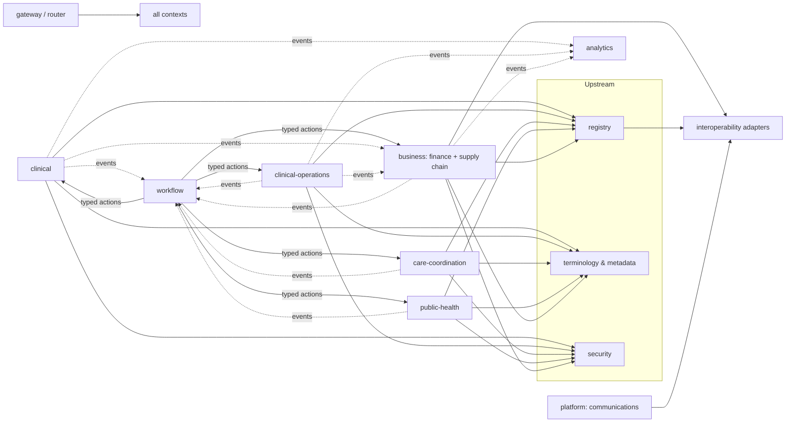

# Service catalogue

This page maps the spec's service layout (MASTER_PROMPT §13, `apps/server/*`) onto the decided Deployables, and records what each service depends on. ADR 0001 (modular monolith first) makes every service a **module of `central-server`** until a real need justifies extracting it. Ownership is in [resource-ownership.md](resource-ownership.md), and crates are in [crate-catalogue.md](crate-catalogue.md).

## Deployables

| Deployable | Runs | Hosts | Process model |
|---|---|---|---|
| `central-server` | Central (Linux x64 OCI) | All 13 Bounded Contexts and the gateway | One process; separate SurrealDB server (persistence.md) |
| `facility-edge` | Each facility (Windows / Ubuntu OS service) | Operational contexts; read-only Registries and Terminology & Metadata replicas | One process with embedded SurrealDB (ADR 0007) |
| Tauri desktop host | Facility PCs | The same application crates as the edge, without LAN serving | Tauri core process (ADR 0039) |

## Spec services → Bounded Contexts

| Spec service (`apps/server/…`) | Bounded Context(s) | On the edge? | Notes |
|---|---|---|---|
| `gateway` | — (HTTP entry, auth, routing) | The edge's own Axum router plays this role | OIDC/SMART authorization server is `health-identity` + `health-auth` (ADR 0010) |
| `registry-service` | Registries | Read-only replica | Client registry and matching run at central only (ADR 0027) |
| `terminology-service` | Terminology & Metadata | Read-only replica, plus the local terminology service | Authoring and publication only at central (ADR 0025) |
| `clinical-service` | Clinical Records | Yes (authority) | |
| `clinical-operations-service` | Clinical Operations | Yes | |
| `care-coordination-service` | Care Coordination | Yes | Referrals across facilities go through central |
| `public-health-service` | Programs & Public Health | Yes (programs); surveillance central | |
| `business-service` | Finance, Supply Chain | Yes (ledgers authoritative per facility) | Claims, accumulators and procurement at central |
| `interoperability-service` | `health-integration` adapters | No | Payers, mobile money, NIRA, suppliers, DHIS2: central only |
| `security-service` | Identity & Access | Yes (local authorization server, audit) | Central is the identity provider of record |
| `workflow-service` | Workflow | Yes | Timers fire at the instance's authority (ADR 0044) |
| `analytics-service` | Analytics | No | |
| `platform-service` | Platform | Partly (communications queue) | Sending happens at central |
| `facility-edge` | — | — | The edge Deployable itself |
| (not in §13) | Patient Engagement | No (portal is central) | Patient requests reach facilities through the owning context |

## Service dependency map

Solid arrows are synchronous calls inside one Deployable (ADR 0004). Dotted arrows are domain events through the outbox (dependency-rules.md).

## Extraction criteria

A context becomes its own Deployable only when there is a measured need, such as independent scaling, a separate security boundary or a separate release cadence. Extraction turns its cross-context transactions into sagas (ADR 0004 consequences), and it needs an ADR.
