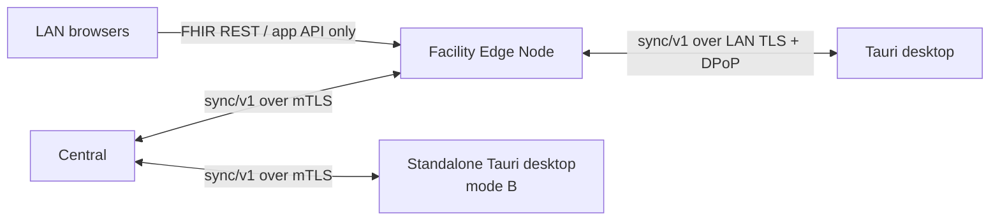
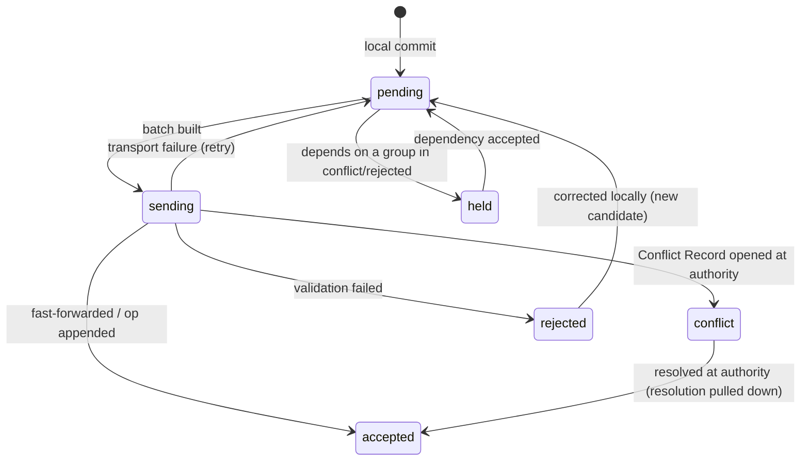

# Synchronization: protocol and per-class conflict policy

Status: **accepted** (ADRs 0019, 0020, 0021). Produced while resolving the Wayfinder ticket [What is the sync protocol and per-resource conflict policy?](https://github.com/carapai/people-centered-healthcare/issues/22). Background: [docs/research/synchronization.md](../research/synchronization.md). Related decisions:
- who accepts what is in [write-authority.md](write-authority.md) (ADR 0012);
- ids and `op_id` are in [identifiers.md](identifiers.md) and ADR 0018;
- the write transaction that feeds the change log is in [persistence.md](persistence.md);
- node trust and tokens are in [lan-security.md](lan-security.md) and [offline-auth.md](offline-auth.md).

## Topology and transport



- **One protocol, one implementation.** Every hop uses the same versioned API, `/sync/v1/…`, implemented once. The wire types and the shared client and apply logic live in `health-sync-protocol`, used by `health-sync-server` at central and by the edge and desktop sync modules (crate-catalogue.md). The edge acts as the sync server for its desktops and as a sync client of central.
- **Wire format.** HTTP/2 with zstd-compressed NDJSON bodies.
- **LAN browsers** never sync. FHIR REST stays the API for apps and external clients.
- **Pinning.** A desktop is pinned to one upstream. Re-pointing it requires a drained outbox (write-authority.md).

## Envelope

Every item on the wire, in either direction:

| Field | Meaning |
|---|---|
| `kind` | `version` (a FHIR resource version) or `op` (a ledger operation) |
| `op_id` | UUIDv7; equals `meta.versionId` for versions (ADR 0018); the idempotency key |
| `tx_id` | The local transaction it was committed in; groups are atomic |
| `resource_type`, `resource_id` | For versions; for ops, the ledger and its scope |
| `parent_version_id` | The base the writer saw (absent on create) |
| `origin_node`, `device_id`, author | Provenance |
| `hlc` | Hybrid logical clock; for ordering and audit, never for conflict decisions |
| `content_hash` | sha-256 of the canonical JSON; detects `op_id` reuse and no-op duplicates |
| `packages` | The metadata and configuration package versions the item was validated against |
| `snapshot_version` | The permission snapshot in force (ADR 0011) |
| `provisional` | For provisional Patients and unconfirmed payments |
| `deleted` | Tombstone flag |
| `blobs` | Hash, size and content type of each attachment referenced |
| `body` | The resource or operation |

## Change log, outbox and cursors

- **Change log.** Each node appends every accepted write to `change_log` in the write transaction (persistence.md):
  - local writes;
  - versions accepted from downstream;
  - versions applied from upstream.
- **`seq`.** Each entry gets the next value of a single counter record written in that same transaction. Writers that race on the counter conflict and retry, so `seq` order is commit order, and a reader can never skip a change that commits late.
- **Outbox.** One row per upstream peer, written in the same transaction as the change.
- **Cursor.** An opaque `(node_id, epoch, seq)`:
  - **Epoch.** A node's `epoch` changes when it is restored from backup or re-seeded. A peer that sees a new epoch discards its cursor and asks for a delta from its own last checkpoint, so a `seq` that went backwards is never misread.
  - **Checkpoints.** Each peer and direction keeps its checkpoint on **both** sides. An interrupted run resumes from the last acknowledged batch.

## Session

```mermaid
sequenceDiagram
  participant N as Downstream node
  participant U as Upstream (Authority Node for its scope)
  N->>U: handshake (cert, protocol, software, packages, snapshot, epoch, cursors)
  U-->>N: compatibility verdict, scope version, expected cursors
  loop until outbox empty
    N->>U: push batch (groups by tx_id)
    U->>U: per group: dedup by op_id, validate, fast-forward or conflict, receipt
    U-->>N: per-group results (accepted / conflict / rejected) + receipts
  end
  loop until caught up
    N->>U: pull since cursor (priority lanes)
    U-->>N: items in seq order + new cursor
    N->>N: apply in one transaction per group; checkpoint
  end
  N->>U: blob uploads (resumable chunks)
```

### Handshake and compatibility (§91)

- **Major protocol versions must match.** The peer's software must be within the supported N-1 range.
- **Package validation.** Each item records the package versions it was validated against. The authority re-validates against those versions while they are still approved, and otherwise rejects the item with `metadata_incompatible`.
- **Metadata goes first.** The pull feed delivers metadata and configuration packages before any data that depends on them.
- **Out-of-range peers.** A peer outside the compatibility range may still push its outbox. The upstream stores the outbox in quarantine for review and sends no data until the peer upgrades.
- **Revoked peers.** A revoked node or device certificate ends the session at the TLS layer.

### Push

- **Order.** Items go in `seq` order, grouped by `tx_id`. A group, such as an Encounter and its Observations from one save, is applied all-or-nothing. Groups are independent of each other, as in a FHIR `batch`.
- **Batch limit:** at most **500 items or 4 MiB compressed**, whichever comes first.
- **No negotiation step**, because the receiver deduplicates.
- **Per group at the receiver:**
  1. Look up `op_id` in `sync_receipt`. If it is found with the same `content_hash`, return the stored result. If the hash differs, reject with `op_id_reused` and audit it.
  2. Validate: profile, references, authorization at action time, invariants (ADR 0016; write-authority.md).
  3. Versions: fast-forward if `parent_version_id` is the head; otherwise apply the conflict rules below. Ops: append to the ledger.
  4. Write the head, history, index entries, change log, the outbox toward the node's own upstream, and the receipt in one transaction.

### Pull and Sync Scope

The upstream computes each node's Sync Scope from a server-side definition, and enforces it on both push and pull.

| Node | Pulls |
|---|---|
| Edge from central | Global replicas (registries, practitioners, products, price masters); approved metadata and configuration packages; permission snapshots and revocations; golden-record Patient updates and links for patients who have records at the facility |
| Desktop from its edge | Its service points, worklists and leased sub-stores: patients with an open Encounter or active worklist item there, plus the last **90 days** of their records; the global replicas and packages it needs |
| Standalone desktop (mode B) from central | Its facility's scope, as an edge would |

- **Shared-record reads** of another facility's records are on-demand queries to central, not replicated.
- **Scope changes.** Growing a scope produces a delta seed. Shrinking a scope, or a revocation, triggers the audited purge (persistence.md).
- **Priority lanes:**
  1. revocations and permission snapshots;
  2. metadata and configuration packages;
  3. clinical data and ledgers;
  4. audit;
  5. blobs.

  A slow link therefore delivers what matters first.

### Seeding

A new, re-pointed or too-stale node is seeded from a snapshot of its scope:
- The snapshot is the head rows streamed as NDJSON from **one read transaction**, together with the cursor at that instant.
- The node rebuilds its search indexes locally. Indexes are never shipped.
- A large first install can be seeded from removable media signed with the facility certificate.

### Wake-up

- **Hints.** While connected, the upstream keeps a server-sent-events channel open that carries only "cursor advanced" hints.
- **Polling fallback:** every 60 s on the LAN and every 5 min to central, with exponential backoff and jitter while offline.
- **Source of truth.** The cursor pull is the truth. R5 Subscriptions are not used for this.

## Item states



- **Editing an unaccepted record** creates a new candidate whose parent is the local version, so the chain stays intact.
- **Pulled data never overwrites a record that has an unaccepted local candidate** (`pending`, `held`, `conflict` or `rejected`). The pulled version becomes the local head, and the local candidate is kept. When it is pushed, the authority treats it under the conflict rules.
- **Rejections** never disappear silently. They go to the originating node's review queue with a reason code, and the user sees the record as "not accepted".

## Conflict detection and resolution (ADR 0020)

- **Detection.** A candidate conflicts when its `parent_version_id` is not the authority's head. Detection is per whole resource version. There is no element-level merge in v1.
- **Automatic resolution happens only when:**
  1. the `content_hash` equals the head's, so it is accepted as a no-op duplicate;
  2. it is a workflow transition that is allowed from the current state and commutes, per the class's transition table;
  3. it is a ledger op, which has no version conflict. A broken invariant raises a Reconciliation Record.
- **Otherwise a Conflict Record is opened.**

### Per-class policy (§89)

| Class | Transfer | On conflict |
|---|---|---|
| Patient demographics / identity | Version | Conflict Record resolved at central by registry staff. Never auto-merged. Provisional Patients stay provisional until identity reconciliation |
| Observation, Condition, AllergyIntolerance, Procedure, medications, immunization, lab | Version (mostly append) | Version-safe correction: both branches are kept, and the resolver writes the corrected version or marks one `entered-in-error`. Never last-write-wins |
| Signed notes (Composition, DocumentReference after signature) | Version, immutable after signing | An in-place edit of a signed version is **rejected** at the receiver. Changes are new amendment resources that `relatesTo` the original |
| Encounter, Task, workflow instances | Version and transition | Allowed and commuting transitions apply. Anything else opens a Conflict Record |
| QuestionnaireResponse | Version, mostly create-once | Idempotent create by `op_id` and id; later edits are treated like Observation |
| Stock ledger | Operation | Always appended. Negative balance or over-dispense raises a Reconciliation Record |
| Charges, invoices, payments | Operation | Idempotent by `op_id` and external transaction id. Reversals only, never edits. Provisional until confirmed by a later op |
| Metadata and configuration | Immutable package version, downward only | No conflicts: only approved versions are activated, and incompatible peers are refused |
| AuditEvent | Version, append-only | None (immutable) |
| Device registry, revocations | Version | Revocation wins |

### Conflict Record and review queue

- **Contents:**
  - the head version and the candidate, with its parent;
  - class and policy;
  - status `open` → `resolved` | `superseded`;
  - who resolved it, when, and the resulting version.
- **Resolution.** It is resolved at the record's Authority Node by a role with the conflict-resolution permission. The resolver writes a new version on top of the head, and that version syncs like any other.
- **Notification.** The originating node learns of the conflict through the pull feed (item status and Conflict Record id). Its user sees "your edit is under review".
- **Review queue.** There is one queue per Authority Node, filterable by class, facility and age. An alert fires when a conflict has been open for more than **7 days**.

## Provisional states

- **Provisional Patients** travel with `provisional: true`.
- **Identity reconciliation.** Central's identity reconciliation sends down its result: confirmation, or `link: replaced-by` the golden record. Matching rules are decided in [How do patient matching, self-registration and caregiver delegation work?](https://github.com/carapai/people-centered-healthcare/issues/26).
- **No reference rewriting.** Facilities never rewrite references after a merge; they resolve through `Patient.link`. No historic clinical record changes for an identity merge.
- **Payments.** Provisional payments are confirmed or reversed by later operations, never by editing.

## Tombstones, retention and long outages

| Item | Value |
|---|---|
| Supported offline window, edge → central | **90 days** (logins are already capped by the 7–30-day snapshot expiry) |
| Supported offline window, desktop → edge | **30 days** |
| Retention on the upstream of tombstones, receipts and non-head history | ≥ **180 days** |
| Node whose cursor is older than the horizon | Answered with `reseed_required`. It keeps its unsent outbox, re-seeds (new epoch), then re-pushes the outbox as Candidate Versions against the new heads |

- **Deletes** are versions with `deleted: true`.
- **Reserved identifier blocks**, where they are mandated (ADR 0014), are sized for the 90-day window.

## Attachments (ADR 0021)

- **Storage.** Blobs live in a content-addressed store on the node filesystem (sha-256), outside SurrealDB and included in backups.
- **References.** Resources reference a blob by hash, size and content type.
- **Upload** comes after the resource that references it, in resumable 1 MiB chunks deduplicated by hash. The resource may be accepted first; its attachment shows as pending until the blob arrives.
- **Download** is on demand, unless the type's metadata flags it for pre-fetch.
- **Size cap:** 50 MiB per attachment.
- **Garbage collection** removes only blobs that nothing references, after the retention horizon.

## Desktop reconnect (§90)

1. TLS with the enrolled device certificate, then token exchange (lan-security.md, offline-auth.md).
2. The handshake checks authorization, compatibility, epoch and the lease state.
3. Push the outbox. Duplicates are answered from receipts.
4. Fast-forward or conflict per group, with clinical, financial and stock validation at the edge.
5. Record conflicts and rejections in the review queues.
6. Pull until caught up, which updates the scope.
7. If a lease is being returned, the edge acknowledges once the scope's outbox is drained, then resumes normal LAN operation.

## Failure scenarios (§91)

| Failure | Behaviour |
|---|---|
| Power loss or crash mid-write | The write, change log and outbox commit atomically or not at all (`sync=every`) |
| Crash mid-push | Unacknowledged groups are resent; receipts make them idempotent |
| Crash mid-pull | Each applied group is atomic with its checkpoint advance; resume from the checkpoint |
| Partial batch failure | Results are per group; failed groups do not block independent groups; dependants go to `held` |
| Node restored from backup | New epoch; peers re-sync from their checkpoints; the outbox re-sends anything not acknowledged |
| Offline beyond the horizon | `reseed_required`, with the outbox kept |
| Incompatible metadata or software | Push quarantined, no pull until upgrade |
| Remote revocation | Session refused; scope purge on the next contact, or a local wipe on a revoked desktop |

## Out of scope

SMS and USSD sync fallbacks (see the map's Out of scope).
