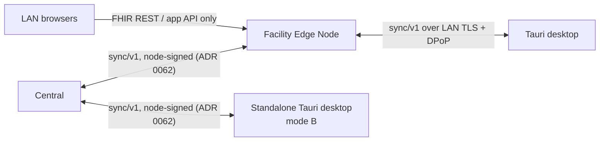
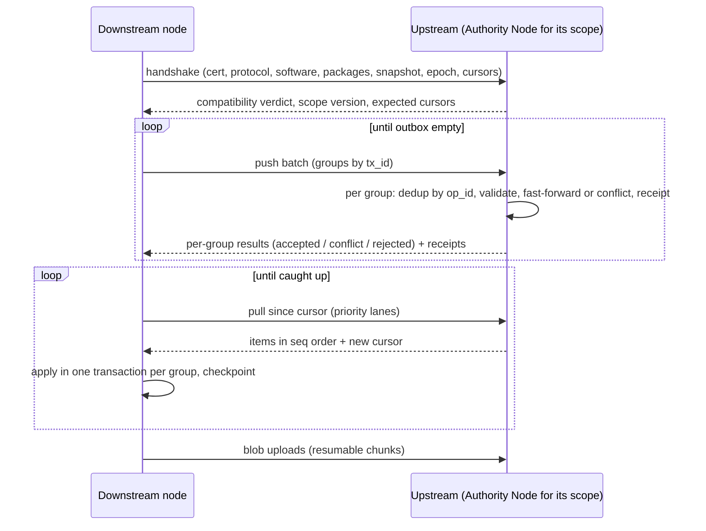
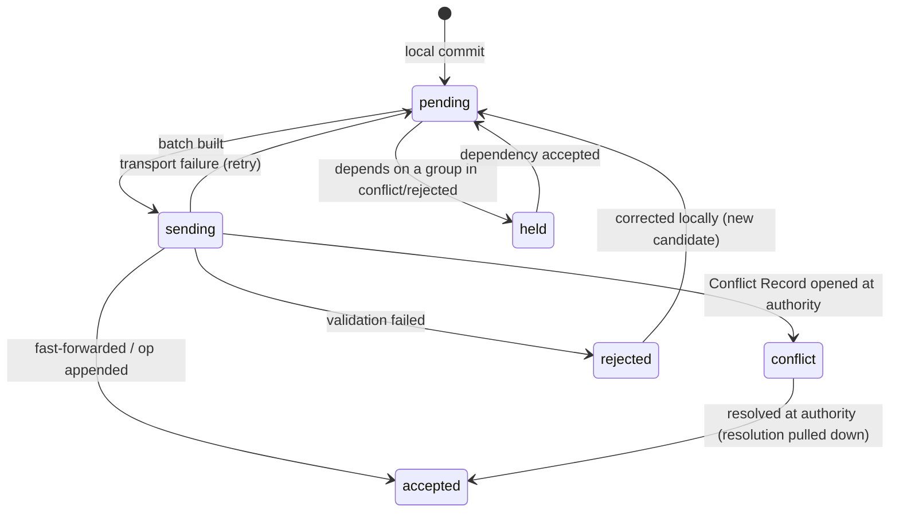

# Synchronization: protocol and per-class conflict policy

Status: **accepted** (ADRs 0019, 0020, 0021). Produced while resolving the Wayfinder ticket [What is the sync protocol and per-resource conflict policy?](https://github.com/carapai/people-centered-healthcare/issues/22). Background: [docs/research/synchronization.md](../research/synchronization.md). Related decisions:
- who accepts what is in [write-authority.md](write-authority.md) (ADR 0012);
- ids and `op_id` are in [identifiers.md](identifiers.md) and ADR 0018;
- the write transaction that feeds the change log is in [persistence.md](persistence.md);
- node trust and tokens are in [lan-security.md](lan-security.md) and [offline-auth.md](offline-auth.md).

## Topology and transport

- **One protocol, one implementation.** Every hop uses the same versioned API, `/sync/v1/…`, implemented once. The wire types and the shared client and apply logic live in `health-sync-protocol`, used by `health-sync-server` at central and by the edge and desktop sync modules (crate-catalogue.md). The edge's sync module serves its desktops with the same `health-sync-protocol` server-side apply logic that `health-sync-server` uses at central. The edge acts as the sync server for its desktops and as a sync client of central.
- **Wire format.** HTTP/2 with zstd-compressed NDJSON bodies.
- **LAN browsers** never sync. FHIR REST stays the API for apps and external clients.
- **Pinning.** A desktop is pinned to one upstream. Re-pointing it requires a drained outbox (write-authority.md).

## Envelope

Every item on the wire, in either direction:

| Field | Meaning |
|---|---|
| `kind` | `version` (a FHIR resource version) or `op` (a ledger operation) |
| `op_id` | UUIDv7; equals `meta.versionId` for versions (ADR 0018); the idempotency key |
| `tx_id` | The local transaction it was committed in; groups are atomic |
| `resource_type`, `resource_id` | For versions; for ops, the ledger and its scope |
| `parent_version_id` | The base the writer saw (absent on create) |
| `origin_node`, `device_id`, author | Provenance |
| `hlc` | Hybrid logical clock; for ordering and audit, never for conflict decisions |
| `content_hash` | sha-256 of the canonical JSON; detects `op_id` reuse and no-op duplicates |
| `packages` | The metadata and configuration package versions the item was validated against |
| `snapshot_version` | The permission snapshot in force (ADR 0011) |
| `provisional` | For provisional Patients and unconfirmed payments |
| `deleted` | Tombstone flag |
| `blobs` | Hash, size and content type of each attachment referenced |
| `body` | The resource or operation |

## Change log, outbox and cursors

- **Change log.** Each node appends every accepted write to `change_log` in the write transaction (persistence.md):
  - local writes;
  - versions accepted from downstream;
  - versions applied from upstream.
- **`seq`.** Each entry gets the next `seq` after the last committed one, taken under the node's commit lock, which is held until the transaction commits (ADR 0061). Writers queue on the lock, so `seq` order is commit order, and a reader can never skip a change that commits late.
- **Outbox.** One row per upstream peer, written in the same transaction as the change.
- **Cursor.** An opaque `(node_id, epoch, seq)`:
  - **Epoch.** A node's `epoch` changes when it is restored from backup or re-seeded. A peer that sees a new epoch discards its cursor and asks for a delta from its own last checkpoint, so a `seq` that went backwards is never misread.
  - **Checkpoints.** Each peer and direction keeps its checkpoint on **both** sides. An interrupted run resumes from the last acknowledged batch.
- **In code (#79).** `health-surrealdb` (migration `0037_change_log`, `src/change_log/`):
  - **`change_log`** is keyed by `seq` and records the version's `tx_id`, `op_id`, type, id, `version_seq` and tombstone flag. The body is read from history.
  - **`sync_upstream`** lists the upstream peers. **`sync_outbox`** rows are keyed `[peer, seq]` and are removed by `acknowledge`.
  - **`sync_state:node`** holds the epoch. Backup restore calls `new_epoch`.
  - **Reads:** `SurrealStore::cursor`, `changes_after` and `pending_for`.
  - **Ledger operations (#81).** A stock movement is logged as an operation in its own write transaction (`SurrealTx::log_op`; `change_log.op`, migration `0044_ledger_ops`). The entry's `resource_type` names the ledger (`stock`) and its `resource_id` the Stock Unit; it travels as a `kind: op` item.
    - **At the receiver:** the operation is appended through inventory's own rules as a late operation (`Inventory::record_in`, `Origin::Late`), in the same transaction as its receipt. A balance it drives negative opens a Reconciliation Record, and a movement already held is skipped.
    - **Direction:** operations go up only, and are never sent down.
    - **Financial records (#81):** charges, deferrals, settlements, waivers, ledger postings, payments and cashier shifts are each logged as an operation on their own ledger (`sync::finance`). The receiver replays the record through the same store method, so central's copy follows the facility's in commit order. A charge billed after it was created arrives billed, as one charge. Records with an id are never created twice; receipts keep the rest once.
    - **Whose ledger (#81):** each operation's scope is claimed by the first facility to send an operation on it (`ledger_claim`, migration `0046_ledger_claims`). The scope is a stock store, a billing account, or a posting, payment or shift id. Central refuses operations on it from any other facility, so a facility can neither post to another's store nor overwrite another's payment.
      - A charge naming an Encounter that central holds must come from that Encounter's facility (ADR 0057 tag).
      - A store's true owner comes from the facility registry's Locations once they record it; until then the first claim stands.
    - **Central's checks (#81):** central does not hold the facility's chart of accounts, so it checks what a record shows on its own (`sync::finance`, migration `0048_finance_checks`). A refused record refuses its whole group.
      - **Postings** (`Posting::balanced`): at least two positive lines in one currency, with debits equal to credits, every line on the sending facility. A reversal must name a posting central holds that is not itself a reversal and has not been reversed already.
      - **Payments** (`Payment::may_follow`): a non-cash payment carries its provider reference. A posted one names its provider evidence, and a customer-reported one is posted only on a statement line.
        - Against the copy central holds, what the payment is (method, purpose, amount, payer, reference, shift) never changes.
        - Its status only moves on: pending to final, or posted to reversed. Refunds only grow.
        - No other payment may carry the same provider reference (the external transaction id).
- **In code (#80).** `health-sync-protocol` (contracts) holds the wire types and both sides' rules, with no I/O ([README](../../crates/contracts/health-sync-protocol/README.md)):
  - the envelope `Item` and its `ContentHash`;
  - the handshake verdict;
  - push grouping and batching;
  - `receive` over the `Authority` port (receipts, `op_id_reused`);
  - `decide` and `apply_pull` over the `Replica` port;
  - `ItemState`;
  - the HLC.

  zstd compression and the `/sync/v1` endpoints belong to the transport (#81).
- **In code (#81, store).** `health-surrealdb` (migration `0038_sync_apply`, `src/sync/`) implements the ports over the change log:
  - **Sending:** `SurrealStore::outbox` reads whole transactions queued for an upstream and builds their items from history. `record_push` acknowledges whatever the upstream answered, and keeps conflicts and rejections in `sync_item_state` as unaccepted candidates.
  - **Receiving a push:** `SurrealAuthority`.
    - It checks the Sync Scope.
    - It fast-forwards versions whose parent is the head. A version already present, or one with the head's content, writes nothing.
    - For any other version it opens a Conflict Record (`sync_conflict`) for the group.
    - It writes a `sync_receipt` per item, in the same transaction.
  - **Serving a pull:** `SurrealStore::pull`.
    - It reads whole transactions after the cursor, in the peer's scope, leaving out what the peer committed itself.
    - It answers `reseed_required` to a cursor from another node or epoch.
  - **Applying a pull:** `SurrealReplica` applies a group and its checkpoint (`sync_checkpoint`) in one transaction, through `Replica::advance` when the response read past items the node was not sent.
  - **Applied versions:** a version received by sync keeps its `op_id` and the `lastUpdated` its origin stamped. It is logged with its origin node (`change_log.origin`) and never queued back toward the peer it came from.
  - **`SyncScope::Facility`**, from the data authority matrix (write-authority.md):
    - **Both ways:** facility-scope records tagged with the node's facility (ADR 0057).
    - **Up:** the global types a facility creates (`UP_GLOBAL`): provisional Patients, Consents, AuditEvents, Provenance, its Locations and Devices, and requests.
    - **Down:** the global replicas (`DOWN_GLOBAL`): registries and golden records, definitions and terminology, price masters, coverage and consent.
    - **Never:** another facility's records, and central's own audit.
  - **Not yet:** HLC and package fields from the writer.
- **In code (#81, edge).** The `sync` task in `health-edge-runtime` ([README](../../crates/edge/health-edge-runtime/README.md)) runs the session above against central.
  - **Wake-up:** central's hints, with polling every `HEALTH_SYNC_INTERVAL_SECS` and backoff while offline.
  - **Backlog:** adding an upstream queues the whole existing log for it, so writes from before the first contact are never left behind.
- **In code (#81, transport).** `health-sync-server` ([README](../../crates/infrastructure/health-sync-server/README.md)), mounted by `central-server` when it provisions nodes:
  - **Endpoints:** `POST /sync/v1/hello`, `push` (NDJSON) and `pull`, and a `GET /sync/v1/events` stream of cursor hints.
  - **Authentication:** every request is signed by the calling node (ADR 0062) and checked by `NodeRegistry::authenticate_sync`. The registry's facility sets the node's Sync Scope.
  - **Verdicts:** the handshake's verdict is kept per node (`sync_peer`, migration `0039_sync_peers`).
    - A quarantined node's pushes are held in `sync_quarantine` and answered `quarantined`, and it is sent nothing.
    - A refused node gets 403.
  - **Central's node id** is kept in its store (`sync_state:node.node`), and `Welcome` carries it to the peer.
  - **zstd (#81):** a node sends its JSON and NDJSON bodies with `Content-Encoding: zstd` and asks for compressed answers with `Accept-Encoding: zstd` (`health_sync_protocol::compress`, `decompress`).
    - The signature covers a body's content, not its encoding, so central decompresses before it checks the signature.
    - A body is at most 8 MiB on the wire and 64 MiB once expanded; a larger one is refused before it is held. Another encoding is refused with 415.
    - The event stream and attachment bytes are sent as they are. A peer that does not ask for zstd is answered uncompressed.

## Session

### Handshake and compatibility (§91)

- **Major protocol versions must match.** The peer's software must be within the supported N-1 range.
- **Package validation.** Each item records the package versions it was validated against. The authority re-validates against those versions while they are still approved, and otherwise rejects the item with `metadata_incompatible`.
- **Metadata goes first.** The pull feed delivers metadata and configuration packages before any data that depends on them.
- **Out-of-range peers.** A peer outside the compatibility range may still push its outbox. The upstream stores the outbox in quarantine for review and sends no data until the peer upgrades.
- **Revoked peers.** A revoked node or device certificate ends the session at the TLS layer.

### Push

- **Order.** Items go in `seq` order, grouped by `tx_id`. A group, such as an Encounter and its Observations from one save, is applied all-or-nothing. Groups are independent of each other, as in a FHIR `batch`.
- **Batch limit:** at most **500 items or 4 MiB compressed**, whichever comes first.
- **No negotiation step**, because the receiver deduplicates.
- **Per group at the receiver:**
  1. Look up `op_id` in `sync_receipt`. If it is found with the same `content_hash`, return the stored result. If the hash differs, reject with `op_id_reused` and audit it.
  2. Validate: profile, references, authorization at action time, invariants (ADR 0016; write-authority.md).
  3. Versions: fast-forward if `parent_version_id` is the head; otherwise apply the conflict rules below. Ops: append to the ledger.
  4. Write the head, history, index entries, change log, the outbox toward the node's own upstream, and the receipt in one transaction.

### Pull and Sync Scope

The upstream computes each node's Sync Scope from a server-side definition, and enforces it on both push and pull.

| Node | Pulls |
|---|---|
| Edge from central | Global replicas (registries, practitioners, products, price masters); approved metadata and configuration packages; permission snapshots and revocations; golden-record Patient updates and links for patients who have records at the facility |
| Desktop from its edge | Its service points, worklists and leased sub-stores: patients with an open Encounter or active worklist item there, plus the last **90 days** of their records; the global replicas and packages it needs |
| Standalone desktop (mode B) from central | Its facility's scope, as an edge would |

- **Shared-record reads** of another facility's records are on-demand queries to central, not replicated.
- **Golden-record narrowing (#81).** Central sends a Patient, RelatedPerson or Person down only to facilities its patient has records at. The index is `patient_facility` (migration `0047_patient_facility`), written with every facility-tagged record that references the patient, and when a facility sends a Patient it registered. Pulls and snapshots both narrow this way.
- **Scope changes.** Growing a scope produces a delta seed. Shrinking a scope, or a revocation, triggers the audited purge (persistence.md).
- **Priority lanes:**
  1. revocations and permission snapshots;
  2. metadata and configuration packages;
  3. clinical data and ledgers;
  4. audit;
  5. blobs.

  A slow link therefore delivers what matters first.
- **In code (#81, lanes).** `Lane::of` puts each type in a lane:
  - **Revocations:** `Device`.
  - **Packages:** definitional types (StructureDefinition, ValueSet, CodeSystem, ConceptMap, Questionnaire, PlanDefinition, ActivityDefinition, Library, SearchParameter), and package activation records (#89). Activation records are operations central sends down to every node, never up; each node applies those its scope chain covers.
  - **Audit:** AuditEvent and Provenance.
  - **Clinical:** everything else.

  A node pulls `Lane::PULLED` in that order. Each lane has its own cursor, a checkpoint keyed by peer and lane, so one lane's cursor never skips another lane's items. A re-seed moves every lane's cursor to the snapshot's. Permission snapshots and revocation lists join the revocations lane when they become records. Blobs come on demand rather than through a lane.

### Seeding

A new, re-pointed or too-stale node is seeded from a snapshot of its scope:
- The snapshot is the head rows streamed as NDJSON from **one read transaction**, together with the cursor at that instant.
- The node rebuilds its search indexes locally. Indexes are never shipped.
- A large first install can be seeded from removable media signed with the facility certificate.

### Wake-up

- **Hints.** While connected, the upstream keeps a server-sent-events channel open that carries only "cursor advanced" hints.
- **Polling fallback:** every 60 s on the LAN and every 5 min to central, with exponential backoff and jitter while offline.
- **Source of truth.** The cursor pull is the truth. R5 Subscriptions are not used for this.

## Item states

- **Editing an unaccepted record** creates a new candidate whose parent is the local version, so the chain stays intact.
- **Pulled data never overwrites a record that has an unaccepted local candidate** (`pending`, `held`, `conflict` or `rejected`). The pulled version becomes the local head, and the local candidate is kept. When it is pushed, the authority treats it under the conflict rules.
- **Rejections** never disappear silently. They go to the originating node's review queue with a reason code, and the user sees the record as "not accepted".

## Conflict detection and resolution (ADR 0020)

- **Detection.** A candidate conflicts when its `parent_version_id` is not the authority's head. Detection is per whole resource version. There is no element-level merge in v1.
- **Automatic resolution happens only when:**
  1. the `content_hash` equals the head's, so it is accepted as a no-op duplicate;
  2. it is a workflow transition that is allowed from the current state and commutes, per the class's transition table;
  3. it is a ledger op, which has no version conflict. A broken invariant raises a Reconciliation Record.
- **Otherwise a Conflict Record is opened.**

### Per-class policy (§89)

| Class | Transfer | On conflict |
|---|---|---|
| Patient demographics / identity | Version | Conflict Record resolved at central by registry staff. Never auto-merged. Provisional Patients stay provisional until identity reconciliation |
| Observation, Condition, AllergyIntolerance, Procedure, medications, immunization, lab | Version (mostly append) | Version-safe correction: both branches are kept, and the resolver writes the corrected version or marks one `entered-in-error`. Never last-write-wins |
| Signed notes (Composition, DocumentReference after signature) | Version, immutable after signing | An in-place edit of a signed version is **rejected** at the receiver. Changes are new amendment resources that `relatesTo` the original |
| Encounter, Task, workflow instances | Version and transition | Allowed and commuting transitions apply. Anything else opens a Conflict Record |
| QuestionnaireResponse | Version, mostly create-once | Idempotent create by `op_id` and id; later edits are treated like Observation |
| Stock ledger | Operation | Always appended. Negative balance or over-dispense raises a Reconciliation Record |
| Charges, invoices, payments | Operation | Idempotent by `op_id` and external transaction id. Reversals only, never edits. Provisional until confirmed by a later op |
| Metadata and configuration | Immutable package version, downward only | No conflicts: only approved versions are activated, and incompatible peers are refused |
| AuditEvent | Version, append-only | None (immutable) |
| Device registry, revocations | Version | Revocation wins |

### Conflict Record and review queue

- **Contents:**
  - the head version and the candidate, with its parent;
  - class and policy;
  - status `open` → `resolved` | `superseded`;
  - who resolved it, when, and the resulting version.
- **Resolution.** It is resolved at the record's Authority Node by a role with the conflict-resolution permission. The resolver writes a new version on top of the head, and that version syncs like any other.
- **Notification.** The originating node learns of the conflict through the pull feed (item status and Conflict Record id). Its user sees "your edit is under review".
- **Review queue.** There is one queue per Authority Node, filterable by class, facility and age. An alert fires when a conflict has been open for more than **7 days**.
- **In code (#82, part 1).** `health-surrealdb`, migration `0040_sync_conflicts`:
  - **Contents:** a Conflict Record keeps the pushed group as sent (the candidate branch), each conflicting version's parent and the head it met, and the class and policy from the table above (`class_of`).
  - **Signed notes:** an edit or delete of a signed Composition or DocumentReference is rejected at the receiver with `signed_version_edited`. It is checked against the version the candidate was written on, by clinical-documentation's own rule.
  - **Store operations:** `open_conflicts` (oldest first, optionally only those opened before a time), `conflict`, and `resolve_conflict`. A resolution writes a new version on top of the head, which syncs like any other, or keeps the head, and records the resolver, the time and the resulting version.
  - **Ageing:** central raises `sync-conflicts-ageing` hourly while a record has been open for more than 7 days.
  - **Review over HTTP (#82, part 2):** `/api/sync/conflicts` at central, for staff whose roles grant `sync.resolve-conflicts` (`health-sync-server::review_router`).
    - `GET /` lists the open records, oldest first, each flagged `overdue` after 7 days.
    - `GET /{id}` shows both branches: the candidate as pushed, and the current head of each conflicting record.
    - `POST /{id}` takes `keep-head`, or `write` with the corrected resource.
    - The decision and its AuditEvent are committed in one transaction.
  - **The resolution reaches its node (#82, part 3):** resolving a record logs a `resolution` operation naming the record, the node whose push opened it, its candidates' `op_id`s and the version it was resolved to.
    - Only that node pulls it. No node sends one up.
    - Applying it clears the candidates' `conflict` state, so the record is accepted as resolved (`conflict → accepted` above). A `keep-head` resolution writes no version, so this is the only way its node learns of it.
    - `SurrealStore::unaccepted` lists a node's candidates still in `conflict` or `rejected`, for the user to see as not accepted.
  - **Commuting transitions (#82, part 4; ADR 0020 case 2):** a pushed Encounter that meets another head is merged rather than held when three things hold:
    - it changes only its status (and the end of its period) from its parent;
    - the head kept the parent's status;
    - the allowed-transition table (`EncounterStatus::may_become`) permits the move from the head's status.

    The head with the transition applied is written as central's own version, so it comes back down to the edge. The group is accepted and both edits are kept. Two status moves from the same version, or any other change, still open a Conflict Record. Task and workflow-instance transitions come with #100.
  - **The review screen (#82, part 5):** `/sync/conflicts` in the web client lists the open records and shows a record's current version beside the facility's. It offers three decisions: keep the current version, use the facility's version, or save a corrected version.

## Provisional states

- **Provisional Patients** travel with `provisional: true`.
- **Identity reconciliation.** Central's identity reconciliation sends down its result: the source Patient gains `link: refer` to its golden record (ADR 0027), or stays provisional while under review. Matching and linking are in [patient-identity.md](patient-identity.md).
- **No reference rewriting.** Facilities never rewrite references after linking or merging; they resolve through `Patient.link`. No historic clinical record changes for an identity merge.
- **Payments.** Provisional payments are confirmed or reversed by later operations, never by editing.

## Tombstones, retention and long outages

| Item | Value |
|---|---|
| Supported offline window, edge → central | **90 days** (logins are already capped by the 7–30-day snapshot expiry) |
| Supported offline window, desktop → edge | **30 days** |
| Retention on the upstream of tombstones, receipts and non-head history | ≥ **180 days** |
| Node whose cursor is older than the horizon | Answered with `reseed_required`. It keeps its unsent outbox, re-seeds (new epoch), then re-pushes the outbox as Candidate Versions against the new heads |

- **Deletes** are versions with `deleted: true`.
- **In code (#83, part 1).**
  - **Pruning:** central prunes the change log and receipts older than 180 days, hourly (`SurrealStore::prune_log`, migration `0041_sync_horizon`). It keeps any entry an outbox still needs, and records the highest `seq` pruned in `sync_horizon:node`. `seq` never goes below it, so a log pruned to empty never hands a `seq` out twice.
  - **`reseed_required`:** central answers it to a pull whose cursor is below the horizon (a node that has never synced included), or from another epoch.
  - **Snapshot:** `POST /sync/v1/snapshot` serves every head in the node's scope, tombstones included, with central's cursor, read in one transaction (`SurrealStore::snapshot`).
  - **Seeding:** the edge applies the heads it lacks without queuing them back, which rebuilds its indexes locally (`SurrealStore::seed`). It moves its checkpoint to the snapshot's cursor and takes a new epoch. Its outbox is pushed before the pull, and anything left stays queued.
  - **Not yet:**
    - streaming the snapshot (it is one JSON body today);
    - the signed USB seed;
    - pruning non-head history.
- **Reserved identifier blocks**, where they are mandated (ADR 0014), are sized for the 90-day window.

## Attachments (ADR 0021)

- **Storage.** Blobs live in a content-addressed store on the node filesystem (sha-256), outside SurrealDB and included in backups.
- **References.** Resources reference a blob by hash, size and content type.
- **Upload** comes after the resource that references it, in resumable 1 MiB chunks deduplicated by hash. The resource may be accepted first; its attachment shows as pending until the blob arrives.
- **Download** is on demand, unless the type's metadata flags it for pre-fetch.
- **Size cap:** 50 MiB per attachment.
- **Garbage collection** removes only blobs that nothing references, after the retention horizon.
- **In code:** `health-files`' `FsBlobStore` ([README](../../crates/infrastructure/health-files/README.md)). It provides SHA-256 addressing, atomic writes, deduplication, the 50 MiB cap, chunked resumable uploads verified on completion, a hash check on every read (a mismatch is quarantined), and garbage collection behind a `BlobReferences` port. The sync upload endpoint and the `Attachment` reference index arrive with sync and persistence.

- **Reference format (#84).** An `Attachment` names its blob as `url` `urn:health:blob:sha256:<64 hex>`, with `size` and `contentType`. `health_sync_protocol::blob_refs` finds every such reference in a resource, at any depth, and each item's `blobs` lists them.
- **In code (#84, part 1).**
  - **Queue:** once the upstream accepts a group, each blob its records reference is queued for that upstream (`sync_blob_queue`, migration `0042_sync_blobs`).
  - **Upload:** after the push, the edge asks `GET /sync/v1/blobs/{hash}/{size}` how much central holds. It then sends `PUT /sync/v1/blobs/{hash}/{size}/{offset}` chunks of 1 MiB from there, into `health-files`' resumable upload, so an interrupted upload resumes rather than restarts. A chunk at the wrong offset is answered 409 with where to resume, and the completing chunk verifies the blob.
  - **Pending:** a blob not yet held at the edge (its desktop's upload has not finished) stays queued.
  - **Download:** on demand (`Sync::fetch_blob`, `GET /sync/v1/blobs/{hash}/content`), verified against its reference.
  - **Storage:** central's store is `HEALTH_FILES_DIR`; the edge's is `files/` beside its data directory, where backups take it from.
  - **Not yet:**
    - the pre-fetch flag per type;
    - the pending marker on an attachment whose blob has not arrived;
    - checking a download against the requesting node's scope (today a node can only ask for hashes it has seen in records within its scope).

## Desktop reconnect (§90)

1. TLS with the enrolled device certificate, then token exchange (lan-security.md, offline-auth.md).
2. The handshake checks authorization, compatibility, epoch and the lease state.
3. Push the outbox. Duplicates are answered from receipts.
4. Fast-forward or conflict per group, with clinical, financial and stock validation at the edge.
5. Record conflicts and rejections in the review queues.
6. Pull until caught up, which updates the scope.
7. If a lease is being returned, the edge acknowledges once the scope's outbox is drained, then resumes normal LAN operation.

## Failure scenarios (§91)

| Failure | Behaviour |
|---|---|
| Power loss or crash mid-write | The write, change log and outbox commit atomically or not at all (`sync=every`) |
| Crash mid-push | Unacknowledged groups are resent; receipts make them idempotent |
| Crash mid-pull | Each applied group is atomic with its checkpoint advance; resume from the checkpoint |
| Partial batch failure | Results are per group; failed groups do not block independent groups; dependants go to `held` |
| Node restored from backup | New epoch; peers re-sync from their checkpoints; the outbox re-sends anything not acknowledged |
| Offline beyond the horizon | `reseed_required`, with the outbox kept |
| Incompatible metadata or software | Push quarantined, no pull until upgrade |
| Remote revocation | Session refused; scope purge on the next contact, or a local wipe on a revoked desktop |

## Out of scope

SMS and USSD sync fallbacks (see the map's Out of scope).
