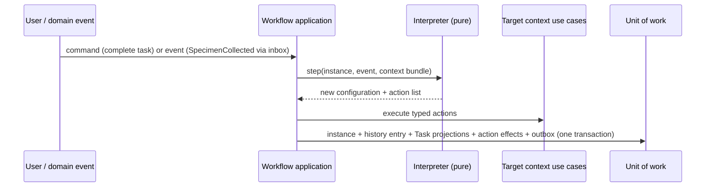
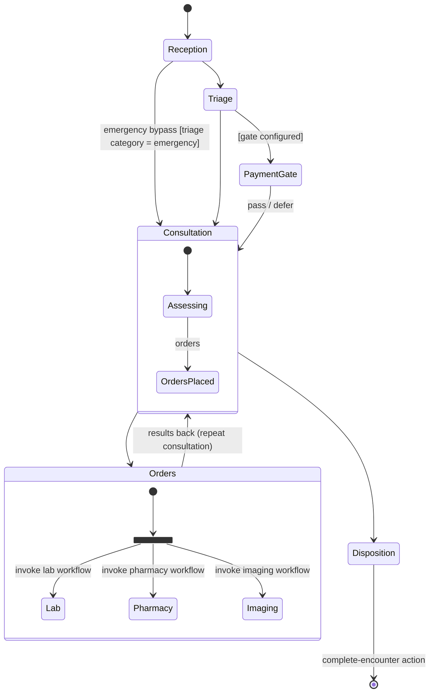

# Workflow engine

Status: **accepted** (ADRs 0002, 0042, 0043, 0044). Produced while resolving the Wayfinder ticket [What is the generic workflow engine's definition and execution model?](https://github.com/carapai/people-centered-healthcare/issues/24). Background: [docs/research/clinical-workflows.md](../research/clinical-workflows.md). Spec: MASTER_PROMPT §46–52. Related decisions:
- authority and conflicts: [write-authority.md](write-authority.md), [synchronization.md](synchronization.md);
- definitions and packaging: [metadata.md](metadata.md), [configuration.md](configuration.md);
- gates: [billing-and-payments.md](billing-and-payments.md);
- forms: [questionnaire-extraction.md](questionnaire-extraction.md).

## Definitions vs FHIR

| Concern | Engine | FHIR |
|---|---|---|
| Definition | **Workflow Definition**: statechart, Published Definition `url\|version` | PlanDefinition / ActivityDefinition as import source; cited in `relatedArtifact` |
| Instance | Workflow Instance: configuration, data model, history | RequestOrchestration and CarePlan (projections, for program-style workflows) |
| Human step | Human-task state | **Task** (projection): `status` within the 12 R5 codes, `businessStatus` = engine state label |
| Timers, escalation, compensation, queues | Engine only | — |
| Clinical outputs | Typed actions call the owning module | ServiceRequest, MedicationRequest, Observation, Encounter, … |

**Workflow state is never written into a clinical resource's status (§47).** `Encounter.status` and the like change only through typed actions that call the owning module's use case.

## Statechart model (ADR 0042)

| Element | Notes |
|---|---|
| State | `atomic`, `compound`, `parallel`, `final` |
| Transition | `event` + `guard` (FHIRPath) + `actions[]` + target. Eventless transitions are allowed |
| Entry / exit actions | Typed actions |
| Timer | `after: <duration>` or `at: <FHIRPath date expression>`, raising an event |
| Human task | Role or performer type, form (Questionnaire `url\|version`), worklist key, priority, claim timeout |
| Gate | References a Financial Gate configuration. Exits on `pass` / `defer` / `block` |
| Invoke | Sub-workflow `url\|version`, with a done or error event back to the parent |
| Decision table | Rows of FHIRPath conditions → outcome value, used in guards |
| Data model | Typed fields (ids, flags, counters). No copies of clinical data |
| Data requirements | The resources and paths the guards need |

- **Semantics.** SCXML-style: run-to-completion, one event queue per instance, transitions chosen by document order, deterministic.
- **Implementation.** Our own pure interpreter in `health-workflow` (domain layer), whose behaviour is pinned by a curated subset of the W3C SCXML conformance tests.
  - It is built (#95), following SCXML Appendix D without history states.
  - It returns effects for the application to carry out: typed actions keyed for idempotency, timers and invocations. Guards are evaluated through a port.
  - `tests/scxml.rs` covers the subset, one test per assertion id.
- **Importing PlanDefinitions.** A PlanDefinition and its ActivityDefinitions are converted into a **draft** definition. `action.condition` becomes guards, `relatedAction` becomes sequencing, and `selectionBehavior` and `groupingBehavior` become parallel or choice structures. ActivityDefinitions are used by the typed action `create-request-from-activity-definition`, which produces requests with `intent=proposal` or `order`, by role.

## Contexts and instances

- **One context per instance.** Each instance binds to one context resource, and that reference is immutable:
  - Encounter, EpisodeOfCare, CarePlan;
  - ServiceRequest, MedicationRequest, Appointment;
  - a PatientRequest Task, an AdministrativeRequest;
  - procurement or coverage documents.
- **Concurrent instances.** A patient may have any number at once, e.g. an OPD visit, ART and TB.
- **Authority.** It is the facility where the instance started (write-authority.md).

## Typed actions and guards (ADR 0043)

```rust
// in health-<context>-contract
pub struct OpenQueueEntry { pub service_point: ServicePointId, pub priority: Priority }
impl WorkflowAction for OpenQueueEntry {
    const ID: &'static str = "patient-flow/open-queue-entry";
    const MAJOR: u16 = 1;
    const PERMISSION: Permission = Permission::PatientFlowManage;
    const COMPENSATION: Compensation = Compensation::Action("patient-flow/close-queue-entry");
}
```

- **Registration.** The workflow application crate calls actions through ports, which the runtime wires to the target context's application crate (dependency-rules.md).
- **Parameters.** The parameter JSON Schema is generated for the Studio, and publication validates definitions against it.
- **Idempotency.** Each action invocation is keyed by UUIDv5 of instance + transition sequence + action index.
- **Guards and expressions** are FHIRPath only, with no side effects, evaluated over the declared context bundle (context resource, patient, encounter, data model, event). There is no scripting and no CQL.
- **Authorization:**
  - user-triggered transitions use the user's authorization, evaluated at action time;
  - timer and system transitions run as the **workflow principal**, limited to the permissions declared in the definition and approved at publication.
- **Compensation.** On cancellation or failure of a scope, the engine runs the compensations of its completed actions in reverse. Steps that can't be undone declare `none`, and the cancellation records why.

## Persistence and transactions (ADR 0044)



- **Records:**

  | Record | Contents |
  |---|---|
  | `workflow_instance` | Definition `url\|version`, context, active configuration, data model, version, authority node |
  | `workflow_history` | Append-only, keyed `[instance, seq]`: event, from- and to-configuration, actions, actor, time, `op_id` |
  | `workflow_timer` | Instance, `fire_at`, event, status |
  | `workflow_inbox` | Event id → processed (deduplication) |

- **Transactions:**
  - **user commands** run the transition and its actions in **one transaction** (ADR 0004);
  - **domain events** from other modules are consumed after commit, through the inbox, one transaction each.

## Timers and escalation

- **Where they live:** durable records at the instance's authority, or the lease holder for leased scope.
- **Firing.** A scheduler checks for due timers every 30 s and fires them idempotently, using the node clock protected by the clock floor (offline-auth.md).
- **Escalation is a timer transition:** reassign, notify (through a CommunicationRequest action), or raise priority.
- **Lost to follow-up.** For example, "N days without an encounter" (UgandaEMR: TB defaults to 60) is a timer on the EpisodeOfCare instance that leads to a review task, then an outcome action.
- **Never on desktops in offline fallback.** They never fire timers for instances their edge owns.

## Offline and sync

- **Candidate transitions.** A desktop in offline fallback runs the engine for instances in its Sync Scope. Each transition is a candidate operation carrying its base configuration.
- **At the authority,** the guard is re-evaluated:
  - if the transition is allowed from the current configuration and commutes, it is applied;
  - otherwise a Conflict Record is opened (ADR 0020).

## Versioning and migration

- **Pinning.** An instance stays on its definition `url|version`, and new instances use the active version (ADR 0025).
- **Migration.** A new version may ship a **migration map** from old states to new states. An admin then runs an audited, resumable migration job over the mapped instances.
- **Unmapped instances** finish on their old version.

## Worklists and queues

- **Read models.** Worklists and queues are read models (`health-worklists`) over Task projections, ordered by priority and then arrival.
- **Claiming** a task is a workflow command that sets `Task.owner`, with a 15-minute idle claim timeout.
- **Other changes** (reassigning, escalating, cancelling) are workflow commands, never direct Task edits (ADR 0002).

## Reference shapes

**OPD (§49):** one Encounter-scoped instance.



**ART / TB (§50):**
- EpisodeOfCare-scoped instances with states enrollment → assessment → initiation → follow-up (with appointment timers and lost-to-follow-up escalation) → outcome.
- Investigations and referrals are invoked sub-workflows.
- Multiple programs run as separate concurrent instances.

**Other workflows (§51):** lab, pharmacy, referral, appointment, procurement approval, insurance preauthorization, payment clearance and patient registration are definitions on the same engine, in their own contexts.

## Financial Gates

- **On entry** to a gate state, the engine calls Finance's `evaluate_gate` (ADR 0033).
- **Exits:**
  - `pass` → continue;
  - `defer` → continue, with a recorded deferral;
  - `block` → create a cashier Task and wait. The gate is re-evaluated on payment events.
- **Configuration.** Whether a gate is active comes from configuration override points per facility (ADR 0026). Urgent triage always defers.

## Simulation and publication gates

- **Simulation** runs the same Rust engine in a sandbox with **stubbed actions**. Scenarios live in the package `tests/` folder: event sequences, with the expected configurations, Tasks, actions and timers.
- **Publication requires:**
  1. every scenario to pass;
  2. no unreachable states and no non-final states without an exit, checked statically;
  3. every action reference and its parameters to be valid;
  4. every guard to type-check against the declared data requirements;
  5. the declared workflow-principal permissions to be approved.
- **Studio UX** remains in the map's Studio fog.
