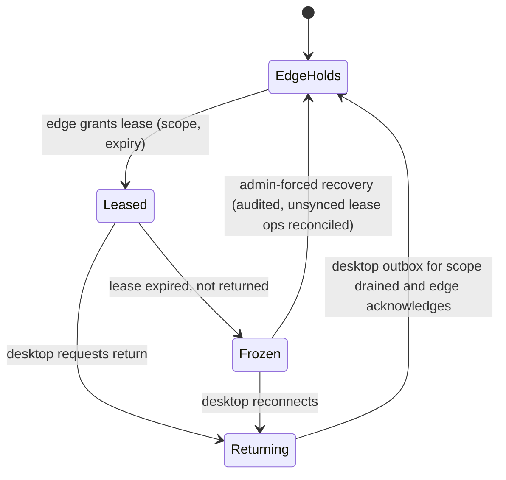

# Write authority and the data authority matrix

Status: **accepted** (ADR 0012). Produced while resolving the Wayfinder ticket [Who holds write authority for each resource at central, edge and desktop?](https://github.com/carapai/people-centered-healthcare/issues/21). This page extends [resource-ownership.md](resource-ownership.md):
- An **Owner** (a Module) decides *which rules* govern a record.
- An **Authority Node** decides *which node's commit is canonical*.

The wire protocol, cursors and per-class conflict mechanics are in [synchronization.md](synchronization.md) (ADRs 0019–0021). Background: the `research/synchronization` branch.

## Concepts

- **Authority Node.** Each record instance has exactly one at any moment: the node whose acceptance makes a version canonical.
- **Candidate Version.** A version written by a non-authoritative node, carrying its parent version. The Authority Node does one of two things with it:
  - **fast-forwards** it, when its parent is the current head;
  - turns it into a **Conflict Record**, which keeps both branches and is resolved by the class's policy.
- **Ledger classes** (stock, finance) are append-only operations. Their Authority Node is the single writer for the ledger's scope, so operations commute, and divergence becomes a reconciliation record rather than a version conflict.

## Assigning the Authority Node

| Scope | Authority Node |
|---|---|
| **Global**: registries' golden records, Published Definitions and configuration, workforce and role assignments, payer and price masters, procurement, patient portal, analytics | Central |
| **Facility**: everything created in a facility's day-to-day operation | The facility's **Facility Authority Node** |

Each facility has exactly one Facility Authority Node, recorded in the facility registry:

| Facility deployment mode | Facility Authority Node |
|---|---|
| A: central online web only | Central |
| C: Facility Edge Node, with optional LAN and Tauri clients | The edge |
| B: a single standalone Tauri desktop, no edge, syncing to central | That desktop |

A facility-scope record stays authoritative at **the facility that created it, permanently**. Authority follows the record's facility, not the patient. Other facilities read it through central (the shared record) and add their own records. They never edit it.

## Data authority matrix (v1)

Abbreviations: **FA** = Facility Authority Node, **C** = central.

| Records (Owner) | Scope | Allowed creators | Allowed offline changes | Authority | Sync direction | Conflict strategy | Central validation |
|---|---|---|---|---|---|---|---|
| Patient, Person, RelatedPerson (client-registry) | global | C; FA and desktops create **provisional** Patients only | Provisional create; demographic edits as candidates | C (golden record) | up; golden record and links down | Review and reconciliation; never auto-merge | Identity matching (deterministic, then probabilistic), duplicate review |
| Organization, Practitioner, PractitionerRole, administrative Locations, products, Healthcare Services (registries) | global | C | None (read-only replica) | C | down | — | — |
| Facility-internal Locations: wards, rooms, beds, stores (facility-registry) | facility | FA admin | Yes | FA | up | Version check; review on conflict | Hierarchy and references |
| Terminology, metadata, configuration packages (Terminology & Metadata) | global | C | Activate approved versions only | C | down | Immutable version activation; refuse incompatible peers | Publication lifecycle |
| Encounter, Observation, Condition, AllergyIntolerance, Procedure, orders, medications, lab, imaging, immunization, referrals, care plans, program records (clinical contexts) | facility | FA users; desktop candidates | Yes | FA | up; down to the facility's own desktops within scope | Version-safe correction. Signed notes are amended only, never edited. Workflow-bearing states use the allowed-transition table | Profiles, references, authorization at action time, clinical rules |
| QuestionnaireResponse (clinical-documentation / patient-engagement) | facility | FA users, desktops | Yes | FA | up | Idempotent create; later edits handled like Observation | Profile, extraction consistency |
| Tasks, RequestOrchestration, workflow instances (workflow) | the facility where the instance started | Workflow at FA | Yes | FA | up | Allowed-transition reconciliation | Transition validity |
| Stock ledger per store (inventory) | the store's facility | FA; a leased desktop for its sub-store | Yes | FA, or the lease holder for a leased sub-store | up, as operations | Ledger reconciliation (a negative balance raises a reconciliation record) | Aggregation, plausibility |
| Inter-facility stock transfers (inventory) | both facilities | Sender records the dispatch; receiver records the receipt | Yes, each side | Each side for its own operations | up, then to the counterpart via C | Two-sided matching at C | Dispatch ↔ receipt matching |
| Procurement orders, supplier records (procurement) | global / district | C | No | C | down | — | — |
| Charges, invoices, local payments (billing, payments, financial-ledger) | facility | FA | Yes; non-cash payments stay provisional until confirmed | FA | up, as operations | Idempotent financial reconciliation; reversals only, never edits | External payment confirmation, ledger balance |
| Coverage, eligibility (coverage) | global | C and the payer | Cached estimate or pending verification | C (the payer confirms) | cache down; requests up | Payer response wins; mismatches go to reconciliation | Payer confirmation |
| Login Accounts, roles, permission snapshots (identity) | global | C; FA provisional grants (ADR 0011) | Revoke; narrow provisional grants | C | down; provisional grants up | Ratify or revoke | Grant policy |
| Consent (consent) | global | C; FA records Consents captured at the facility | Capture | C | up; down to facilities in scope | Version check; review | Validity, scope |
| AuditEvent (audit) | wherever it occurred | Any node | Yes | Origin node (append-only) | up | None (immutable) | Completeness |
| Device registry (edge admin) | facility | FA admin | Yes | FA | up; revocations down from C | Revocation wins | — |
| Patient-originated Records, portal (Patient Engagement) | global | C (the portal is online) | — | C | down to the target facility for acceptance | Accepted through the owning clinical context at the FA | Identity, consent |
| Analytics, reporting | global | C | — | C | — | — | — |
| Communications (communications) | global | C sends; FA queues CommunicationRequests | Queue only | C | up | Idempotent by `op_id` | Channel policy |

FHIR `Device` for equipment instances is still unassigned (see the map's Not yet specified).

## Hand-over rules

Authority never switches implicitly. Every hand-over drains the relevant outbox first (§90).

- **Desktop under an edge.**
  - A desktop is never an Authority Node by default. Its writes are Candidate Versions, which the edge accepts or turns into conflicts.
  - It is pinned to that one edge and never syncs directly to central while it is assigned to the edge.
- **Authority Lease (edge → desktop).**
  - An edge can grant a desktop a time-boxed lease over a defined scope, for example an outreach session with its own sub-store, the session's encounters and its worklist.
  - While the lease is active, the edge refuses writes in that scope.
  - The lease ends only when the desktop's outbox for that scope has drained and the edge has acknowledged.
  - If the lease expires without being returned, the scope freezes at both ends and an alert is raised.
- **Re-pointing a desktop's upstream** (edge A → edge B, or edge → central) requires a drained outbox, then re-enrollment and re-scoping.
- **Changing a facility's Authority Node**, for example from central online to a new edge, is a central-run migration:
  1. Drain all outboxes.
  2. Seed the new node.
  3. Flip the facility registry entry.
  4. Resume.
- **Program transfer** (an ART/TB EpisodeOfCare moving to another facility) is a hand-over coordinated by central. The old facility closes its episode and the new facility opens its own. No record changes authority.

## Validation on ingest

- Central re-validates every incoming candidate and operation:
  - profile;
  - referential integrity;
  - authorization **at action time**, using the snapshot version recorded in the token;
  - business invariants.
- An edge validates its desktops' candidates the same way.
- A failure is never a silent drop. It becomes a per-item `rejected` or `conflict` status, plus a review record returned to the originating node.
- Clinical data that fails only the authorization check is accepted but flagged (ADR 0011).
- Conflict Records are resolved at the record's Authority Node, by roles holding the conflict-resolution permission. Patient identity conflicts are resolved at central by registry staff.
