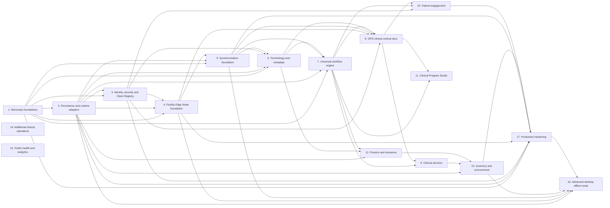

# Dependencies

_Generated from the backlog spec when the backlog was created (2026-10-28). GitHub issues are authoritative; update this file when the plan changes._

Every task-level edge is a native GitHub issue dependency (see each issue's "Blocked by"). This page summarises them.

## Phase-level graph

## Validation spikes that gate tasks

| Spike | Gates |
|---|---|
| [Does embedded SurrealDB RocksDB survive hard power loss on facility hardware?](https://github.com/carapai/people-centered-healthcare/issues/34) | [Create the facility-edge executable as an OS service](https://github.com/carapai/people-centered-healthcare/issues/72) |
| [Which R5 model crate passes the round-trip spike: helios-fhir or fhir-r5?](https://github.com/carapai/people-centered-healthcare/issues/35) | [Adopt the R5 model crate behind health-fhir-models](https://github.com/carapai/people-centered-healthcare/issues/53) |
| [Does the per-node commit counter sustain facility write rates on edge hardware?](https://github.com/carapai/people-centered-healthcare/issues/36) | [Implement the change log, commit counter and outbox in the write transaction](https://github.com/carapai/people-centered-healthcare/issues/79) |
| [Can SurrealDB blocking indexes serve patient matching at 45M-person scale?](https://github.com/carapai/people-centered-healthcare/issues/37) | [Implement the matching engine and Patient/$match](https://github.com/carapai/people-centered-healthcare/issues/69) |
| [Does the frontend scaffold build on Bun, Vite 8, Panda 2, React Compiler and TS 7?](https://github.com/carapai/people-centered-healthcare/issues/38) | [Create the Bun workspace and the React app shell with the platform boundary](https://github.com/carapai/people-centered-healthcare/issues/44) |
| [Does embedded SurrealDB run reliably inside the Tauri process on facility PCs?](https://github.com/carapai/people-centered-healthcare/issues/39) | [Build the Tauri desktop runtime](https://github.com/carapai/people-centered-healthcare/issues/132) |

## Starting point

The only task with no blockers is [Create the Cargo workspace with the six-layer layout](https://github.com/carapai/people-centered-healthcare/issues/42). Everything else follows from it and from the spikes.
